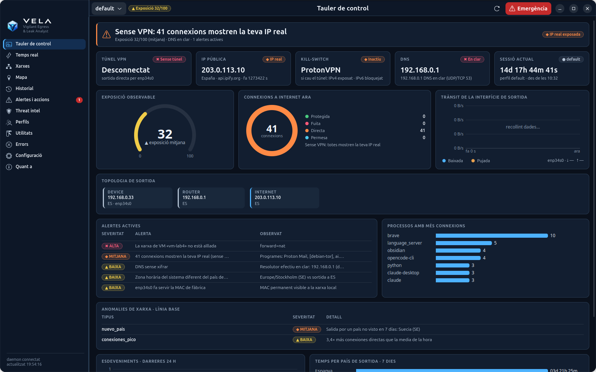
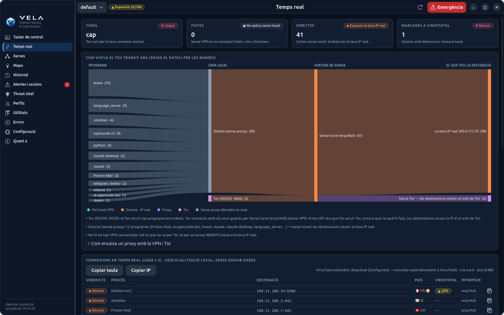
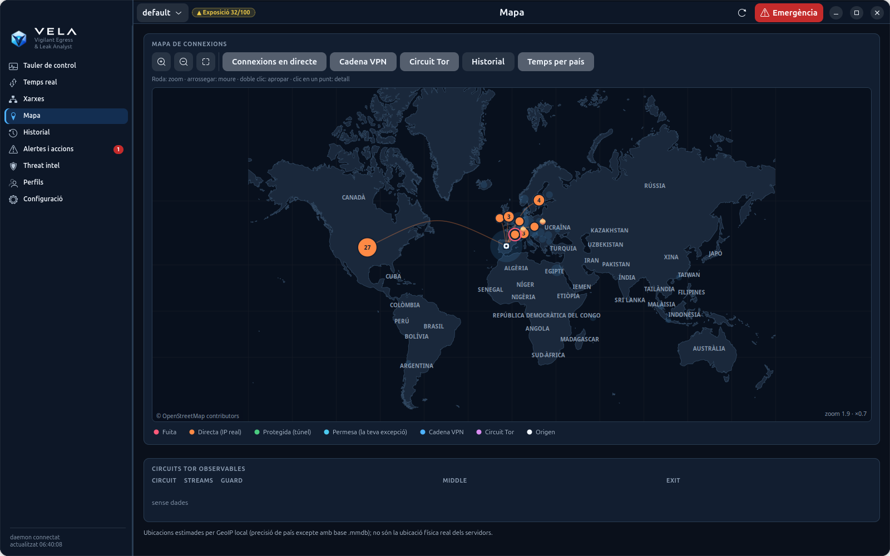
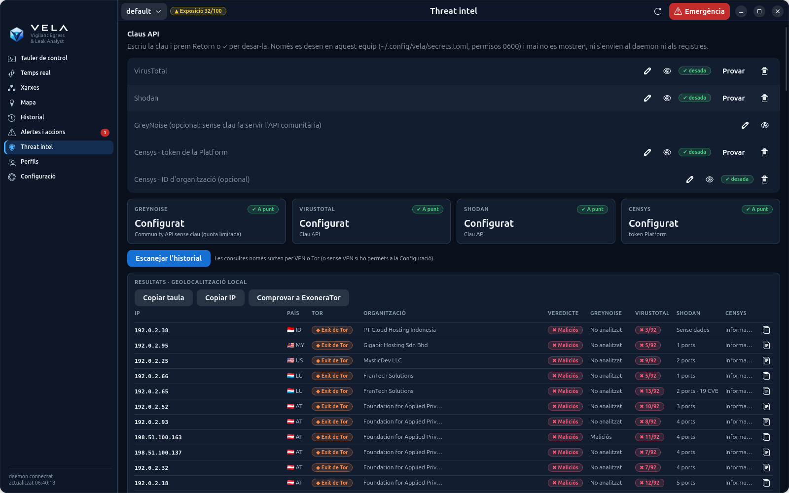
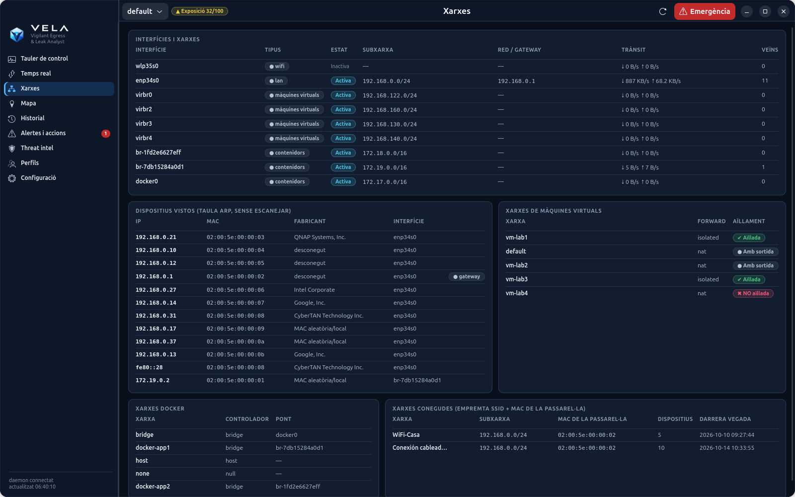
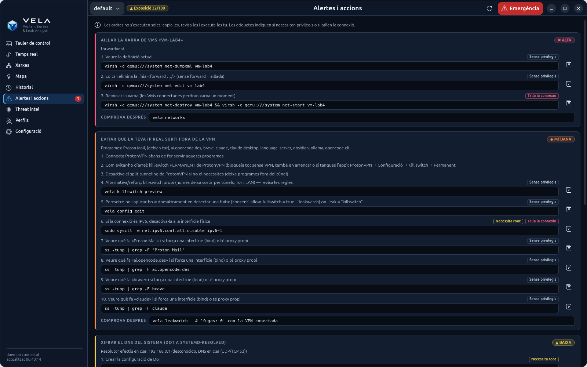
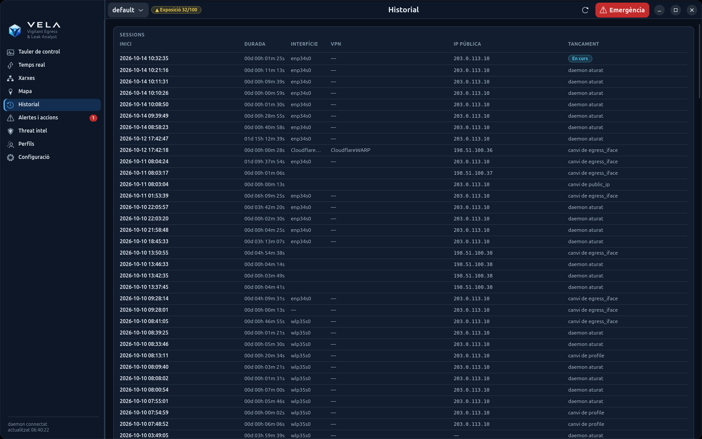
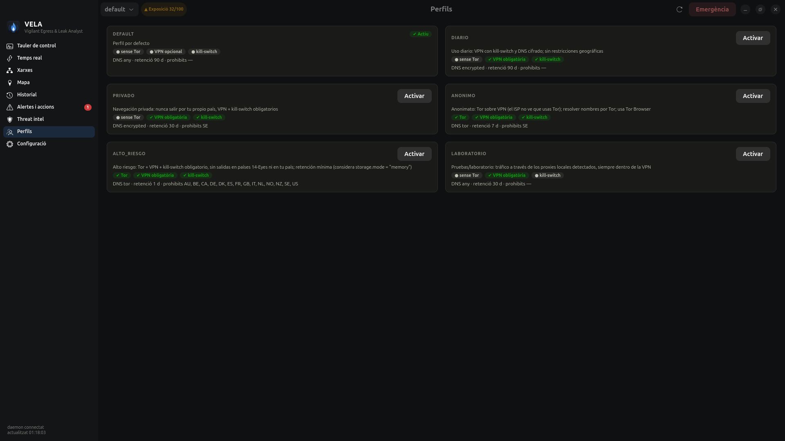
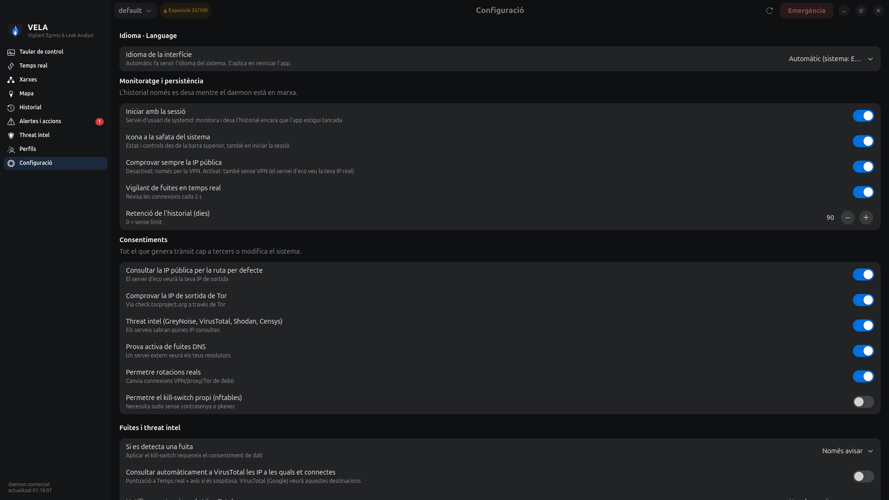
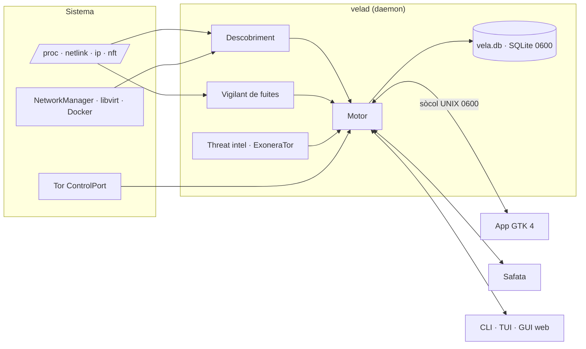

<p align="center">
  
</p>

<p align="center">
  <picture>
    <source media="(prefers-color-scheme: light)" srcset="docs/brand/banner-light.png">
    
  </picture>
</p>

<h1 align="center">VELA</h1>

<p align="center">
  <a href="README.md">English</a> · <a href="README.es.md">Español</a> · <b>Català</b> · <a href="README.pt.md">Português</a> · <a href="README.fr.md">Français</a> · <a href="README.de.md">Deutsch</a>
</p>

<p align="center">
  <b>V</b>igilant <b>E</b>gress &amp; <b>L</b>eak <b>A</b>nalyst<br>
  <i>La teva identitat de xarxa, sempre en vetlla.</i>
</p>

<p align="center">
  
  
  
  
  
  
  
  
</p>

<p align="center">
  
</p>

VELA vigila **per on surt el teu trànsit** (router, VPN, proxies, Tor i DNS), **quant de temps** fas servir
cada sortida, **les fuites** que t'exposen i **la reputació** de les IP amb què parles. Tot en local, a Linux,
sense dependències externes: descobreix què hi ha al teu equip i només activa el que existeix.

> **Només Linux.** VELA llegeix la xarxa directament del nucli de Linux (/proc, netlink, nftables, systemd). Les versions per a Windows es desenvolupen en branques a part: [`windows-lite`](../../tree/windows-lite) (lleugera: IP pública, connexions i fuites, DNS, GUI web) i [`windows`](../../tree/windows) (versió completa).

| Lletra | Què fa |
|---|---|
| **V**igilant | Daemon permanent, vigilant de fuites cada 2 s, esdeveniments del nucli (netlink) i avisos a la safata |
| **E**gress | Segueix cada sortida: IP local, WAN del router, IP pública, VPN, proxies, circuits Tor i DNS, amb sessions, comptadors `00d 00h 00m 00s` i rotació sense repeticions |
| **L**eak | Detecta el que t'exposa: connexions fora del túnel, DNS en clar, IPv6, WebRTC, kill-switch, xarxes de VMs sense aïllar |
| **A**nalyst | Enriqueix i explica: geolocalització local, VirusTotal, Shodan, GreyNoise, Censys, ExoneraTor i el recorregut de cada connexió |

*Vela* és la flama que es queda encesa quan tot dorm: **estar en vela** (en vetlla) és quedar-se vigilant.

> Les captures fan servir dades **anonimitzades**: adreces privades i de documentació, MAC, SSIDs, xarxes,
> noms de processos i relays de Tor inventats, i hores desplaçades.

---

## Contingut

- [Funcions](#funcions)
- [Privadesa per disseny](#privadesa-per-disseny)
- [Temes](#temes)
- [Idiomes](#idiomes)
- [Instal·lació](#instal·lació)
- [Ús](#ús)
- [Arquitectura](#arquitectura)
- [Estat i limitacions](#estat-i-limitacions)
- [Desenvolupament i seguretat del repositori](#desenvolupament-i-seguretat-del-repositori)

## Funcions

### Tauler de control
D'un cop d'ull: túnel VPN, IP pública, kill-switch, DNS, sessió actual amb el seu comptador, l'**exposició
observable** (0–100), connexions per estat, trànsit de la interfície de sortida, la **topologia** completa
(equip → router → Internet → guard → middle → exit de Tor), alertes actives, processos amb més connexions,
esdeveniments de les darreres 24 h i temps per país de sortida.

### Temps real: com viatja el teu trànsit
Cada connexió es classifica cada 2 s com a **protegida**, **fuita** o **directa**, amb el programa responsable,
el país, la puntuació de VirusTotal i còpia ràpida. El diagrama de flux mostra **programa → capa local (directe /
proxy / Tor) → sortida (túnel VPN o no) → el que veu la destinació**, i explica en frases què vol dir: per exemple,
que un proxy *local* no canvia la IP que veu la destinació.

<p align="center"></p>

### Mapa propi d'OpenStreetMap
Mapa Web Mercator fet amb dades d'OSM i **incorporat a l'app** (costes, països, capitals i ciutats, 4 nivells de
detall, noms en el teu idioma). Funciona sense connexió: mirar el mapa **no demana tessel·les a cap servidor**,
de manera que no revela quines zones consultes. Capes de connexions en directe, cadena VPN, circuit Tor,
historial i temps per país; zoom, arrossegament i detall en fer clic.

<p align="center"></p>

### Threat intel amb ExoneraTor
GreyNoise, VirusTotal, Shodan i Censys sobre el teu historial o una llista d'IP, amb bandera, organització i
**detecció de nodes Tor** (consens del teu propi Tor, llista oficial d'exits i ExoneraTor). Les consultes només
surten per la VPN o per Tor; les claus es desen a `~/.config/vela/secrets.toml` (0600).

<p align="center"></p>

### Més pantalles

| Xarxes | Alertes i accions |
|---|---|
|  |  |
| WiFi, LAN, VPN, Docker i VMs; dispositius vistos (ARP, sense escanejar), aïllament de xarxes de VMs i empremta de xarxes conegudes | Cada problema amb **ordres concretes** per corregir-lo. VELA no les executa mai: les copies, les revises i les llances tu |
| **Historial** | **Perfils** |
|  |  |
| Sessions de sortida amb durada, interfície, VPN, IP pública i motiu del tancament | Perfils generats segons el que hi ha al teu sistema (diari, privat, anònim, alt risc, laboratori) |

<details>
<summary><b>Configuració i consentiments</b></summary>
<p align="center"></p>
</details>

També inclou **icona a la safata** (estat, perfil, Tor, emergència i notificacions), **TUI** al terminal,
**GUI web** local (només 127.0.0.1, amb testimoni) i una **CLI** completa amb sortida `--json`.

### Eines

- **Traductor + OCR** — un LLM local petit (Ollama o llama.cpp) tradueix qualsevol text; selecciona una regió de la pantalla i tesseract la llegeix. Res no surt de la màquina tret que activis una API remota.
- **Dades** — exporta/importa còpies completes (historial, ajustos, configuració i opcionalment secrets) i esborra només l'historial o totes les dades de VELA, amb confirmació.
- **Anomalies de xarxa** — línia base local de volum, fan-out de connexions, processos/països/ports nous, canvis de ruta i de DNS.
- **DNS xifrat** — un clic per activar DoT (systemd-resolved) o DoH (cloudflared) amb còpia, verificació i reversió; avisa abans de trepitjar el DNS de la VPN.
- **Apps amb una altra zona horària** — obre qualsevol app `.desktop` o comanda amb `TZ=Asia/Tokyo` sense canviar el rellotge de l'escriptori.
- **Canviador de MAC** — MAC aleatòria o manual, amb l'original guardada i restauració en un clic.
- **Dependències opcionals** — detecta i instal·la paquets d'OCR, captura, MAC, DNS i LLM amb confirmació i la comanda exacta a la vista.
- **About** — versió, crèdits i perfil del creador, offline per defecte amb sincronització opcional de GitHub.
- **Perfils adaptables** — en arrencar, VELA crea els perfils `diario`, `privado`, `anonimo`, `alto_riesgo` i
  `laboratorio` segons el que tingui l'equip (VPN, kill-switch, Tor, proxys i DNS xifrat). Es recalculen quan canvia
  el sistema i els pots escriure a `config.toml` amb `vela profiles generate --write`.

## Privadesa per disseny

- **Per defecte només observa.** Tot el que genera trànsit cap a tercers o canvia el sistema requereix un
  consentiment explícit (`[consent]` o la pàgina de Configuració).
- **Res no surt per la teva IP real sense permís:** la IP pública es comprova pel túnel; threat intel, mapa i
  ExoneraTor van per la VPN o per Tor.
- **Local:** geolocalització amb les bases de Tor i del sistema, mapa incorporat, sense CDN ni telemetria.
- **Secrets:** claus en un fitxer 0600 que mai no es mostra ni viatja al daemon; IPC per sòcol UNIX 0600 amb
  comprovació de l'usuari (`SO_PEERCRED`).
- **Honestedat:** la base de dades **no** està xifrada si no instal·les SQLCipher (només permisos 0600), i la
  geolocalització és aproximada (país).

<details>
<summary><b>Consentiments disponibles</b></summary>

Per defecte l'eina només observa. Aquestes accions s'activen a `[consent]`; vegeu
[config.example.toml](config.example.toml):

| Clau | Per què està desactivada |
|---|---|
| `direct_ip_checks` | El servei d'eco veuria la teva IP real |
| `active_dns_leak_test` | Un servei extern veu la teva IP i els teus resolutors |
| `allow_rotation_changes` | Canvia connexions reals |
| `allow_killswitch` | Aplica regles nftables (amb `sudo -n` o pkexec) |
</details>

## Temes

L'app d'escriptori té **cinc temes, cadascun en clar i fosc**, i el mode *Segueix el sistema*: **VELA Signature** (oficial,
amb el blau marí, el blau i el cian de la marca), **Obsidian** (grafit per a feina SOC), **Glacier** (fred i analític),
**Sentinel** (verd petroli) i **High Contrast** (text ≥ 7:1). Es tria a **Ajustos → Aparença**, juntament amb la densitat
(còmoda o compacta) i les animacions. S'aplica a l'instant, sense reiniciar res.

Els colors són *design tokens* que comparteixen l'app GTK, els seus gràfics i el mapa, i la GUI web. El seu significat no canvia
entre temes: protegida en verd, directa (IP real) en taronja, proxy en índigo, Tor en violeta i fuita en vermell, sempre amb icona i
text. Les 790 comprovacions de contrast (WCAG 2.2 AA; AAA per al text de High Contrast) es calculen i les exigeixen les proves.
Més a [docs/THEMES.md](docs/THEMES.md).

<p align="center"></p>

## Idiomes

Tota la interfície (app d'escriptori, safata, CLI, TUI, GUI web, avisos i explicacions) està en **català,
castellà, anglès, portuguès, francès i alemany**, també els noms de països i ciutats del mapa.

- **Automàtic:** fa servir l'idioma del sistema (`LANG`); si no és cap dels sis, l'anglès.
- **Triar-lo:** Configuració → Idioma (l'app es reinicia i el daemon canvia a l'instant), `vela --lang ca status`
  o la variable `VELA_LANG=ca`.
- **Traduir:** els catàlegs són a [`vela/locale/`](vela/locale) (`{"text en castellà": "traducció"}`);
  `python3 -m vela.i18n check` indica què falta i si alguna traducció perd una variable `{…}`.

## Instal·lació

Requisits: **Linux** i **Python ≥ 3.10**. L'app d'escriptori fa servir GTK 4 + libadwaita (PyGObject) i la safata
AyatanaAppIndicator3, ja presents a GNOME/Ubuntu.

```bash
git clone https://github.com/j0rd1s3rr4n0/VELA.git && cd VELA
./install.sh          # instal·la l'app, el servei velad, la icona de la safata i el llançador (sense pip; també amb sudo, instal·la per al teu usuari)
./install.sh --with-all   # afegeix OCR, captura, MAC i Ollama + qwen2.5:1.5b (≈1 GB)
```

Actualitzar: **Ajustos → Actualitzacions** a l'app o `vela update` (consulta el remot del teu clon per Tor o per la VPN, mai pel seu compte, mostra els commits nous i només avança; `vela update --check` no canvia res) · Desinstal·lar: `./install.sh --uninstall` (`--purge` també esborra les teves dades). Detecta els paquets del sistema que faltin (apt, dnf, pacman, zypper) i pregunta abans d'instal·lar-los; vegeu `./install.sh --help`.

També funciona sense instal·lar, amb `python3 -m vela <ordre>`.

Opcionals:

- `pip install geoip2`, amb les bases GeoLite2-City/ASN `.mmdb` a `~/.local/share/GeoIP/`, per a ciutat i ASN;
- `pip install sqlcipher3` per a xifratge real de la base de dades.

Per observar Tor cal poder llegir la seva galeta de control:

```bash
sudo usermod -aG debian-tor $USER
```

## Ús

```bash
vela app               # aplicació d'escriptori
vela status            # cadena, IP, Tor, DNS, sessió, comptadors, rotació, alertes
vela leakwatch         # IP pública i fuites d'IP en temps real
vela routes            # com viatja el teu trànsit: programa → directe/proxy/Tor → VPN → destinació
vela tui               # terminal interactiu
```

<details>
<summary><b>Totes les ordres</b></summary>

| Ordre | Què fa |
|---|---|
| `vela tray [--install \| --remove]` | **Icona a la safata** (AppIndicator): estat de la VPN, IP, exposició i fuites; obrir l'app, comprovar IP/fuites, perfil, Tor, emergència, ajustos ràpids i notificacions |
| `vela daemon enable\|disable` | Engegar el daemon amb la sessió (servei d'usuari de systemd) per no perdre historial |
| `vela app [--install]` | **Aplicació d'escriptori nativa** (GTK 4 + libadwaita); `--install` afegeix el llançador al menú |
| `vela leakwatch [--once] [--all]` | **IP pública i fuites d'IP en temps real**: cada connexió classificada com a protegida / fuita / directa, amb el programa responsable |
| `vela networks [-n]` | Totes les teves xarxes (WiFi, LAN, VPN, Docker, VMs): trànsit, passarel·la, SSID, dispositius vistos, aïllament de VMs |
| `vela fix` | Ordres concretes per corregir cada problema detectat (no executa res) |
| `vela intel scan [IP…] [--file f] [--history]` | GreyNoise / VirusTotal / Shodan / Censys sobre el teu historial o una llista (`intel keys`, `intel set-key`, `intel show`, `intel targets`) |
| `vela map [status\|build]` | **Mapa propi d'OpenStreetMap, incorporat a l'app** (`vela/data/`, funciona sense connexió a l'app nativa, la TUI i la GUI web). `build` l'actualitza amb dades recents: baixada per Tor o la VPN (`--via direct` només si ho demanes, `--file` per a un zip ja baixat); mirar el mapa no demana tessel·les a ningú |
| `vela update [--check\|--status] [--via auto\|tor\|vpn\|direct]` | Actualitzar des del teu clon git: només quan ho demanes, per Tor o la VPN, només avançant i mostrant abans els commits nous |
| `vela network` | Interfícies, adreces classificades (privada, CGNAT, ULA…), rutes i policy routing |
| `vela vpn list` / `vela proxy list` | VPN i proxies detectats, amb el seu estat |
| `vela tor status` | Circuits amb guard, middle i exit; guards; comprovació externa |
| `vela dns check [--active]` | Resolutors per enllaç, DNS dividit, DoT i fuites |
| `vela ip [--route tor]` | IP pública per via (amb consentiment) i IP WAN per UPnP |
| `vela sessions` / `vela counters` / `vela history` | Sessions, comptadors `00d 00h 00m 00s` i cronologia |
| `vela watch` | Esdeveniments en temps real (requereix el daemon) |
| `vela rotate [tor\|proxy\|vpn] [--dry-run]` | Rotació segura o estat de la rotació |
| `vela leaks check [--active]` | Diagnòstics amb evidència, mètode, limitacions i confiança |
| `vela profiles [activate X \| correlation \| generate [--write]]` | Perfils, risc de correlació i generació de perfils adaptats al sistema |
| `vela audit [--html f.html]` | Auditoria de privadesa |
| `vela stats --period day\|week\|month` | Estadístiques i anomalies |
| `vela export --format json\|csv\|html --out …` | Exportar l'historial |
| `vela killswitch preview\|apply --yes\|release` | Kill-switch nftables (taula pròpia) |
| `vela panic` / `vela resume` | Mode d'emergència (no esborra dades) |
| `vela purge --days N --yes` | Esborrar l'historial antic |
| `vela config show\|init\|edit` / `vela doctor` | Configuració i diagnòstic de la instal·lació |

Qualsevol ordre accepta `--json` i `--lang`. Sense el daemon, la CLI, la TUI i la GUI fan servir el motor en el
seu propi procés, però no registren sessions.
</details>

## Arquitectura



Detalls a [ARCHITECTURE.md](ARCHITECTURE.md) (en castellà).

## Estat i limitacions

<details>
<summary><b>Matriu de capacitats</b> (validat el 2026-10-09 a Ubuntu 26.04, Python 3.14)</summary>

Llegenda:

- ✅ implementat i provat (proves automàtiques i/o execució real en aquest equip);
- 🟡 implementat però pendent de validació real;
- ⛔ no disponible per una limitació de l'entorn;
- ⏳ pendent.

| Funcionalitat | Estat | Evidència |
|---|---|---|
| Descobriment de capacitats (5 estats) | ✅ | proves + `vela discover` real |
| Interfícies, rutes, ruta efectiva, classificació IPv4/IPv6/CGNAT/ULA | ✅ | proves + `vela network` real |
| Esdeveniments netlink | ✅ | daemon real: "netlink: esdeveniments actius" |
| Tor: SAFECOOKIE, circuits, guard/middle/exit, streams, guards | ✅ | servidor fals + 22 circuits reals |
| Tor: IP de sortida via check.torproject.org (IsTor) | ✅ | real: 192.0.2.140 confirmat |
| Tor: NEWNYM amb límit de freqüència i sense repetir exit | ✅ / 🟡 | provat amb mocks i dry-run real; NEWNYM real no executat (sense consentiment) |
| DNS per enllaç (systemd-resolved), DNS dividit, DoT | ✅ | proves + `vela dns check` real |
| DNS efectiu i xifrat: WARP DoH, cloudflared, dnscrypt/stubby, DoT, DoH de Firefox/Chromium; ruta del DoH | ✅ | proves + real: WARP DoH per `proton0` |
| Kill-switch de clients (ProtonVPN, Mullvad, NordVPN) + verificació per rutes «i si cau el túnel?» | ✅ / 🟡 | ProtonVPN real verificat (IPv4/IPv6); Mullvad/NordVPN sense validar (no instal·lats) |
| Clients VPN en snap/flatpak (ProtonVPN) i servidor VPN a partir del nom de la connexió | ✅ | real: `ProtonVPN XX-YY#2` |
| Generació de perfils (diari, privat, anònim, alt risc, laboratori) i polítiques `require_killswitch`/`dns_policy` | ✅ | proves + perfils reals avaluats en directe |
| Fuites passives: IPv6, túnel, DNS, proxy exposat, zona horària, MAC, kill-switch | ✅ | proves + troballes reals |
| Monitoratge de totes les xarxes: trànsit, veïns ARP (sense escanejar), empremta de xarxa, canvi de MAC de la passarel·la (ARP spoofing), dispositius nous, WiFi oberta, aïllament de xarxes libvirt | ✅ | proves + real: va detectar `lab-isolated` amb NAT |
| IP pública només pel túnel (`public_ip.require_tunnel`) | ✅ | proves + real: omesa en caure la VPN |
| IP pública en temps real (cada 60 s amb túnel + immediata en canviar la ruta) i detecció de «Internet veu la teva IP real» | ✅ / 🟡 | proves; validació real pendent de reconnectar la VPN |
| Vigilant de fuites en temps real (sòcols del nucli cada 2 s, programa responsable, fuites DNS, reacció automàtica amb kill-switch) | ✅ | proves + real: 29 connexions directes detectades amb la VPN caiguda |
| Remeiació amb ordres (`vela fix`, GUI amb botó de copiar) | ✅ | proves + execució real |
| Threat intel: GreyNoise | ✅ | proves + consulta real via Tor |
| Threat intel: VirusTotal / Shodan | ✅ | validats amb les claus reals de l'usuari (puntuació VT, ports Shodan) |
| Threat intel: Censys | 🟡 | implementat i provat amb respostes simulades; sense clau per validar |
| Geolocalització amb bandera, organització i puntuació VT a Temps real i Threat intel | ✅ | proves + dades reals |
| Icona a la safata amb estat i controls + notificacions d'escriptori | ✅ | real: registrada a la safata de GNOME i menú verificat per D-Bus |
| Persistència: daemon amb la sessió (systemd), ajustos i claus API des de l'app | ✅ | proves + servei actiu |
| GUI nativa GTK 4 + libadwaita (tauler, xarxes, mapa cairo, historial, alertes, intel, perfils, notificacions) | ✅ | captures reals renderitzades per GTK |
| Prova activa de fuites DNS (bash.ws) | 🟡 | implementada; no executada (requereix consentiment) |
| Prova WebRTC a la GUI | 🟡 | implementada; no executada en un navegador |
| IP pública directa / per proxy | 🟡 | implementat; desactivat sense consentiment |
| IP WAN per UPnP-IGD + CGNAT/doble NAT | 🟡 | implementat; el teu router no respon a UPnP |
| Sessions, intervals, comptadors, persistència, recuperació | ✅ | proves + daemon real |
| Motor de rotació (selector, espera, exclusions, límits, rollback, fail-closed) | ✅ | 12 proves amb backend simulat |
| Adaptadors VPN NetworkManager / wg-quick / Mullvad | 🟡 | implementats; sense validar. ProtonVPN (app gràfica v4) no té CLI per canviar de servidor: només s'observa |
| Reenviador per rotar proxies | ✅ | prova amb upstreams locals |
| Kill-switch nftables | ✅ / 🟡 | regles provades i vista prèvia real; no aplicat (consentiment i sudo) |
| Perfils, Correlation Risk Engine, anomalies, estadístiques, Exposure Score | ✅ | proves |
| Exportació JSON/CSV/HTML, auditoria de privadesa, doctor | ✅ | execució real |
| IPC (0600, SO_PEERCRED, llista blanca, esdeveniments) | ✅ | proves + permisos reals |
| CLI | ✅ | totes les ordres executades contra el sistema real |
| TUI (curses) | ✅ / 🟡 | arrencada i renderitzat reals; navegació interactiva no verificada per mi |
| GUI web (testimoni, Host/Origin, CSP, tauler, mapa, cronologia) | ✅ | proves + navegador real sense errors de consola |
| Rutes del trànsit (programa → proxy/Tor/directe → VPN → destinació), `vela routes` + diagrama a Temps real | ✅ / 🟡 | proves + dades reals (Tor i directe sense VPN); proxy local real i proxy encadenat només amb proves simulades (no hi ha proxy a l'equip) |
| Proxy HTTP vs servidor web (sonda CONNECT) | ✅ | proves + :8080 real identificat com a servidor web |
| Mapa base d'OpenStreetMap incorporat (Mercator, 4 nivells de detall, costes, països, capitals i ciutats; sense connexió; també TUI i GUI web) | ✅ | proves + dades OSM reals baixades per Tor i captures de l'app nativa; GUI web comprovada només amb proves i `node --check` |
| Interfície en 6 idiomes (ca, es, en, pt, fr, de) amb canvi en calent al daemon i noms del mapa traduïts | ✅ | proves (catàlegs complets, variables intactes) + captures reals en els 6 idiomes |
| Fronteres entre països al mapa | ⏳ | no incloses (les dades de fronteres d'OSM pesen centenars de MB) |
| Ciutat / ASN | ⛔ | sense base `.mmdb` al sistema (opcional) |
| Xifratge de la base de dades | ⛔ | SQLCipher no instal·lat: la base **no** està xifrada, només protegida per permisos 0600 |
| Windows i macOS | ⛔ | aquesta branca és només per a Linux; Windows: branques `windows-lite` i `windows` |
| Proxies PAC/WPAD: avaluació de l'script | ⏳ | es detecta que existeixen, però no s'avalua l'script PAC |
</details>

- La geolocalització és local i aproximada (país). **No és la ubicació física real** dels servidors.
- `NEWNYM` no garanteix un exit diferent. L'eina no toca mai els guards ni fixa `ExitNodes`.
- Tor Browser, si es detecta al port 9151, només s'observa: la seva rotació és "Identitat nova".
- Separar perfils de xarxa no evita la correlació per galetes, comptes o l'empremta del navegador.

## Desenvolupament i seguretat del repositori

```bash
python3 -m unittest discover -s tests -t .
```

259 proves amb mocks i backends simulats (servidor de control de Tor fals amb SAFECOOKIE real, rotació amb errors
i rollback, fuites simulades, IPC, seguretat de la GUI, proxy SOCKS5 fals, mapa OSM, migració, guardià de git i
traduccions). Cap no toca la connectivitat real.

El repositori inclou un guardià (`vela/gitguard.py`) que s'executa sol amb els hooks de `.githooks/`
(`git config core.hooksPath .githooks` després de clonar):

- **pre-commit**: bloqueja fitxers personals (`.devlogs/`, bases de dades, `secrets.toml`, `config.toml`, ajustos
  de l'app, galetes de Tor, configuracions de VPN, claus…), patrons de secrets (claus privades, PrivateKey de
  WireGuard, testimonis de GitHub/AWS/Google/Slack, `api_key = "…"`) i els **valors exactes del teu equip**: les
  teves claus d'API i les teves IP reals, sense desar-los enlloc.
- **pre-push**: revisa cada commit que es publicarà (també el que s'ha esborrat després, perquè continua a
  l'historial) i bloqueja si el correu de l'autor no és anònim (`…@users.noreply.github.com`).
- `python3 -m vela.gitguard all`: revisa tot el que ja és al repositori.

Mai no mostra el secret trobat, només fitxer, línia i tipus. `user.useConfigOnly=true` evita que git s'inventi la
teva identitat a partir de l'usuari i el nom de l'equip.

### Migració des d'OPSecTools

VELA es deia *OPSecTools* (ordres `opsec`/`opsecd`). La primera ordre de `vela` mou les teves dades (`~/.config`,
`~/.local/share`, `~/.local/state` i `~/.cache` d'`opsectools` a `vela`, amb `opsec.db` → `vela.db`), substitueix
el servei `opsecd` per `velad` si estava habilitat i renova l'inici automàtic de la safata i el llançador. Mai no
sobreescriu dades noves i no actua mentre el daemon antic continuï en marxa.

## Llicència i crèdits

- **Codi, documentació, disseny i marca: propietaris, tots els drets reservats.** VELA
  **no és open source**. No es permet usar, copiar, modificar, distribuir, allotjar, oferir com a
  servei ni explotar comercialment sense permís previ per escrit. Vegeu [LICENSE](LICENSE),
  [LICENSING.md](LICENSING.md) i [TRADEMARK.md](TRADEMARK.md).
- Dades del mapa: © OpenStreetMap contributors, [ODbL 1.0](https://www.openstreetmap.org/copyright)
  (vegeu [vela/data/OSM-ATTRIBUTION.txt](vela/data/OSM-ATTRIBUTION.txt)). Les dades ODbL no estan
  cobertes per la llicència propietària.
