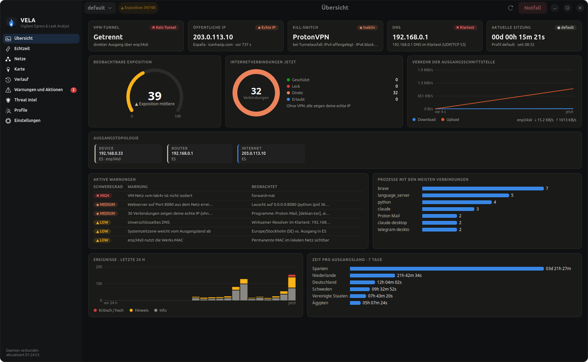
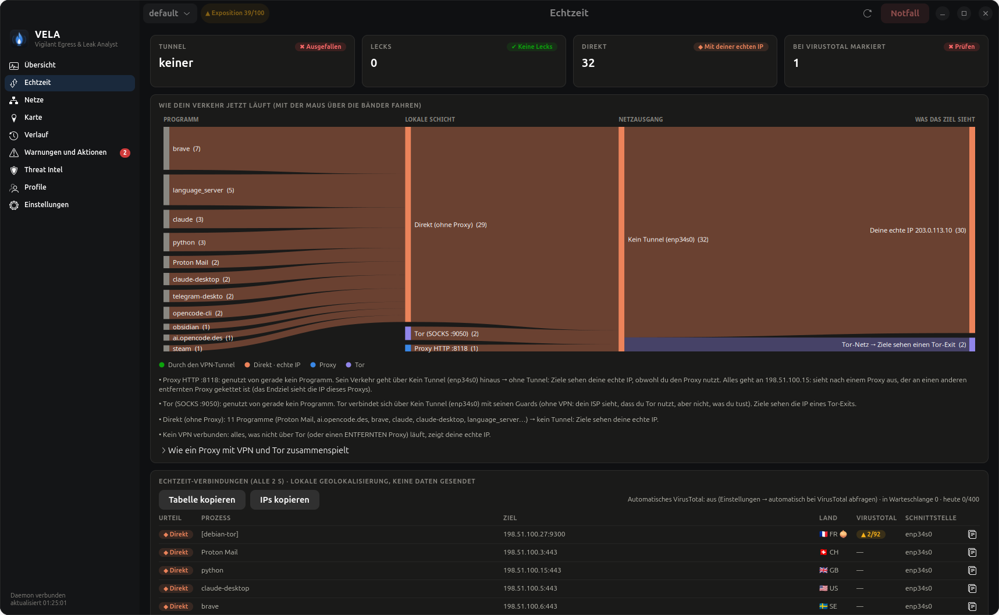
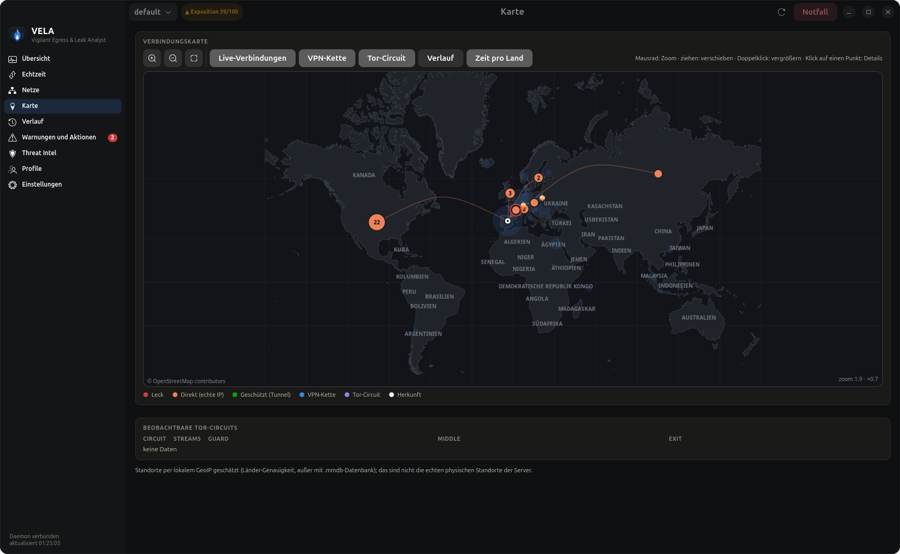
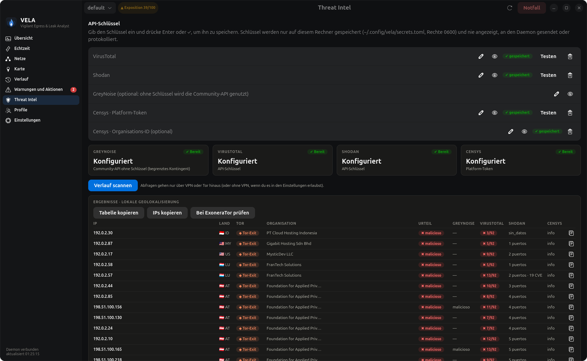
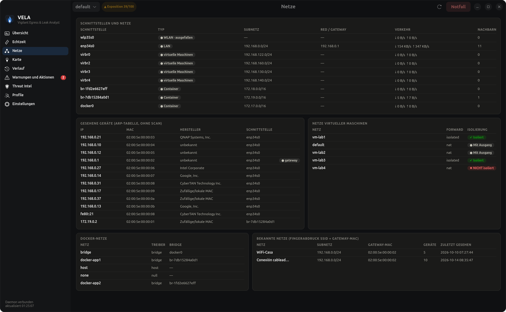
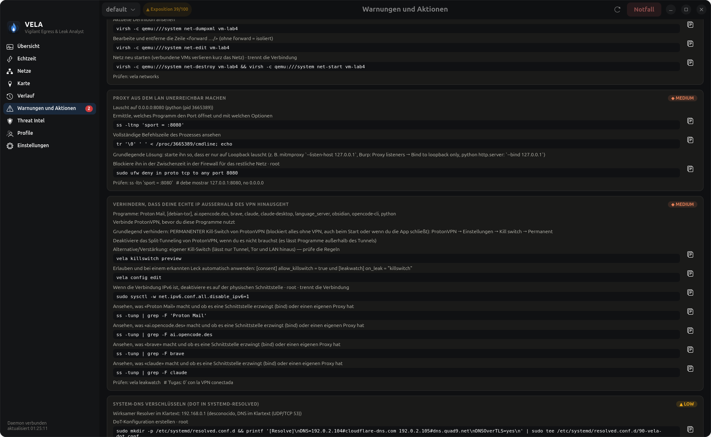
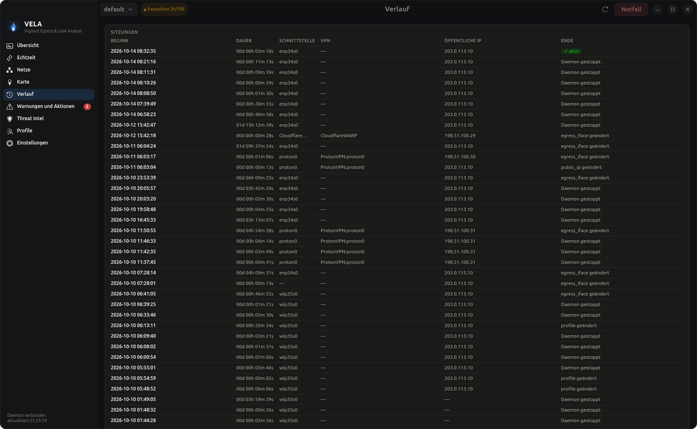
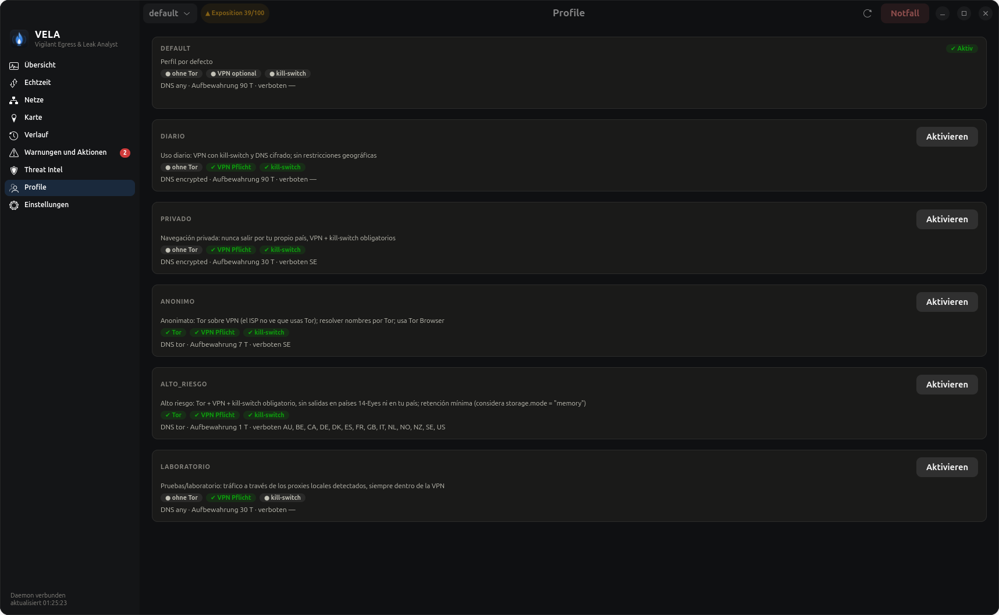
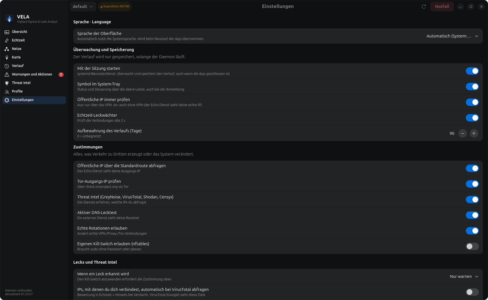
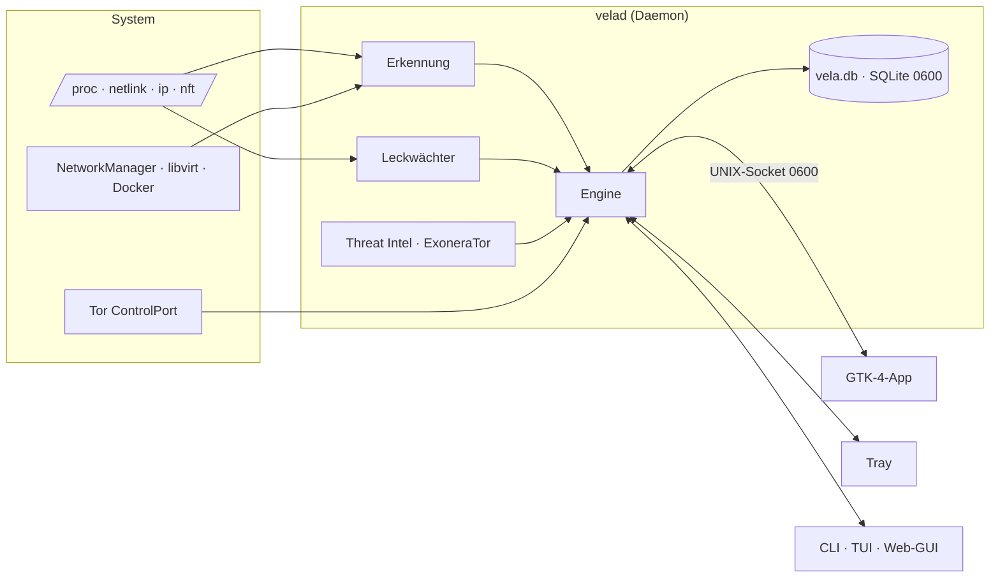

<p align="center">
  
</p>

<h1 align="center">VELA</h1>

<p align="center">
  <a href="README.md">English</a> · <a href="README.es.md">Español</a> · <a href="README.ca.md">Català</a> · <a href="README.pt.md">Português</a> · <a href="README.fr.md">Français</a> · <b>Deutsch</b>
</p>

<p align="center">
  <b>V</b>igilant <b>E</b>gress &amp; <b>L</b>eak <b>A</b>nalyst<br>
  <i>Deine Netzwerkidentität, immer wachsam.</i>
</p>

<p align="center">
  
  
  
  
  
  
  
</p>

<p align="center">
  
</p>

VELA überwacht, **wo dein Verkehr hinausgeht** (Router, VPN, Proxys, Tor und DNS), **wie lange** du jeden Ausgang
nutzt, **die Lecks**, die dich preisgeben, und **die Reputation** der IPs, mit denen du kommunizierst. Alles lokal,
unter Linux, ohne externe Abhängigkeiten: es erkennt, was auf deinem Rechner vorhanden ist, und aktiviert nur, was
es wirklich gibt.

| Buchstabe | Was er tut |
|---|---|
| **V**igilant | Dauerhafter Daemon, Leckwächter alle 2 s, Kernel-Ereignisse (netlink) und Hinweise im Tray |
| **E**gress | Verfolgt jeden Ausgang: lokale IP, Router-WAN, öffentliche IP, VPN, Proxys, Tor-Circuits und DNS, mit Sitzungen, Zählern `00d 00h 00m 00s` und Rotation ohne Wiederholungen |
| **L**eak | Erkennt, was dich preisgibt: Verbindungen außerhalb des Tunnels, DNS im Klartext, IPv6, WebRTC, Kill-Switch, nicht isolierte VM-Netze |
| **A**nalyst | Reichert an und erklärt: lokale Geolokalisierung, VirusTotal, Shodan, GreyNoise, Censys, ExoneraTor und den Weg jeder Verbindung |

*Vela* ist spanisch für die Kerze, die weiterbrennt, während alle schlafen: **estar en vela** heißt Wache halten.

> Die Screenshots verwenden echte, **anonymisierte** Daten: IPs aus Dokumentationsbereichen (RFC 5737/3849),
> erfundene MACs, WLAN-Namen, Netze und Tor-Relays sowie verschobene Uhrzeiten.

---

## Inhalt

- [Funktionen](#funktionen)
- [Datenschutz durch Technik](#datenschutz-durch-technik)
- [Sprachen](#sprachen)
- [Installation](#installation)
- [Verwendung](#verwendung)
- [Architektur](#architektur)
- [Status und Grenzen](#status-und-grenzen)
- [Entwicklung und Repository-Sicherheit](#entwicklung-und-repository-sicherheit)

## Funktionen

### Übersicht
Auf einen Blick: VPN-Tunnel, öffentliche IP, Kill-Switch, DNS, aktuelle Sitzung mit Zähler, die **beobachtbare
Exposition** (0–100), Verbindungen nach Zustand, Verkehr der Ausgangsschnittstelle, die vollständige **Topologie**
(Gerät → Router → Internet → Tor-Guard → Middle → Exit), aktive Warnungen, Prozesse mit den meisten Verbindungen,
Ereignisse der letzten 24 h und Zeit pro Ausgangsland.

### Echtzeit: wie dein Verkehr läuft
Jede Verbindung wird alle 2 s als **geschützt**, **Leck** oder **direkt** eingestuft, mit verantwortlichem
Programm, Land, VirusTotal-Bewertung und Schnellkopie. Das Flussdiagramm zeigt **Programm → lokale Schicht (direkt /
Proxy / Tor) → Ausgang (VPN-Tunnel oder nicht) → was das Ziel sieht** und erklärt in einfachen Worten, was das
bedeutet: zum Beispiel, dass ein *lokaler* Proxy die IP, die das Ziel sieht, nicht ändert.

<p align="center"></p>

### Eigene OpenStreetMap-Karte
Web-Mercator-Karte aus OSM-Daten, **in die App eingebaut** (Küsten, Länder, Hauptstädte und Städte, 4
Detailstufen, Namen in deiner Sprache). Sie funktioniert offline: das Ansehen der Karte **fragt bei keinem Server
Kacheln an** und verrät daher nicht, welche Gegenden du dir ansiehst. Ebenen für Live-Verbindungen, VPN-Kette,
Tor-Circuit, Verlauf und Zeit pro Land; Zoom, Verschieben und Details per Klick.

<p align="center"></p>

### Threat Intel mit ExoneraTor
GreyNoise, VirusTotal, Shodan und Censys für deinen Verlauf oder eine IP-Liste, mit Flagge, Organisation und
**Erkennung von Tor-Knoten** (Konsens deines eigenen Tor, offizielle Exit-Liste und ExoneraTor). Abfragen gehen nur
über das VPN oder Tor hinaus; die Schlüssel liegen in `~/.config/vela/secrets.toml` (0600).

<p align="center"></p>

### Weitere Ansichten

| Netze | Warnungen und Aktionen |
|---|---|
|  |  |
| WLAN, LAN, VPN, Docker und VMs; gesehene Geräte (ARP, ohne Scan), Isolierung von VM-Netzen und Fingerabdruck bekannter Netze | Jedes Problem mit **konkreten Befehlen** zur Behebung. VELA führt sie nie aus: du kopierst, prüfst und startest sie selbst |
| **Verlauf** | **Profile** |
|  |  |
| Ausgangssitzungen mit Dauer, Schnittstelle, VPN, öffentlicher IP und Grund des Endes | Profile, erzeugt aus dem, was auf deinem System vorhanden ist (Alltag, privat, anonym, hohes Risiko, Labor) |

<details>
<summary><b>Einstellungen und Zustimmungen</b></summary>
<p align="center"></p>
</details>

Dazu kommen ein **Tray-Symbol** (Status, Profil, Tor, Notfall und Benachrichtigungen), eine **TUI** im Terminal,
eine lokale **Web-GUI** (nur 127.0.0.1, mit Token) und eine vollständige **CLI** mit `--json`-Ausgabe.

## Datenschutz durch Technik

- **Standardmäßig nur beobachten.** Alles, was Verkehr zu Dritten erzeugt oder das System verändert, erfordert eine
  ausdrückliche Zustimmung (`[consent]` oder die Seite Einstellungen).
- **Nichts geht ohne Erlaubnis über deine echte IP hinaus:** die öffentliche IP wird durch den Tunnel geprüft;
  Threat Intel, Karte und ExoneraTor laufen über das VPN oder Tor.
- **Lokal:** Geolokalisierung mit den Datenbanken von Tor und des Systems, eingebaute Karte, kein CDN, keine Telemetrie.
- **Geheimnisse:** Schlüssel in einer 0600-Datei, die nie angezeigt und nie an den Daemon gesendet wird; IPC über
  einen UNIX-Socket 0600 mit Benutzerprüfung (`SO_PEERCRED`).
- **Ehrlichkeit:** die Datenbank ist ohne SQLCipher **nicht** verschlüsselt (nur Rechte 0600), und die
  Geolokalisierung ist ungefähr (Land).

<details>
<summary><b>Verfügbare Zustimmungen</b></summary>

Standardmäßig beobachtet das Werkzeug nur. Diese Aktionen werden unter `[consent]` aktiviert; siehe
[config.example.toml](config.example.toml):

| Schlüssel | Warum er aus ist |
|---|---|
| `direct_ip_checks` | Der Echo-Dienst würde deine echte IP sehen |
| `active_dns_leak_test` | Ein externer Dienst sieht deine IP und deine Resolver |
| `allow_rotation_changes` | Ändert echte Verbindungen |
| `allow_killswitch` | Wendet nftables-Regeln an (mit `sudo -n` oder pkexec) |
</details>

## Sprachen

Die gesamte Oberfläche (Desktop-App, Tray, CLI, TUI, Web-GUI, Warnungen und Erklärungen) gibt es auf **Deutsch,
Englisch, Spanisch, Katalanisch, Portugiesisch und Französisch**, einschließlich der Länder- und Städtenamen auf der
Karte.

- **Automatisch:** folgt der Systemsprache (`LANG`); ist es keine der sechs, Englisch.
- **Wählen:** Einstellungen → Sprache (die App startet neu, der Daemon wechselt sofort), `vela --lang de status`
  oder die Variable `VELA_LANG=de`.
- **Übersetzen:** die Kataloge liegen in [`vela/locale/`](vela/locale) (`{"spanischer Quelltext": "Übersetzung"}`);
  `python3 -m vela.i18n check` meldet, was fehlt und ob eine Übersetzung eine Variable `{…}` verliert.

## Installation

Voraussetzungen: **Linux** und **Python ≥ 3.10**. Die Desktop-App nutzt GTK 4 + libadwaita (PyGObject), das Tray
AyatanaAppIndicator3 — beides unter GNOME/Ubuntu bereits vorhanden.

```bash
git clone https://github.com/j0rd1s3rr4n0/VELA.git && cd VELA
git config core.hooksPath .githooks    # Wächter gegen Geheimnisse und persönliche Daten
python3 -m pip install --user .        # installiert die Befehle `vela` und `velad`
vela app --install                     # Starter im Anwendungsmenü
vela daemon enable                     # ab der Anmeldung überwachen
```

Funktioniert auch ohne Installation, mit `python3 -m vela <Befehl>`.

Optional:

- `pip install geoip2` mit den GeoLite2-City/ASN-`.mmdb`-Datenbanken in `~/.local/share/GeoIP/` für Stadt und ASN;
- `pip install sqlcipher3` für echte Datenbankverschlüsselung.

Um Tor zu beobachten, musst du sein Steuer-Cookie lesen können:

```bash
sudo usermod -aG debian-tor $USER
```

## Verwendung

```bash
vela app               # Desktop-Anwendung
vela status            # Kette, IPs, Tor, DNS, Sitzung, Zähler, Rotation, Warnungen
vela leakwatch         # öffentliche IP und IP-Lecks in Echtzeit
vela routes            # wie dein Verkehr läuft: Programm → direkt/Proxy/Tor → VPN → Ziel
vela tui               # interaktives Terminal
```

<details>
<summary><b>Alle Befehle</b></summary>

| Befehl | Was er tut |
|---|---|
| `vela tray [--install \| --remove]` | **Tray-Symbol** (AppIndicator): VPN-Status, IP, Exposition und Lecks; App öffnen, IP/Lecks prüfen, Profil, Tor, Notfall, Schnelleinstellungen und Benachrichtigungen |
| `vela daemon enable\|disable` | Daemon mit der Sitzung starten (systemd-Benutzerdienst), damit kein Verlauf verloren geht |
| `vela app [--install]` | **Native Desktop-Anwendung** (GTK 4 + libadwaita); `--install` fügt den Starter zum Menü hinzu |
| `vela leakwatch [--once] [--all]` | **Öffentliche IP und IP-Lecks in Echtzeit**: jede Verbindung als geschützt / Leck / direkt eingestuft, mit verantwortlichem Programm |
| `vela networks [-n]` | Alle deine Netze (WLAN, LAN, VPN, Docker, VMs): Verkehr, Gateway, SSID, gesehene Geräte, VM-Isolierung |
| `vela fix` | Konkrete Befehle zur Behebung jedes erkannten Problems (führt nichts aus) |
| `vela intel scan [IP…] [--file f] [--history]` | GreyNoise / VirusTotal / Shodan / Censys für deinen Verlauf oder eine Liste (`intel keys`, `intel set-key`, `intel show`, `intel targets`) |
| `vela map [status\|build]` | **Eigene OpenStreetMap-Karte, in die App eingebaut** (`vela/data/`, funktioniert offline in der nativen App, der TUI und der Web-GUI). `build` aktualisiert sie mit neuen Daten: Download über Tor oder das VPN (`--via direct` nur auf Wunsch, `--file` für ein bereits geladenes Zip); das Ansehen der Karte fragt bei niemandem Kacheln an |
| `vela network` | Schnittstellen, eingeordnete Adressen (privat, CGNAT, ULA…), Routen und Policy-Routing |
| `vela vpn list` / `vela proxy list` | Erkannte VPNs und Proxys mit ihrem Status |
| `vela tor status` | Circuits mit Guard, Middle und Exit; Guards; externe Prüfung |
| `vela dns check [--active]` | Resolver pro Verbindung, Split-DNS, DoT und Lecks |
| `vela ip [--route tor]` | Öffentliche IP pro Weg (mit Zustimmung) und WAN-IP über UPnP |
| `vela sessions` / `vela counters` / `vela history` | Sitzungen, Zähler `00d 00h 00m 00s` und Zeitleiste |
| `vela watch` | Echtzeit-Ereignisse (erfordert den Daemon) |
| `vela rotate [tor\|proxy\|vpn] [--dry-run]` | Sichere Rotation oder Rotationsstatus |
| `vela leaks check [--active]` | Diagnosen mit Nachweis, Methode, Grenzen und Konfidenz |
| `vela profiles [activate X \| correlation \| generate [--write]]` | Profile, Korrelationsrisiko und an das System angepasste Profilerzeugung |
| `vela audit [--html f.html]` | Datenschutz-Audit |
| `vela stats --period day\|week\|month` | Statistiken und Anomalien |
| `vela export --format json\|csv\|html --out …` | Verlauf exportieren |
| `vela killswitch preview\|apply --yes\|release` | nftables-Kill-Switch (eigene Tabelle) |
| `vela panic` / `vela resume` | Notfallmodus (löscht keine Daten) |
| `vela purge --days N --yes` | Alten Verlauf löschen |
| `vela config show\|init\|edit` / `vela doctor` | Konfiguration und Installationsdiagnose |

Jeder Befehl akzeptiert `--json` und `--lang`. Ohne Daemon führen CLI, TUI und GUI die Engine im eigenen Prozess
aus, zeichnen aber keine Sitzungen auf.
</details>

## Architektur



Details in [ARCHITECTURE.md](ARCHITECTURE.md) (auf Spanisch).

## Status und Grenzen

<details>
<summary><b>Fähigkeitsmatrix</b> (validiert am 2026-10-09 unter Ubuntu 26.04, Python 3.14)</summary>

Legende:

- ✅ implementiert und getestet (automatische Tests und/oder echte Ausführung auf diesem Rechner);
- 🟡 implementiert, Praxisvalidierung ausstehend;
- ⛔ wegen einer Umgebungsgrenze nicht verfügbar;
- ⏳ ausstehend.

| Funktion | Status | Nachweis |
|---|---|---|
| Fähigkeitserkennung (5 Zustände) | ✅ | Tests + echtes `vela discover` |
| Schnittstellen, Routen, wirksame Route, Einordnung IPv4/IPv6/CGNAT/ULA | ✅ | Tests + echtes `vela network` |
| Netlink-Ereignisse | ✅ | echter Daemon: „netlink: aktive Ereignisse“ |
| Tor: SAFECOOKIE, Circuits, Guard/Middle/Exit, Streams, Guards | ✅ | Fake-Server + 22 echte Circuits |
| Tor: Ausgangs-IP über check.torproject.org (IsTor) | ✅ | echt: 185.220.101.140 bestätigt |
| Tor: NEWNYM mit Ratenlimit und ohne Exit-Wiederholung | ✅ / 🟡 | mit Mocks und echtem Dry-Run getestet; echtes NEWNYM nicht ausgeführt (keine Zustimmung) |
| DNS pro Verbindung (systemd-resolved), Split-DNS, DoT | ✅ | Tests + echtes `vela dns check` |
| Wirksames und verschlüsseltes DNS: WARP DoH, cloudflared, dnscrypt/stubby, DoT, DoH von Firefox/Chromium; DoH-Route | ✅ | Tests + echt: WARP DoH über `proton0` |
| Kill-Switches von Clients (ProtonVPN, Mullvad, NordVPN) + Routenprüfung „was, wenn der Tunnel ausfällt?“ | ✅ / 🟡 | echtes ProtonVPN verifiziert (IPv4/IPv6); Mullvad/NordVPN nicht validiert (nicht installiert) |
| VPN-Clients als Snap/Flatpak (ProtonVPN) und VPN-Server aus dem Verbindungsnamen | ✅ | echt: `ProtonVPN CH-DE#2` |
| Profilerzeugung (Alltag, privat, anonym, hohes Risiko, Labor) und Richtlinien `require_killswitch`/`dns_policy` | ✅ | Tests + echte Profile live bewertet |
| Passive Lecks: IPv6, Tunnel, DNS, offener Proxy, Zeitzone, MAC, Kill-Switch | ✅ | Tests + echte Befunde |
| Überwachung aller Netze: Verkehr, ARP-Nachbarn (ohne Scan), Netz-Fingerabdruck, Wechsel der Gateway-MAC (ARP-Spoofing), neue Geräte, offenes WLAN, Isolierung von libvirt-Netzen | ✅ | Tests + echt: `pentest-isolated` mit NAT erkannt |
| Öffentliche IP nur durch den Tunnel (`public_ip.require_tunnel`) | ✅ | Tests + echt: übersprungen, als das VPN ausfiel |
| Öffentliche IP in Echtzeit (alle 60 s mit Tunnel + sofort bei Routenwechsel) und Erkennung „das Internet sieht deine echte IP“ | ✅ / 🟡 | Tests; Praxisvalidierung steht aus, bis das VPN wieder verbunden ist |
| Echtzeit-Leckwächter (Kernel-Sockets alle 2 s, verantwortliches Programm, DNS-Lecks, automatische Reaktion mit Kill-Switch) | ✅ | Tests + echt: 29 direkte Verbindungen bei ausgefallenem VPN erkannt |
| Behebung mit Befehlen (`vela fix`, GUI mit Kopierknopf) | ✅ | Tests + echte Ausführung |
| Threat Intel: GreyNoise | ✅ | Tests + echte Abfrage über Tor |
| Threat Intel: VirusTotal / Shodan | ✅ | mit den echten Schlüsseln des Nutzers validiert (VT-Bewertung, Shodan-Ports) |
| Threat Intel: Censys | 🟡 | implementiert und mit simulierten Antworten getestet; kein Schlüssel zur Validierung |
| Geolokalisierung mit Flagge, Organisation und VT-Bewertung in Echtzeit und Threat Intel | ✅ | Tests + echte Daten |
| Tray-Symbol mit Status und Steuerung + Desktop-Benachrichtigungen | ✅ | echt: im GNOME-Tray registriert, Menü über D-Bus geprüft |
| Persistenz: Daemon mit der Sitzung (systemd), Einstellungen und API-Schlüssel aus der App | ✅ | Tests + aktiver Dienst |
| Native GUI mit GTK 4 + libadwaita (Übersicht, Netze, Cairo-Karte, Verlauf, Warnungen, Intel, Profile, Benachrichtigungen) | ✅ | echte, von GTK gerenderte Screenshots |
| Aktiver DNS-Lecktest (bash.ws) | 🟡 | implementiert; nicht ausgeführt (erfordert Zustimmung) |
| WebRTC-Test in der GUI | 🟡 | implementiert; nicht in einem Browser ausgeführt |
| Öffentliche IP direkt / über Proxy | 🟡 | implementiert; ohne Zustimmung deaktiviert |
| WAN-IP über UPnP-IGD + CGNAT/doppeltes NAT | 🟡 | implementiert; dein Router antwortet nicht auf UPnP |
| Sitzungen, Intervalle, Zähler, Persistenz, Wiederherstellung | ✅ | Tests + echter Daemon |
| Rotations-Engine (Auswahl, Abklingzeit, Ausschlüsse, Limits, Rollback, Fail-Closed) | ✅ | 12 Tests mit simuliertem Backend |
| VPN-Adapter NetworkManager / wg-quick / Mullvad | 🟡 | implementiert; nicht validiert. ProtonVPN (grafische App v4) hat keine CLI zum Serverwechsel: wird nur beobachtet |
| Weiterleitung zum Rotieren von Proxys | ✅ | Test mit lokalen Upstreams |
| nftables-Kill-Switch | ✅ / 🟡 | Regeln getestet und echte Vorschau; nicht angewendet (Zustimmung und sudo) |
| Profile, Correlation Risk Engine, Anomalien, Statistiken, Exposure Score | ✅ | Tests |
| Export JSON/CSV/HTML, Datenschutz-Audit, doctor | ✅ | echte Ausführung |
| IPC (0600, SO_PEERCRED, Whitelist, Ereignisse) | ✅ | Tests + echte Rechte |
| CLI | ✅ | alle Befehle gegen das echte System ausgeführt |
| TUI (curses) | ✅ / 🟡 | echter Start und echtes Rendering; interaktive Navigation von mir nicht geprüft |
| Web-GUI (Token, Host/Origin, CSP, Übersicht, Karte, Zeitleiste) | ✅ | Tests + echter Browser ohne Konsolenfehler |
| Verkehrsrouten (Programm → Proxy/Tor/direkt → VPN → Ziel), `vela routes` + Diagramm in Echtzeit | ✅ / 🟡 | Tests + echte Daten (Tor und direkt ohne VPN); echter lokaler Proxy und verketteter Proxy nur mit simulierten Tests (kein Proxy auf dem Rechner) |
| HTTP-Proxy vs. Webserver (CONNECT-Probe) | ✅ | Tests + echtes :8080 als Webserver erkannt |
| Eingebaute OpenStreetMap-Basiskarte (Mercator, 4 Detailstufen, Küsten, Länder, Hauptstädte und Städte; offline; auch TUI und Web-GUI) | ✅ | Tests + echte, über Tor geladene OSM-Daten und Screenshots der nativen App; Web-GUI nur mit Tests und `node --check` geprüft |
| Oberfläche in 6 Sprachen (de, en, es, ca, pt, fr) mit Live-Wechsel im Daemon und übersetzten Kartennamen | ✅ | Tests (vollständige Kataloge, Variablen intakt) + echte Screenshots in allen 6 Sprachen |
| Ländergrenzen auf der Karte | ⏳ | nicht enthalten (OSM-Grenzdaten wiegen Hunderte MB) |
| Stadt / ASN | ⛔ | keine `.mmdb`-Datenbank auf dem System (optional) |
| Datenbankverschlüsselung | ⛔ | SQLCipher nicht installiert: die Datenbank ist **nicht** verschlüsselt, nur durch Rechte 0600 geschützt |
| Windows und macOS | ⏳ | der Kern ist Linux-spezifisch (/proc, /sys, netlink, nftables) |
| PAC/WPAD-Proxys: Auswertung des Skripts | ⏳ | wird erkannt, das PAC-Skript wird aber nicht ausgewertet |
</details>

- Die Geolokalisierung ist lokal und ungefähr (Land). **Sie ist nicht der echte physische Standort** der Server.
- `NEWNYM` garantiert keinen anderen Exit. Das Werkzeug fasst nie die Guards an und setzt keine `ExitNodes`.
- Der Tor Browser wird, wenn er auf Port 9151 erkannt wird, nur beobachtet: seine Rotation ist „Neue Identität“.
- Getrennte Netzwerkprofile verhindern keine Korrelation über Cookies, Konten oder den Browser-Fingerabdruck.

## Entwicklung und Repository-Sicherheit

```bash
python3 -m unittest discover -s tests -t .
```

171 Tests mit Mocks und simulierten Backends (falscher Tor-Steuerserver mit echtem SAFECOOKIE, Rotation mit Fehlern
und Rollback, simulierte Lecks, IPC, GUI-Sicherheit, falscher SOCKS5-Proxy, OSM-Karte, Migration, Git-Wächter und
Übersetzungen). Keiner berührt die echte Konnektivität.

Das Repository enthält einen Wächter (`vela/gitguard.py`), der über die Hooks in `.githooks/` automatisch läuft
(`git config core.hooksPath .githooks` nach dem Klonen):

- **pre-commit**: blockiert persönliche Dateien (`.devlogs/`, Datenbanken, `secrets.toml`, `config.toml`,
  App-Einstellungen, Tor-Cookies, VPN-Konfigurationen, Schlüssel…), Geheimnismuster (private Schlüssel,
  WireGuard-PrivateKey, GitHub/AWS/Google/Slack-Tokens, `api_key = "…"`) und die **exakten Werte deines Rechners**:
  deine API-Schlüssel und echten IPs, ohne sie irgendwo zu speichern.
- **pre-push**: prüft jeden Commit vor der Veröffentlichung (auch später Gelöschtes, da es im Verlauf bleibt) und
  blockiert, wenn die Autor-E-Mail nicht anonym ist (`…@users.noreply.github.com`).
- `python3 -m vela.gitguard all`: prüft alles, was bereits im Repository ist.

Er zeigt das gefundene Geheimnis nie an, nur Datei, Zeile und Art. `user.useConfigOnly=true` verhindert, dass Git
deine Identität aus Benutzernamen und Rechnernamen erfindet.

### Migration von OPSecTools

VELA hieß früher *OPSecTools* (Befehle `opsec`/`opsecd`). Der erste `vela`-Befehl verschiebt deine Daten
(`~/.config`, `~/.local/share`, `~/.local/state` und `~/.cache` von `opsectools` nach `vela`, mit `opsec.db` →
`vela.db`), ersetzt den Dienst `opsecd` durch `velad`, falls er aktiviert war, und erneuert den Tray-Autostart und
den Starter. Neuere Daten werden nie überschrieben, und solange der alte Daemon läuft, passiert nichts.

## Lizenz und Danksagung

- Kartendaten: © OpenStreetMap contributors, [ODbL 1.0](https://www.openstreetmap.org/copyright)
  (siehe [vela/data/OSM-ATTRIBUTION.txt](vela/data/OSM-ATTRIBUTION.txt)).
- Code-Lizenz: noch festzulegen.
