<p align="center">
  
</p>

<p align="center">
  <picture>
    <source media="(prefers-color-scheme: light)" srcset="docs/brand/banner-light.png">
    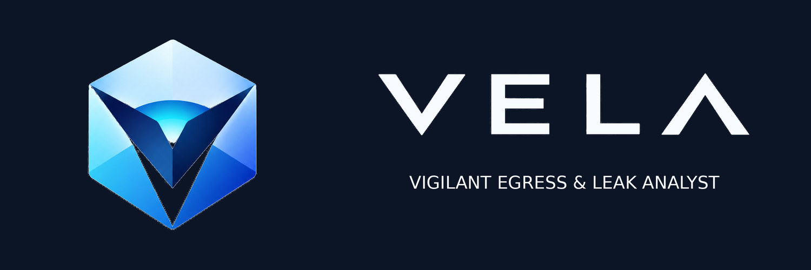
  </picture>
</p>

<h1 align="center">VELA</h1>

<p align="center">
  <a href="README.md">English</a> · <b>Español</b> · <a href="README.ca.md">Català</a> · <a href="README.pt.md">Português</a> · <a href="README.fr.md">Français</a> · <a href="README.de.md">Deutsch</a>
</p>

<p align="center">
  <b>V</b>igilant <b>E</b>gress &amp; <b>L</b>eak <b>A</b>nalyst<br>
  <i>Tu identidad de red, siempre en vela.</i>
</p>

<p align="center">
  
  
  
  
  
  
  
  
</p>

<p align="center">
  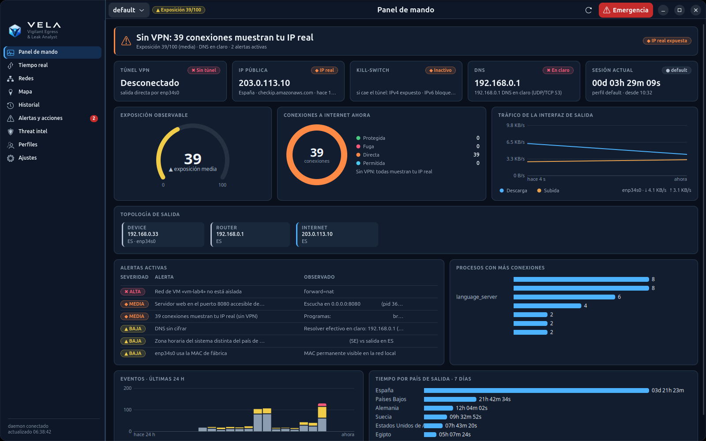
</p>

VELA vigila **por dónde sale tu tráfico** (router, VPN, proxies, Tor y DNS), **cuánto tiempo** usas cada
salida, **las fugas** que te exponen y **la reputación** de las IPs con las que hablas. Todo en local, en
Linux, sin dependencias externas: descubre solo lo que hay en tu equipo y activa únicamente lo que existe.

> **Solo Linux.** VELA lee la red directamente del núcleo de Linux (/proc, netlink, nftables, systemd). Las versiones para Windows se desarrollan en ramas aparte: [`windows-lite`](../../tree/windows-lite) (ligera: IP pública, conexiones y fugas, DNS, GUI web) y [`windows`](../../tree/windows) (versión completa).

| Letra | Qué hace |
|---|---|
| **V**igilant | Daemon permanente, vigilante de fugas cada 2 s, eventos del kernel (netlink) y avisos en la bandeja |
| **E**gress | Sigue cada salida: IP local, WAN del router, IP pública, VPN, proxies, circuitos Tor y DNS, con sesiones y contadores `00d 00h 00m 00s` y rotación sin repeticiones |
| **L**eak | Detecta lo que te expone: conexiones fuera del túnel, DNS en claro, IPv6, WebRTC, kill-switch, redes de VMs sin aislar |
| **A**nalyst | Enriquece y explica: geolocalización local, VirusTotal, Shodan, GreyNoise, Censys, ExoneraTor y el recorrido de cada conexión |

*Vela* es la llama que sigue encendida cuando todo duerme: **estar en vela** es quedarse vigilando.

> Las capturas usan datos **anonimizados**: direcciones privadas y de documentación, MACs, SSIDs, redes,
> nombres de procesos y relays de Tor inventados, y horas desplazadas.

---

## Contenido

- [Funciones](#funciones)
- [Privacidad por diseño](#privacidad-por-diseño)
- [Temas](#temas)
- [Idiomas](#idiomas)
- [Instalación](#instalación)
- [Uso](#uso)
- [Arquitectura](#arquitectura)
- [Estado y limitaciones](#estado-y-limitaciones)
- [Desarrollo y seguridad del repositorio](#desarrollo-y-seguridad-del-repositorio)

## Funciones

### Panel de mando
De un vistazo: túnel VPN, IP pública, kill-switch, DNS, sesión actual con su contador, la **exposición
observable** (0–100), conexiones por estado, tráfico de la interfaz de salida, la **topología** completa
(equipo → router → Internet → guard → middle → exit de Tor), alertas activas, procesos con más
conexiones, eventos de las últimas 24 h y tiempo por país de salida.

### Tiempo real: cómo viaja tu tráfico
Cada conexión clasificada cada 2 s como **protegida**, **fuga** o **directa**, con el programa responsable,
país, puntuación de VirusTotal y copia rápida. El diagrama de flujo muestra **programa → capa local
(directo / proxy / Tor) → salida (túnel VPN o no) → lo que ve el destino**, y explica en frases qué
significa: por ejemplo, que un proxy *local* no cambia la IP que ve el destino.

<p align="center">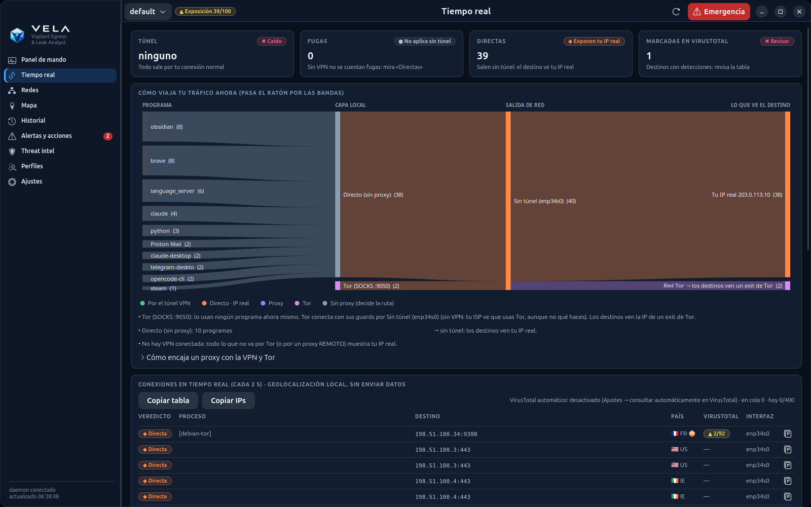</p>

### Mapa propio de OpenStreetMap
Mapa Web Mercator con datos de OSM **incorporado en la app** (costas, países, capitales y ciudades,
4 niveles de detalle). Funciona sin conexión: mirar el mapa **no pide teselas a ningún servidor**, así que
no revela qué zonas consultas. Capas de conexiones en vivo, cadena VPN, circuito Tor, historial y tiempo
por país; zoom, arrastre y detalle al hacer clic.

<p align="center">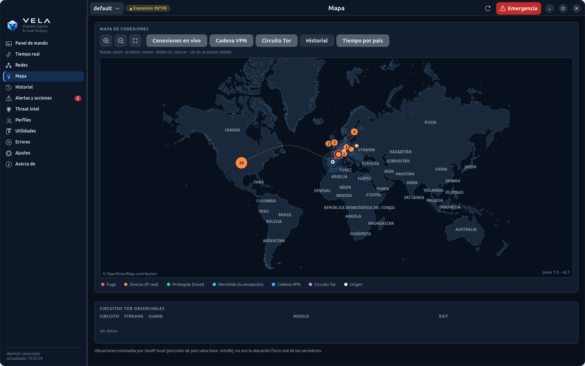</p>

### Threat intel con ExoneraTor
GreyNoise, VirusTotal, Shodan y Censys sobre tu historial o un listado de IPs, con bandera, organización
y **detección de nodos Tor** (consenso de tu propio Tor, lista oficial de exits y ExoneraTor). Las
consultas salen solo por la VPN o por Tor; las claves se guardan en `~/.config/vela/secrets.toml` (0600).

<p align="center">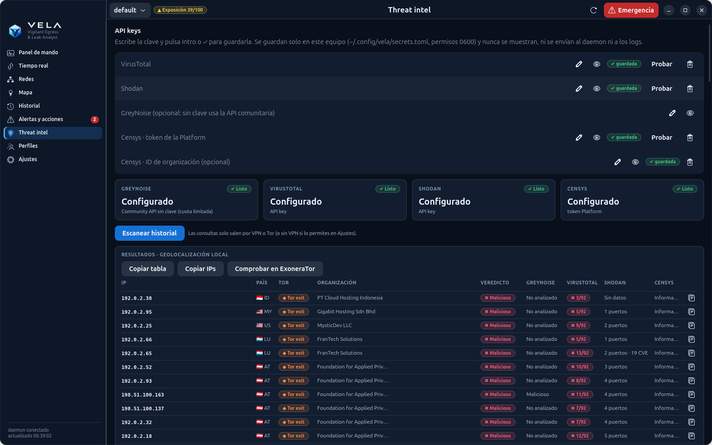</p>

### Más pantallas

| Redes | Alertas y acciones |
|---|---|
| 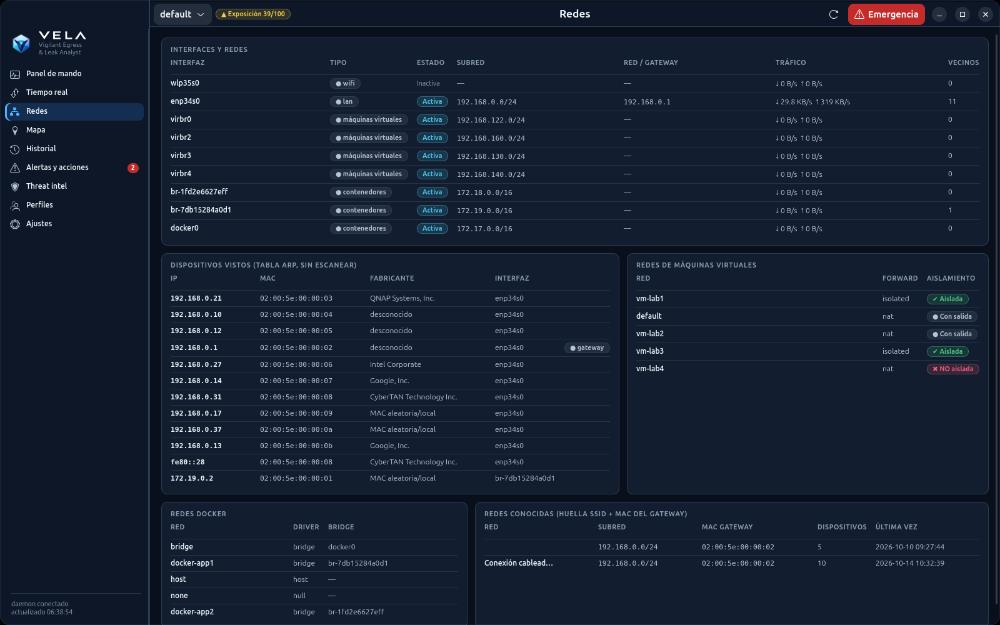 | 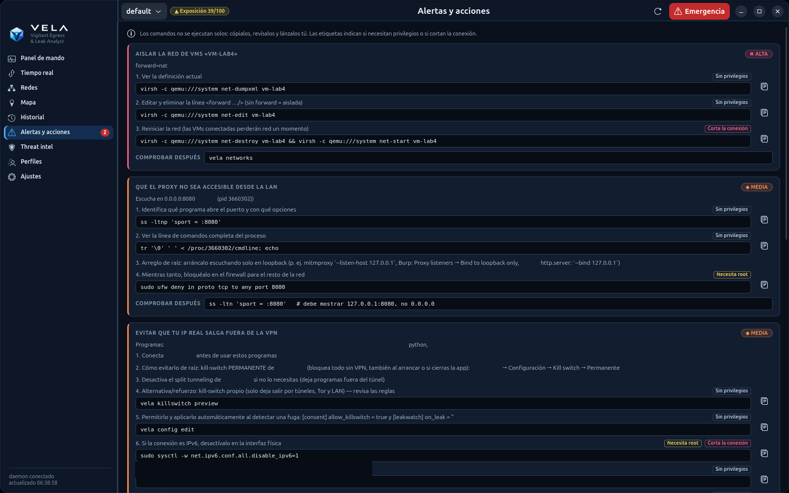 |
| WiFi, LAN, VPN, Docker y VMs; dispositivos vistos (ARP, sin escanear), aislamiento de redes de VMs y huella de redes conocidas | Cada problema con **comandos concretos** para corregirlo. VELA nunca los ejecuta: los copias, revisas y lanzas tú |
| **Historial** | **Perfiles** |
| 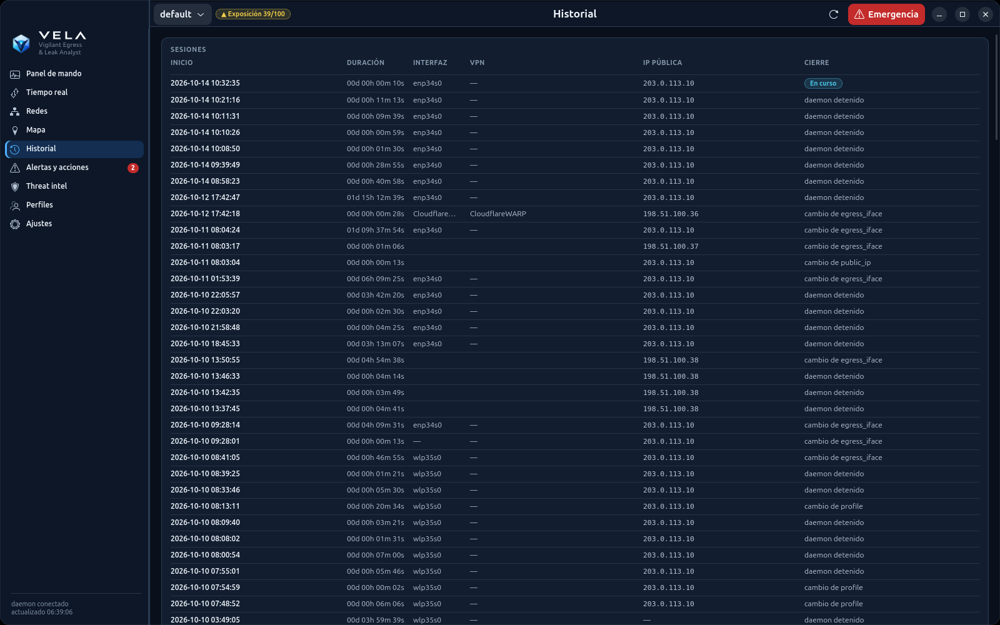 | 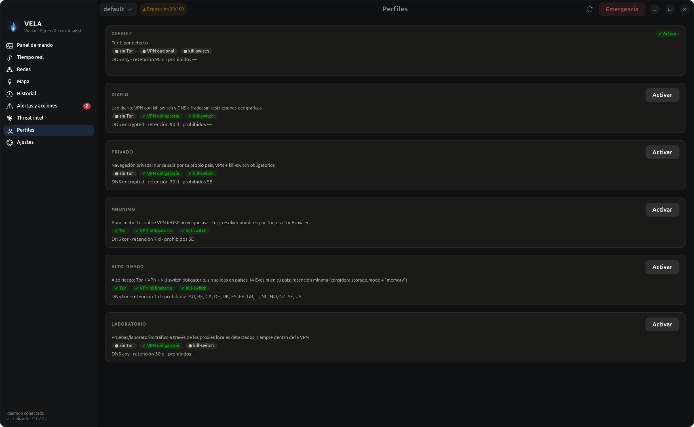 |
| Sesiones de salida con duración, interfaz, VPN, IP pública y motivo del cierre | Perfiles generados según lo que hay en tu sistema (diario, privado, anónimo, alto riesgo, laboratorio) |

<details>
<summary><b>Ajustes y consentimientos</b></summary>
<p align="center">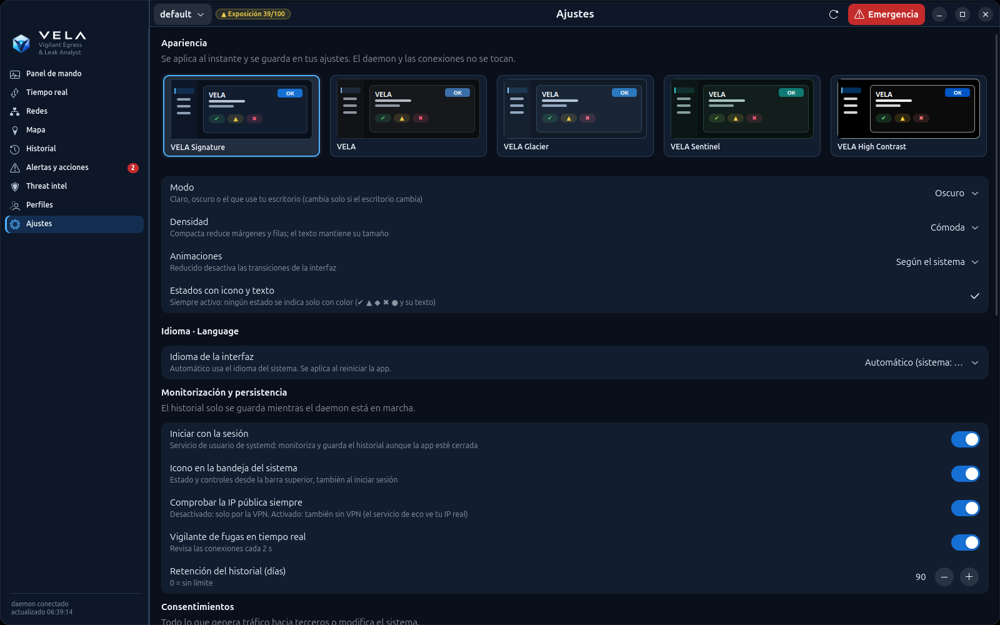</p>
</details>

También incluye **icono en la bandeja** (estado, perfil, Tor, emergencia y notificaciones), **TUI** en
terminal, **GUI web** local (solo 127.0.0.1, con token) y una **CLI** completa con salida `--json`.

### Herramientas

- **Traductor + OCR** — un LLM local pequeño (Ollama o llama.cpp) traduce cualquier texto; selecciona una región de la pantalla y tesseract la lee. Nada sale de la máquina salvo que actives una API remota.
- **Datos** — exporta/importa backups completos (historial, ajustes, configuración y opcionalmente secretos) y borra solo el historial o todos los datos de VELA, con confirmación.
- **Anomalías de red** — línea base local de volumen, fan-out de conexiones, procesos/países/puertos nuevos, cambios de ruta y de DNS.
- **DNS cifrado** — un clic para activar DoT (systemd-resolved) o DoH (cloudflared) con copia, verificación y reversión; avisa antes de pisar el DNS de la VPN.
- **Apps con otra zona horaria** — abre cualquier app `.desktop` o comando con `TZ=Asia/Tokyo` sin cambiar el reloj del escritorio.
- **Cambiador de MAC** — MAC aleatoria o manual, con la original guardada y restauración en un clic.
- **Dependencias opcionales** — detecta e instala paquetes de OCR, captura, MAC, DNS y LLM con confirmación y el comando exacto a la vista.
- **Registros** — pestaña **Errores** con dos ficheros persistentes: `audit.log` (acciones tuyas o del daemon) y
  `errors.log` (excepciones no controladas y fallos de la UI/CLI), con rotación, copia y borrado.
- **About** — versión, créditos y perfil del creador, offline por defecto con sincronización opcional de GitHub.
- **Perfiles adaptables** — al arrancar, VELA crea los perfiles `diario`, `privado`, `anonimo`, `alto_riesgo` y
  `laboratorio` según lo que tenga el equipo (VPN, kill-switch, Tor, proxies y DNS cifrado). Se recalculan cuando
  cambia el sistema y puedes escribirlos en `config.toml` con `vela profiles generate --write`.

## Privacidad por diseño

- **Solo observa por defecto.** Todo lo que genera tráfico hacia terceros o cambia el sistema está detrás
  de un consentimiento explícito (`[consent]` o la página de Ajustes).
- **Nada sale por tu IP real sin permiso:** la IP pública se comprueba por el túnel; threat intel, mapa y
  ExoneraTor van por la VPN o por Tor.
- **Local:** geolocalización con las bases de Tor y del sistema, mapa incorporado, sin CDN ni telemetría.
- **Secretos:** claves en un fichero 0600 que nunca se muestra ni viaja al daemon; IPC por socket UNIX
  0600 con comprobación del usuario (`SO_PEERCRED`).
- **Honestidad:** la base de datos **no** está cifrada salvo que instales SQLCipher (solo permisos 0600), y
  la geolocalización es aproximada (país).

<details>
<summary><b>Consentimientos disponibles</b></summary>

Por defecto la herramienta solo observa. Estas acciones se activan en `[consent]`; ver
[config.example.toml](config.example.toml):

| Clave | Por qué está desactivada |
|---|---|
| `direct_ip_checks` | El servicio de eco vería tu IP real |
| `active_dns_leak_test` | Un servicio externo ve tu IP y tus resolvers |
| `allow_rotation_changes` | Cambia conexiones reales |
| `allow_killswitch` | Aplica reglas nftables (con `sudo -n` o pkexec) |
</details>

## Temas

La app de escritorio tiene **cinco temas, cada uno en claro y oscuro**, y el modo *Seguir al sistema*: **VELA Signature**
(oficial, con el azul marino, el azul y el cian de la marca), **Obsidian** (grafito para trabajo SOC), **Glacier** (frío y
analítico), **Sentinel** (verde petróleo) y **High Contrast** (texto ≥ 7:1). Se elige en **Ajustes → Apariencia**, junto con
la densidad (cómoda o compacta) y las animaciones. Se aplica al instante, sin reiniciar nada.

Los colores son *design tokens* que comparten la app GTK, sus gráficos y el mapa, y la GUI web. Su significado no cambia entre
temas: protegida en verde, directa (IP real) en naranja, proxy en índigo, Tor en violeta y fuga en rojo, siempre con icono y texto.
Las 790 comprobaciones de contraste (WCAG 2.2 AA; AAA para el texto de High Contrast) se calculan y las exigen las pruebas. Más en
[docs/THEMES.es.md](docs/THEMES.es.md).

<p align="center">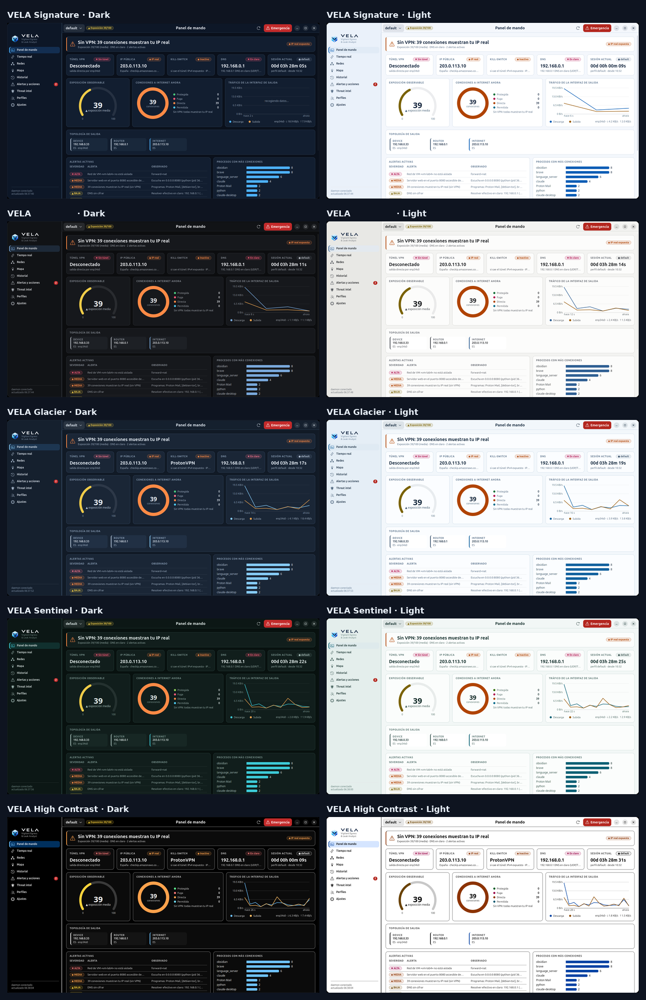</p>

## Idiomas

Toda la interfaz (app de escritorio, bandeja, CLI, TUI, GUI web, avisos y explicaciones) está en
**español, inglés, catalán, portugués, francés y alemán**, también los nombres de países y ciudades del mapa.

- **Automático:** usa el idioma del sistema (`LANG`); si no está entre los seis, inglés.
- **Elegirlo:** Ajustes → Idioma (la app se reinicia y el daemon cambia al momento), `vela --lang de status`
  o la variable `VELA_LANG=fr`.
- **Traducir:** los catálogos están en [`vela/locale/`](vela/locale) (`{"texto en español": "traducción"}`);
  `python3 -m vela.i18n check` indica lo que falta y si alguna traducción pierde una variable `{…}`.

## Instalación

Requisitos: **Linux** y **Python ≥ 3.10**. La app de escritorio usa GTK 4 + libadwaita (PyGObject) y la
bandeja AyatanaAppIndicator3, ya presentes en GNOME/Ubuntu.

**Autoinstalación en una línea** (descarga el script, instala git/curl si faltan, clona o actualiza VELA y ejecuta
`install.sh`):

```bash
curl -fsSL https://raw.githubusercontent.com/j0rd1s3rr4n0/VELA/master/autoinstall.sh | bash
```

Usa la URL **raw**, no la página `/blob/` de GitHub. Las opciones van después de `bash -s --`:

```bash
# añade OCR, captura, MAC y Ollama + qwen2.5:1.5b
curl -fsSL https://raw.githubusercontent.com/j0rd1s3rr4n0/VELA/master/autoinstall.sh | bash -s -- --with-all

# instala en otra carpeta y no arranca servicio ni bandeja
curl -fsSL https://raw.githubusercontent.com/j0rd1s3rr4n0/VELA/master/autoinstall.sh | bash -s -- --dir ~/src/VELA --no-service --no-tray
```

Desde un clon:

```bash
git clone https://github.com/j0rd1s3rr4n0/VELA.git && cd VELA
./install.sh          # instala la app, el servicio velad, el icono de bandeja y el lanzador (sin pip; también con sudo, instala para tu usuario)
./install.sh --with-all   # añade OCR, captura, MAC y Ollama + qwen2.5:1.5b (≈1 GB)
```

Puedes ejecutar `./install.sh` o `sudo ./install.sh`: en ambos casos instala para el usuario que lo invocó (con sudo se redirige a `$SUDO_USER`). Los comandos también funcionan con o sin sudo: `sudo vela …` vuelve a ejecutarse como tu usuario para que los datos sigan en tu home y la app pueda usar tu sesión gráfica; las acciones privilegiadas siguen usando `pkexec`/`sudo`. Usa `VELA_KEEP_ROOT=1 sudo vela …` si de verdad quieres conservar root. Detecta los paquetes del sistema que falten (apt, dnf, pacman, zypper) y pregunta antes de instalarlos; ver `./install.sh --help`.

Actualizar: **Ajustes → Actualizaciones** en la app o `vela update` (consulta el remoto de tu clon por Tor o por la VPN, nunca por su cuenta, enseña los commits nuevos y solo avanza; `vela update --check` no cambia nada) · Desinstalar: `./install.sh --uninstall` (`--purge` borra también tus datos).

También funciona sin instalar, con `python3 -m vela <comando>`.

Opcionales:

- `pip install geoip2`, junto con las bases GeoLite2-City/ASN `.mmdb` en `~/.local/share/GeoIP/`, para
  obtener ciudad y ASN;
- `pip install sqlcipher3` para cifrado real de la base de datos.

Para observar Tor hace falta poder leer su cookie de control:

```bash
sudo usermod -aG debian-tor $USER
```

## Uso

```bash
vela app               # aplicación de escritorio
vela status            # cadena, IPs, Tor, DNS, sesión, contadores, rotación, alertas
vela leakwatch         # IP pública y fugas de IP en tiempo real
vela routes            # cómo viaja tu tráfico: programa → directo/proxy/Tor → VPN → destino
vela tui               # terminal interactiva
```

<details>
<summary><b>Todos los comandos</b></summary>

| Comando | Qué hace |
|---|---|
| `vela tray [--install \| --remove]` | **Icono en la bandeja** (AppIndicator): estado de VPN, IP, exposición y fugas; abrir la app, comprobar IP/fugas, perfil, Tor, emergencia, ajustes rápidos y notificaciones |
| `vela daemon enable\|disable` | Arrancar el daemon con la sesión (servicio de usuario de systemd) para no perder historial |
| `vela app [--install]` | **Aplicación nativa de escritorio** (GTK 4 + libadwaita); `--install` añade el lanzador al menú |
| `vela leakwatch [--once] [--all]` | **IP pública y fugas de IP en tiempo real**: cada conexión clasificada como protegida / fuga / directa, con el programa responsable |
| `vela networks [-n]` | Todas tus redes (WiFi, LAN, VPN, Docker, VMs): tráfico, gateway, SSID, dispositivos vistos, aislamiento de VMs |
| `vela fix` | Comandos concretos para corregir cada problema detectado (no ejecuta nada) |
| `vela intel scan [IP…] [--file f] [--history]` | GreyNoise / VirusTotal / Shodan / Censys sobre tu historial o un listado (`intel keys`, `intel set-key`, `intel show`, `intel targets`) |
| `vela map [status\|build]` | **Mapa propio de OpenStreetMap, incorporado en la app** (`vela/data/`, funciona sin conexión en la app nativa, la TUI y la GUI web). `build` lo actualiza con datos recientes: descarga por Tor o la VPN (`--via direct` solo si lo pides, `--file` para un zip ya descargado); mirar el mapa no pide teselas a nadie |
| `vela update [--check\|--status] [--via auto\|tor\|vpn\|direct]` | Actualizar desde tu clon git: solo cuando lo pides, por Tor o la VPN, solo avanzando y enseñando antes los commits nuevos |
| `vela network` | Interfaces, direcciones clasificadas (privada, CGNAT, ULA…), rutas y policy routing |
| `vela vpn list` / `vela proxy list` | VPN y proxies detectados, con su estado |
| `vela tor status` | Circuitos con guard, middle y exit; guards; comprobación externa |
| `vela dns check [--active]` | Resolvers por enlace, split DNS, DoT y fugas |
| `vela ip [--route tor]` | IP pública por vía (con consentimiento) e IP WAN por UPnP |
| `vela sessions` / `vela counters` / `vela history` | Sesiones, contadores `00d 00h 00m 00s` y timeline |
| `vela watch` | Eventos en tiempo real (requiere el daemon) |
| `vela rotate [tor\|proxy\|vpn] [--dry-run]` | Rotación segura o estado de la rotación |
| `vela leaks check [--active]` | Diagnósticos con evidencia, método, limitaciones y confianza |
| `vela profiles [activate X \| correlation \| generate [--write]]` | Perfiles, riesgo de correlación y generación de perfiles adaptados al sistema |
| `vela audit [--html f.html]` | Privacy Audit |
| `vela stats --period day\|week\|month` | Estadísticas y anomalías |
| `vela export --format json\|csv\|html --out …` | Exportar el histórico |
| `vela killswitch preview\|apply --yes\|release` | Kill-switch nftables (tabla propia) |
| `vela panic` / `vela resume` | Modo de emergencia (no borra datos) |
| `vela purge --days N --yes` | Borrar el histórico antiguo |
| `vela config show\|init\|edit` / `vela doctor` | Configuración y diagnóstico de la instalación |

Cualquier comando acepta `--json`. Sin el daemon, la CLI, la TUI y la GUI usan el motor en su propio
proceso, pero no registran sesiones.
</details>

## Arquitectura

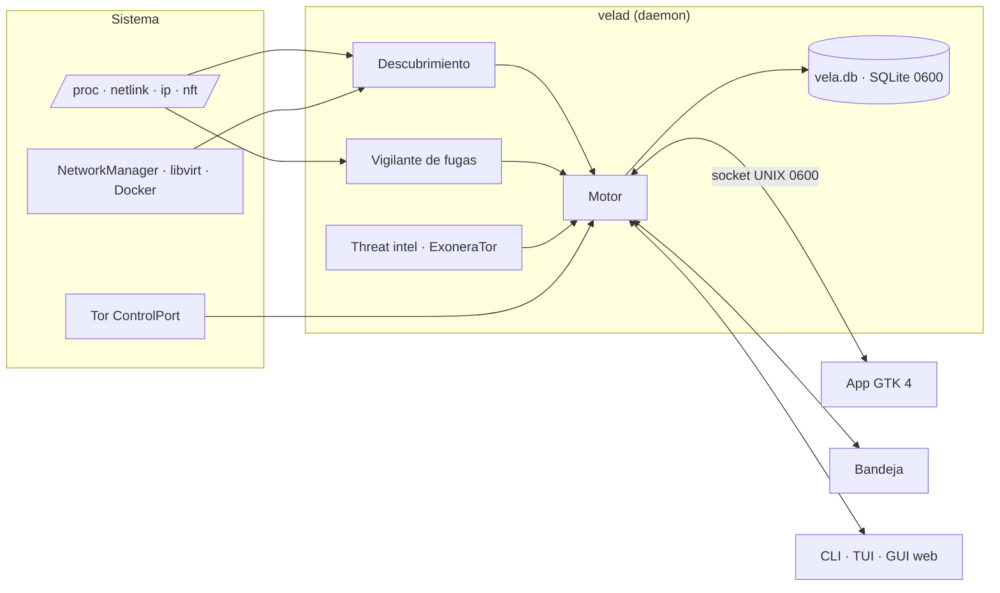

Detalles en [ARCHITECTURE.md](ARCHITECTURE.md).

## Estado y limitaciones

<details>
<summary><b>Matriz de capacidades</b> (validado el 2026-10-09 en Ubuntu 26.04, Python 3.14)</summary>

Leyenda:

- ✅ implementado y probado (pruebas automáticas y/o ejecución real en este equipo);
- 🟡 implementado pero pendiente de validación real;
- ⛔ no disponible por limitación del entorno;
- ⏳ pendiente.

| Funcionalidad | Estado | Evidencia |
|---|---|---|
| Descubrimiento de capacidades (5 estados) | ✅ | pruebas + `vela discover` real |
| Interfaces, rutas, ruta efectiva, clasificación IPv4/IPv6/CGNAT/ULA | ✅ | pruebas + `vela network` real |
| Eventos netlink | ✅ | daemon real: "netlink: eventos activos" |
| Tor: SAFECOOKIE, circuitos, guard/middle/exit, streams, guards | ✅ | servidor falso + 22 circuitos reales |
| Tor: IP de salida vía check.torproject.org (IsTor) | ✅ | real: 192.0.2.140 confirmado |
| Tor: NEWNYM con rate-limit y no repetición de exit | ✅ / 🟡 | probado con mocks y dry-run real; NEWNYM real no ejecutado (sin consentimiento) |
| DNS por enlace (systemd-resolved), split DNS, DoT | ✅ | pruebas + `vela dns check` real |
| DNS efectivo y cifrado: WARP DoH, cloudflared, dnscrypt/stubby, DoT, DoH de Firefox/Chromium; ruta del DoH | ✅ | pruebas + real: WARP DoH por `proton0` |
| Kill-switch de clientes (ProtonVPN, Mullvad, NordVPN) + verificación por rutas «¿y si cae el túnel?» | ✅ / 🟡 | ProtonVPN real verificado (IPv4/IPv6); Mullvad/NordVPN sin validar (no instalados) |
| Clientes VPN en snap/flatpak (ProtonVPN) y servidor VPN desde el nombre de la conexión | ✅ | real: `ProtonVPN XX-YY#2` |
| Generación de perfiles (diario, privado, anónimo, alto riesgo, laboratorio) y políticas `require_killswitch`/`dns_policy` | ✅ | pruebas + perfiles reales evaluados en vivo |
| Fugas pasivas: IPv6, túnel, DNS, proxy expuesto, zona horaria, MAC, kill-switch | ✅ | pruebas + hallazgos reales |
| Monitorización de todas las redes: tráfico, vecinos ARP (sin escanear), huella de red, cambio de MAC del gateway (ARP spoofing), dispositivos nuevos, WiFi abierta, aislamiento de redes libvirt | ✅ | pruebas + real: detectó `lab-isolated` con NAT |
| IP pública solo por túnel (`public_ip.require_tunnel`) | ✅ | pruebas + real: omitida al caer la VPN |
| IP pública en tiempo real (cada 60 s con túnel + inmediata al cambiar la ruta) y detección de «Internet ve tu IP real» | ✅ / 🟡 | pruebas; validación real pendiente de reconectar la VPN |
| Vigilante de fugas en tiempo real (sockets del kernel cada 2 s, programa responsable, fugas DNS, reacción automática con kill-switch) | ✅ | pruebas + real: 29 conexiones directas detectadas con la VPN caída |
| Remediación con comandos (`vela fix`, GUI con botón copiar) | ✅ | pruebas + ejecución real |
| Threat intel: GreyNoise | ✅ | pruebas + consulta real vía Tor |
| Threat intel: VirusTotal / Shodan | ✅ | validados con las claves reales del usuario (puntuación VT, puertos Shodan) |
| Threat intel: Censys | 🟡 | implementado y probado con respuestas simuladas; sin clave para validar |
| Geolocalización con bandera, organización y puntuación VT en Tiempo real y Threat intel | ✅ | pruebas + datos reales |
| Icono de bandeja con estado y controles + notificaciones de escritorio | ✅ | real: registrado en la bandeja de GNOME y menú verificado por D-Bus |
| Persistencia: daemon con la sesión (systemd), ajustes desde la app, API keys desde la app | ✅ | pruebas + servicio activo |
| GUI nativa GTK 4 + libadwaita (panel, redes, mapa cairo, historial, alertas, intel, perfiles, notificaciones) | ✅ | capturas reales renderizadas por GTK |
| Test activo de fugas DNS (bash.ws) | 🟡 | implementado; no ejecutado (requiere consentimiento) |
| Prueba WebRTC en la GUI | 🟡 | implementado; no ejecutado en un navegador |
| IP pública directa / por proxy | 🟡 | implementado; desactivado sin consentimiento |
| IP WAN por UPnP-IGD + CGNAT/doble NAT | 🟡 | implementado; tu router no responde a UPnP |
| Sesiones, intervalos, contadores, persistencia, recuperación | ✅ | pruebas + daemon real |
| Motor de rotación (selector, cooldown, exclusiones, límites, rollback, fail-closed) | ✅ | 12 pruebas con backend simulado |
| Adaptadores VPN NetworkManager / wg-quick / Mullvad | 🟡 | implementados; sin validar. ProtonVPN (app gráfica v4) no tiene CLI para cambiar de servidor: solo se observa |
| Forwarder para rotar proxies | ✅ | prueba con upstreams locales |
| Kill-switch nftables | ✅ / 🟡 | reglas probadas y vista previa real; no aplicado (consentimiento y sudo) |
| Perfiles, Correlation Risk Engine, anomalías, estadísticas, Exposure Score | ✅ | pruebas |
| Exportación JSON/CSV/HTML, Privacy Audit, doctor | ✅ | ejecución real |
| IPC (0600, SO_PEERCRED, lista blanca, eventos) | ✅ | pruebas + permisos reales |
| CLI | ✅ | todos los comandos ejecutados contra el sistema real |
| TUI (curses) | ✅ / 🟡 | arranque y renderizado reales; navegación interactiva no verificada por mí |
| GUI (token, Host/Origin, CSP, dashboard, mapa, timeline) | ✅ | pruebas + navegador real sin errores de consola |
| Rutas del tráfico (programa → proxy/Tor/directo → VPN → destino), `vela routes` + diagrama en Tiempo real | ✅ / 🟡 | pruebas + datos reales (Tor y directo sin VPN); proxy local real y proxy encadenado solo con pruebas simuladas (no hay proxy en el equipo) |
| Proxy HTTP vs servidor web (sonda CONNECT) | ✅ | pruebas + :8080 real identificado como servidor web |
| Mapa base OpenStreetMap incorporado (Mercator, 4 niveles de detalle, costa, países, capitales y ciudades; offline; también TUI y GUI web) | ✅ | pruebas + datos OSM reales descargados por Tor y capturas de la app nativa; GUI web comprobada solo con pruebas y `node --check` |
| Interfaz en 6 idiomas (es, en, ca, pt, fr, de) con cambio en caliente en el daemon y nombres del mapa traducidos | ✅ | pruebas (catálogos completos, variables intactas) + capturas reales en los 6 idiomas |
| Fronteras entre países en el mapa | ⏳ | no incluidas (los datos de fronteras de OSM pesan cientos de MB) |
| Ciudad / ASN | ⛔ | sin base `.mmdb` en el sistema (opcional) |
| Cifrado de la base de datos | ⛔ | SQLCipher no instalado: la base **no** está cifrada, solo protegida por permisos 0600 |
| Plataformas Windows y macOS | ⛔ | esta rama es solo para Linux; Windows: ramas `windows-lite` y `windows` |
| Proxies PAC/WPAD: evaluación del script | ⏳ | se detecta que existen, pero no se evalúa el script PAC |
</details>

- La geolocalización es local y aproximada (país). **No es la ubicación física real** de los servidores.
- `NEWNYM` no garantiza un exit distinto. La herramienta nunca toca los guards ni fija `ExitNodes`.
- Tor Browser, si se detecta en el puerto 9151, solo se observa: su rotación es "Nueva identidad".
- Separar perfiles de red no evita la correlación por cookies, cuentas o la huella del navegador.

## Desarrollo y seguridad del repositorio

```bash
python3 -m unittest discover -s tests -t .
```

255 pruebas con mocks y backends simulados (servidor de control de Tor falso con SAFECOOKIE real,
rotación con fallos y rollback, fugas simuladas, IPC, seguridad de la GUI, proxy SOCKS5 falso, mapa OSM,
migración, guardián de git y traducciones). Ninguna toca la conectividad real.

El repositorio trae un guardián (`vela/gitguard.py`) que se ejecuta solo con los hooks de `.githooks/`
(`git config core.hooksPath .githooks` tras clonar):

- **pre-commit**: bloquea ficheros personales (`.devlogs/`, bases de datos, `secrets.toml`, `config.toml`,
  ajustes de la app, cookies de Tor, configuraciones de VPN, claves…), patrones de secretos (claves privadas,
  PrivateKey de WireGuard, tokens de GitHub/AWS/Google/Slack, `api_key = "…"`) y los **valores exactos de tu
  equipo**: tus claves de API y tus IPs reales, sin guardarlos en ningún sitio.
- **pre-push**: revisa cada commit que se va a publicar (también lo borrado después, porque sigue en el
  historial) y bloquea si el correo del autor no es anónimo (`…@users.noreply.github.com`).
- `python3 -m vela.gitguard all`: revisa todo lo que ya está en el repositorio.

Nunca muestra el secreto encontrado, solo fichero, línea y tipo. `user.useConfigOnly=true` impide que git
invente tu identidad a partir del usuario y el nombre del equipo.

### Migración desde OPSecTools

VELA se llamaba *OPSecTools* (comandos `opsec`/`opsecd`). El primer comando de `vela` mueve tus datos
(`~/.config`, `~/.local/share`, `~/.local/state` y `~/.cache` de `opsectools` a `vela`, con `opsec.db` → `vela.db`),
sustituye el servicio `opsecd` por `velad` si estaba habilitado y renueva el autoarranque de la bandeja y el
lanzador. Nunca sobrescribe datos nuevos y no actúa mientras el daemon antiguo siga en marcha.

## Licencia y créditos

- **Código, documentación, diseño y marca: propietarios, todos los derechos reservados.** VELA
  **no es open source**. No se permite usar, copiar, modificar, distribuir, alojar, ofrecer como
  servicio ni explotar comercialmente sin permiso previo por escrito. Ver [LICENSE](LICENSE),
  [LICENSING.md](LICENSING.md) y [TRADEMARK.md](TRADEMARK.md).
- Datos del mapa: © OpenStreetMap contributors, [ODbL 1.0](https://www.openstreetmap.org/copyright)
  (ver [vela/data/OSM-ATTRIBUTION.txt](vela/data/OSM-ATTRIBUTION.txt)). Los datos ODbL no están
  cubiertos por la licencia propietaria.
