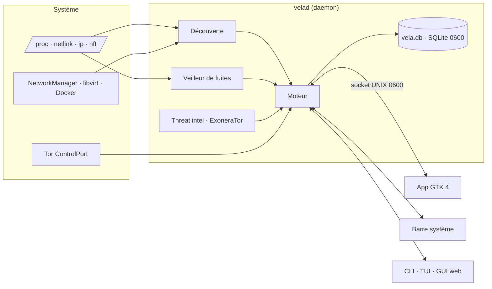

<p align="center">
  
</p>

<p align="center">
  <picture>
    <source media="(prefers-color-scheme: light)" srcset="docs/brand/banner-light.png">
    
  </picture>
</p>

<h1 align="center">VELA</h1>

<p align="center">
  <a href="README.md">English</a> · <a href="README.es.md">Español</a> · <a href="README.ca.md">Català</a> · <a href="README.pt.md">Português</a> · <b>Français</b> · <a href="README.de.md">Deutsch</a>
</p>

<p align="center">
  <b>V</b>igilant <b>E</b>gress &amp; <b>L</b>eak <b>A</b>nalyst<br>
  <i>Votre identité réseau, toujours en veille.</i>
</p>

<p align="center">
  
  
  
  
  
  
  
  
</p>

<p align="center">
  
</p>

VELA surveille **par où sort votre trafic** (routeur, VPN, proxies, Tor et DNS), **combien de temps** vous
utilisez chaque sortie, **les fuites** qui vous exposent et **la réputation** des IP avec lesquelles vous
communiquez. Tout en local, sous Linux, sans dépendances externes : il découvre ce qui se trouve sur votre machine
et n'active que ce qui existe réellement.

> **Linux uniquement.** VELA lit le réseau directement depuis le noyau Linux (/proc, netlink, nftables, systemd). Les versions Windows sont développées dans des branches séparées : [`windows-lite`](../../tree/windows-lite) (légère : IP publique, connexions et fuites, DNS, GUI web) et [`windows`](../../tree/windows) (portage complet).

| Lettre | Ce qu'elle fait |
|---|---|
| **V**igilant | Daemon permanent, veilleur de fuites toutes les 2 s, événements du noyau (netlink) et alertes dans la barre |
| **E**gress | Suit chaque sortie : IP locale, WAN du routeur, IP publique, VPN, proxies, circuits Tor et DNS, avec sessions, compteurs `00d 00h 00m 00s` et rotation sans répétition |
| **L**eak | Détecte ce qui vous expose : connexions hors du tunnel, DNS en clair, IPv6, WebRTC, kill-switch, réseaux de VM non isolés |
| **A**nalyst | Enrichit et explique : géolocalisation locale, VirusTotal, Shodan, GreyNoise, Censys, ExoneraTor et le trajet de chaque connexion |

*Vela* est, en espagnol, la bougie qui reste allumée quand tout le monde dort : **estar en vela**, c'est veiller.

> Les captures utilisent des données **anonymisées** : adresses privées et de documentation, MAC, SSID, réseaux,
> noms de processus et relais Tor inventés, et heures décalées.

---

## Sommaire

- [Fonctionnalités](#fonctionnalités)
- [Confidentialité dès la conception](#confidentialité-dès-la-conception)
- [Thèmes](#thèmes)
- [Langues](#langues)
- [Installation](#installation)
- [Utilisation](#utilisation)
- [Architecture](#architecture)
- [État et limites](#état-et-limites)
- [Développement et sécurité du dépôt](#développement-et-sécurité-du-dépôt)

## Fonctionnalités

### Tableau de bord
En un coup d'œil : tunnel VPN, IP publique, kill-switch, DNS, session actuelle avec son compteur, l'**exposition
observable** (0–100), connexions par état, trafic de l'interface de sortie, la **topologie** complète (machine →
routeur → Internet → guard → middle → exit Tor), alertes actives, processus avec le plus de connexions,
événements des dernières 24 h et temps par pays de sortie.

### Temps réel : comment circule votre trafic
Chaque connexion est classée toutes les 2 s comme **protégée**, **fuite** ou **directe**, avec le programme
responsable, le pays, le score VirusTotal et une copie rapide. Le diagramme de flux montre **programme → couche
locale (direct / proxy / Tor) → sortie (tunnel VPN ou non) → ce que voit la destination**, et explique en clair ce
que cela signifie : par exemple, qu'un proxy *local* ne change pas l'IP que voit la destination.

<p align="center"></p>

### La carte OpenStreetMap propre à l'app
Carte Web Mercator créée à partir des données OSM et **intégrée à l'app** (côtes, pays, capitales et villes,
4 niveaux de détail, noms dans votre langue). Elle fonctionne hors ligne : consulter la carte **ne demande aucune
tuile à aucun serveur**, elle ne révèle donc pas les zones que vous regardez. Couches pour les connexions en
direct, la chaîne VPN, le circuit Tor, l'historique et le temps par pays ; zoom, glisser et détail au clic.

<p align="center"></p>

### Threat intel avec ExoneraTor
GreyNoise, VirusTotal, Shodan et Censys sur votre historique ou une liste d'IP, avec drapeau, organisation et
**détection des nœuds Tor** (consensus de votre propre Tor, liste officielle des exits et ExoneraTor). Les requêtes
ne sortent que via le VPN ou Tor ; les clés sont stockées dans `~/.config/vela/secrets.toml` (0600).

<p align="center"></p>

### Autres écrans

| Réseaux | Alertes et actions |
|---|---|
|  |  |
| Wi-Fi, LAN, VPN, Docker et VM ; appareils vus (ARP, sans scan), isolation des réseaux de VM et empreinte des réseaux connus | Chaque problème avec des **commandes précises** pour le corriger. VELA ne les exécute jamais : vous les copiez, les relisez et les lancez |
| **Historique** | **Profils** |
|  |  |
| Sessions de sortie avec durée, interface, VPN, IP publique et motif de fermeture | Profils générés selon ce qui se trouve sur votre système (quotidien, privé, anonyme, haut risque, labo) |

<details>
<summary><b>Réglages et consentements</b></summary>
<p align="center"></p>
</details>

Il inclut aussi une **icône dans la barre** (état, profil, Tor, urgence et notifications), une **TUI** en terminal,
une **GUI web** locale (127.0.0.1 uniquement, avec jeton) et une **CLI** complète avec sortie `--json`.

### Outils

- **Traducteur + OCR** — un petit LLM local (Ollama ou llama.cpp) traduit n'importe quel texte ; sélectionnez une région de l'écran et tesseract la lit. Rien ne quitte la machine sauf si vous activez une API distante.
- **Données** — exportez/importez des sauvegardes complètes (historique, réglages, configuration et éventuellement secrets) et effacez uniquement l'historique ou toutes les données de VELA, avec confirmation.
- **Anomalies réseau** — ligne de base locale du volume, du fan-out des connexions, des nouveaux processus/pays/ports, des changements de route et de DNS.
- **DNS chiffré** — un clic pour activer DoT (systemd-resolved) ou DoH (cloudflared) avec sauvegarde, vérification et retour arrière ; avertit avant d'écraser le DNS du VPN.
- **Applications avec un autre fuseau horaire** — ouvrez n'importe quelle application `.desktop` ou commande avec `TZ=Asia/Tokyo` sans changer l'horloge du bureau.
- **Changeur de MAC** — MAC aléatoire ou manuelle, avec l'originale sauvegardée et restauration en un clic.
- **Dépendances optionnelles** — détecte et installe les paquets OCR, capture, MAC, DNS et LLM avec confirmation et la commande exacte affichée.
- **Journaux** — onglet **Erreurs** avec deux fichiers persistants : `audit.log` (actions de l'utilisateur ou du
  daemon) et `errors.log` (exceptions non gérées et échecs de l'UI/CLI), avec rotation, copie et effacement.
- **Contrôle des notifications** — activez ou coupez les notifications de bureau 15 min, 1 h, 8 h, 24 h ou
  indéfiniment depuis les Réglages, la barre système ou `vela notify`. Les coupures temporaires expirent seules.
- **About** — version, crédits et profil du créateur, hors ligne par défaut avec synchronisation GitHub optionnelle.
- **Profils adaptatifs** — au démarrage, VELA crée les profils `diario`, `privado`, `anonimo`, `alto_riesgo` et
  `laboratorio` selon ce que la machine possède réellement (VPN, kill-switch, Tor, proxys et DNS chiffré). Ils sont
  recalculés quand le système change et peuvent être écrits dans `config.toml` avec `vela profiles generate --write`.

## Confidentialité dès la conception

- **Observation seule par défaut.** Tout ce qui génère du trafic vers des tiers ou modifie le système exige un
  consentement explicite (`[consent]` ou la page Réglages).
- **Rien ne sort par votre IP réelle sans autorisation :** l'IP publique est vérifiée via le tunnel ; la threat
  intel, la carte et ExoneraTor passent par le VPN ou Tor.
- **Local :** géolocalisation avec les bases de Tor et du système, carte intégrée, ni CDN ni télémétrie.
- **Secrets :** clés dans un fichier 0600 jamais affiché ni envoyé au daemon ; IPC par socket UNIX 0600 avec
  vérification de l'utilisateur (`SO_PEERCRED`).
- **Honnêteté :** la base de données n'est **pas** chiffrée sans SQLCipher (permissions 0600 uniquement), et la
  géolocalisation est approximative (pays).

<details>
<summary><b>Consentements disponibles</b></summary>

Par défaut, l'outil se contente d'observer. Ces actions s'activent dans `[consent]` ; voir
[config.example.toml](config.example.toml) :

| Clé | Pourquoi elle est désactivée |
|---|---|
| `direct_ip_checks` | Le service d'écho verrait votre IP réelle |
| `active_dns_leak_test` | Un service externe voit votre IP et vos résolveurs |
| `allow_rotation_changes` | Modifie des connexions réelles |
| `allow_killswitch` | Applique des règles nftables (avec `sudo -n` ou pkexec) |
| `allow_dns_changes` | Modifie `/etc/systemd/resolved.conf.d` pour chiffrer le DNS |
| `allow_mac_changes` | Change la MAC d'une interface (coupe brièvement la connexion) |
| `llm_remote` | Envoie du texte à une API de traduction distante |
| `about_profile_lookup` | Interroge api.github.com et télécharge l'avatar public |
</details>

## Thèmes

L'application de bureau propose **cinq thèmes, chacun en clair et en sombre**, plus le mode *Suivre le système* :
**VELA Signature** (officiel, avec le bleu marine, le bleu et le cyan de la marque), **Obsidian** (graphite pour le travail SOC),
**Glacier** (froid et analytique), **Sentinel** (vert pétrole) et **High Contrast** (texte ≥ 7:1). On le choisit dans
**Réglages → Apparence**, avec la densité (confortable ou compacte) et les animations. Il s'applique immédiatement, sans rien
redémarrer.

Les couleurs sont des *design tokens* partagés par l'application GTK, ses graphiques et sa carte, et la GUI web. Leur sens ne
change jamais d'un thème à l'autre : protégée en vert, directe (IP réelle) en orange, proxy en indigo, Tor en violet et fuite en
rouge, toujours avec une icône et du texte. Les 790 vérifications de contraste (WCAG 2.2 AA ; AAA pour le texte de High Contrast)
sont calculées et imposées par les tests. Voir [docs/THEMES.md](docs/THEMES.md).

<p align="center"></p>

## Langues

Toute l'interface (app de bureau, barre système, CLI, TUI, GUI web, alertes et explications) est disponible en
**français, anglais, espagnol, catalan, portugais et allemand**, y compris les noms de pays et de villes de la
carte.

- **Automatique :** suit la langue du système (`LANG`) ; si ce n'est aucune des six, l'anglais.
- **La choisir :** Réglages → Langue (l'app redémarre et le daemon bascule immédiatement), `vela --lang fr status`
  ou la variable `VELA_LANG=fr`.
- **Traduire :** les catalogues se trouvent dans [`vela/locale/`](vela/locale) (`{"texte source en espagnol": "traduction"}`) ;
  `python3 -m vela.i18n check` indique ce qui manque et toute traduction qui perd une variable `{…}`.

## Installation

Prérequis : **Linux** et **Python ≥ 3.10**. L'app de bureau utilise GTK 4 + libadwaita (PyGObject) et la barre
système AyatanaAppIndicator3, déjà présents sous GNOME/Ubuntu.

**Auto-installation en une ligne** (télécharge le script, installe git/curl si nécessaire, clone ou met à jour
VELA et exécute `install.sh`) :

```bash
curl -fsSL https://raw.githubusercontent.com/j0rd1s3rr4n0/VELA/master/autoinstall.sh | bash
```

Utilisez l'URL **raw**, pas la page `/blob/` de GitHub. Les options se placent après `bash -s --` :

```bash
# ajoute OCR, capture, MAC et Ollama + qwen2.5:1.5b
curl -fsSL https://raw.githubusercontent.com/j0rd1s3rr4n0/VELA/master/autoinstall.sh | bash -s -- --with-all

# installe dans un autre dossier et ne démarre ni service ni barre système
curl -fsSL https://raw.githubusercontent.com/j0rd1s3rr4n0/VELA/master/autoinstall.sh | bash -s -- --dir ~/src/VELA --no-service --no-tray
```

Depuis un clone :

```bash
git clone https://github.com/j0rd1s3rr4n0/VELA.git && cd VELA
./install.sh          # installe l'app, le service velad, l'icône de la barre et le lanceur (sans pip ; aussi avec sudo, installe pour votre utilisateur)
./install.sh --with-all   # ajoute OCR, capture, MAC et Ollama + qwen2.5:1.5b (≈1 Go)
```

`install.sh` installe PyGObject, pycairo, GTK 4, libadwaita, AyatanaAppIndicator3, PolicyKit (`pkexec`), systemd-resolved, iproute2 et un portail XDG ; il détecte le gestionnaire de paquets (apt, dnf, pacman, zypper), affiche la commande exacte et demande avant de modifier le système. Options : `--with-ocr`, `--with-mac`, `--with-llm`, `--with-all`, `--no-optional`, `--no-deps`, `--no-service`, `--no-tray`, `--prefix DIR`. `cloudflared` n'est généralement pas dans les dépôts : installez-le depuis cloudflare.com uniquement si vous préférez DoH ; DoT fonctionne sans lui.

Vous pouvez exécuter `./install.sh` ou `sudo ./install.sh` : dans les deux cas, il installe pour l'utilisateur qui l'a invoqué (sudo est redirigé vers `$SUDO_USER`). Les commandes fonctionnent aussi avec ou sans sudo : `sudo vela …` se réexécute en tant que votre utilisateur pour que les données restent dans votre home et que l'app puisse utiliser votre session graphique ; les actions privilégiées utilisent toujours `pkexec`/`sudo`. Utilisez `VELA_KEEP_ROOT=1 sudo vela …` si vous voulez vraiment conserver root.

Mettre à jour : **Réglages → Mises à jour** dans l'app ou `vela update` (interroge le dépôt distant de votre clone via Tor ou le VPN, jamais de lui-même, montre les nouveaux commits et n'avance qu'en fast-forward ; `vela update --check` ne change rien) · Désinstaller : `./install.sh --uninstall` (`--purge` supprime aussi vos données). Il détecte les paquets système manquants (apt, dnf, pacman, zypper) et demande avant de les installer ; voir `./install.sh --help`.

Fonctionne aussi sans installation, avec `python3 -m vela <commande>`.

Facultatif :

- `pip install geoip2`, avec les bases GeoLite2-City/ASN `.mmdb` dans `~/.local/share/GeoIP/`, pour la ville et l'ASN ;
- `pip install sqlcipher3` pour un vrai chiffrement de la base de données.
- `tesseract-ocr` (avec les langues `spa`/`eng`) et un outil de capture ou un portail XDG pour l'OCR ;
- [Ollama](https://ollama.com) avec un petit modèle (`qwen2.5:1.5b`) pour traduire en local ;
- `cloudflared` uniquement si vous préférez DoH à DoT ;
- `macchanger` est facultatif : VELA utilise `ip link` s'il n'est pas présent.

Pour observer Tor, il faut pouvoir lire son cookie de contrôle :

```bash
sudo usermod -aG debian-tor $USER
```

## Utilisation

```bash
vela app               # application de bureau
vela status            # chaîne, IP, Tor, DNS, session, compteurs, rotation, alertes
vela leakwatch         # IP publique et fuites d'IP en temps réel
vela routes            # comment circule votre trafic : programme → direct/proxy/Tor → VPN → destination
vela tui               # terminal interactif
```

<details>
<summary><b>Toutes les commandes</b></summary>

| Commande | Ce qu'elle fait |
|---|---|
| `vela tray [--install \| --remove]` | **Icône dans la barre** (AppIndicator) : état du VPN, IP, exposition et fuites ; ouvrir l'app, vérifier IP/fuites, profil, Tor, urgence, réglages rapides et notifications |
| `vela daemon enable\|disable` | Lancer le daemon avec la session (service utilisateur systemd) pour ne pas perdre d'historique |
| `vela app [--install]` | **Application de bureau native** (GTK 4 + libadwaita) ; `--install` ajoute le lanceur au menu |
| `vela leakwatch [--once] [--all]` | **IP publique et fuites d'IP en temps réel** : chaque connexion classée protégée / fuite / directe, avec le programme responsable |
| `vela networks [-n]` | Tous vos réseaux (Wi-Fi, LAN, VPN, Docker, VM) : trafic, passerelle, SSID, appareils vus, isolation des VM |
| `vela fix` | Commandes précises pour corriger chaque problème détecté (n'exécute rien) |
| `vela intel scan [IP…] [--file f] [--history]` | GreyNoise / VirusTotal / Shodan / Censys sur votre historique ou une liste (`intel keys`, `intel set-key`, `intel show`, `intel targets`) |
| `vela map [status\|build]` | **Carte OpenStreetMap propre, intégrée à l'app** (`vela/data/`, fonctionne hors ligne dans l'app native, la TUI et la GUI web). `build` la met à jour avec des données récentes : téléchargement via Tor ou le VPN (`--via direct` uniquement si vous le demandez, `--file` pour un zip déjà téléchargé) ; consulter la carte ne demande aucune tuile à personne |
| `vela update [--check\|--status] [--via auto\|tor\|vpn\|direct]` | Mettre à jour depuis votre clone git : seulement à la demande, via Tor ou le VPN, en fast-forward uniquement, après avoir montré les nouveaux commits |
| `vela network` | Interfaces, adresses classées (privée, CGNAT, ULA…), routes et policy routing |
| `vela vpn list` / `vela proxy list` | VPN et proxies détectés, avec leur état |
| `vela tor status` | Circuits avec guard, middle et exit ; guards ; vérification externe |
| `vela dns check [--active]` | Résolveurs par lien, DNS fractionné, DoT et fuites |
| `vela ip [--route tor]` | IP publique par voie (avec consentement) et IP WAN via UPnP |
| `vela sessions` / `vela counters` / `vela history` | Sessions, compteurs `00d 00h 00m 00s` et chronologie |
| `vela watch` | Événements en temps réel (nécessite le daemon) |
| `vela rotate [tor\|proxy\|vpn] [--dry-run]` | Rotation sûre ou état de la rotation |
| `vela leaks check [--active]` | Diagnostics avec preuve, méthode, limites et confiance |
| `vela profiles [activate X \| correlation \| generate [--write]]` | Profils, risque de corrélation et génération de profils adaptés au système |
| `vela audit [--html f.html]` | Audit de confidentialité |
| `vela stats --period day\|week\|month` | Statistiques et anomalies |
| `vela anomalies` | Anomalies réseau de la ligne de base locale |
| `vela logs [show\|clear] [--kind audit\|errors]` | Journal d'audit et journal d'erreurs |
| `vela notify [status\|on\|off\|mute --for 1h]` | Activer, couper temporairement/indéfiniment ou consulter les notifications |
| `vela refresh [dns\|network\|leaks\|all…]` | Invalider les caches et recalculer alertes/recommandations maintenant |
| `vela translate [TEXTE] --to es` | Traduire avec le LLM local (Ollama/llama.cpp) |
| `vela ocr [--image f] --to es` | OCR d'une région ou image et traduction |
| `vela data info\|export\|import\|reset` | Sauvegardes, import et reset (historique ou toutes les données) |
| `vela deps check\|install [--feature …]` | Détecter et installer les dépendances optionnelles |
| `vela dns encrypt\|restore [--transport dot\|doh]` | Chiffrer le DNS système ou revenir en arrière |
| `vela tz list\|launch --app … --tz …` | Ouvrir une app ou commande avec un autre fuseau horaire |
| `vela mac list\|random\|set\|restore` | Changer ou restaurer la MAC d'une interface |
| `vela about [--sync]` | Version, crédits et profil du créateur |
| `vela export --format json\|csv\|html --out …` | Exporter l'historique |
| `vela killswitch preview\|apply --yes\|release` | Kill-switch nftables (table propre) |
| `vela panic` / `vela resume` | Mode urgence (ne supprime aucune donnée) |
| `vela purge --days N --yes` | Supprimer l'ancien historique |
| `vela config show\|init\|edit` / `vela doctor` | Configuration et diagnostic de l'installation |

Toutes les commandes acceptent `--json` et `--lang`. Sans le daemon, la CLI, la TUI et la GUI exécutent le moteur
dans leur propre processus, mais n'enregistrent pas de sessions.
</details>

## Architecture



Détails dans [ARCHITECTURE.md](ARCHITECTURE.md) (en espagnol).

## État et limites

<details>
<summary><b>Matrice des capacités</b> (validée le 2026-10-09 sous Ubuntu 26.04, Python 3.14)</summary>

Légende :

- ✅ implémenté et testé (tests automatiques et/ou exécution réelle sur cette machine) ;
- 🟡 implémenté, validation réelle en attente ;
- ⛔ indisponible en raison d'une limite de l'environnement ;
- ⏳ en attente.

| Fonctionnalité | État | Preuve |
|---|---|---|
| Découverte des capacités (5 états) | ✅ | tests + `vela discover` réel |
| Interfaces, routes, route effective, classification IPv4/IPv6/CGNAT/ULA | ✅ | tests + `vela network` réel |
| Événements netlink | ✅ | daemon réel : « netlink : événements actifs » |
| Tor : SAFECOOKIE, circuits, guard/middle/exit, flux, guards | ✅ | faux serveur + 22 circuits réels |
| Tor : IP de sortie via check.torproject.org (IsTor) | ✅ | réel : 192.0.2.140 confirmé |
| Tor : NEWNYM avec limite de fréquence et sans répéter l'exit | ✅ / 🟡 | testé avec des mocks et un dry-run réel ; NEWNYM réel non lancé (sans consentement) |
| DNS par lien (systemd-resolved), DNS fractionné, DoT | ✅ | tests + `vela dns check` réel |
| DNS effectif et chiffré : WARP DoH, cloudflared, dnscrypt/stubby, DoT, DoH de Firefox/Chromium ; route du DoH | ✅ | tests + réel : WARP DoH via `proton0` |
| Kill-switch des clients (ProtonVPN, Mullvad, NordVPN) + vérification par les routes « et si le tunnel tombe ? » | ✅ / 🟡 | ProtonVPN réel vérifié (IPv4/IPv6) ; Mullvad/NordVPN non validés (non installés) |
| Clients VPN snap/flatpak (ProtonVPN) et serveur VPN déduit du nom de la connexion | ✅ | réel : `ProtonVPN XX-YY#2` |
| Génération de profils (quotidien, privé, anonyme, haut risque, labo) et politiques `require_killswitch`/`dns_policy` | ✅ | tests + profils réels évalués en direct |
| Fuites passives : IPv6, tunnel, DNS, proxy exposé, fuseau horaire, MAC, kill-switch | ✅ | tests + constats réels |
| Surveillance de tous les réseaux : trafic, voisins ARP (sans scan), empreinte réseau, changement de MAC de la passerelle (ARP spoofing), nouveaux appareils, Wi-Fi ouvert, isolation des réseaux libvirt | ✅ | tests + réel : a détecté `lab-isolated` avec NAT |
| IP publique uniquement via le tunnel (`public_ip.require_tunnel`) | ✅ | tests + réel : ignorée quand le VPN est tombé |
| IP publique en temps réel (toutes les 60 s avec tunnel + immédiate au changement de route) et détection de « Internet voit votre IP réelle » | ✅ / 🟡 | tests ; validation réelle en attente d'une reconnexion du VPN |
| Veilleur de fuites en temps réel (sockets du noyau toutes les 2 s, programme responsable, fuites DNS, réaction automatique avec kill-switch) | ✅ | tests + réel : 29 connexions directes détectées avec le VPN coupé |
| Remédiation par commandes (`vela fix`, GUI avec bouton copier) | ✅ | tests + exécution réelle |
| Threat intel : GreyNoise | ✅ | tests + requête réelle via Tor |
| Threat intel : VirusTotal / Shodan | ✅ | validés avec les vraies clés de l'utilisateur (score VT, ports Shodan) |
| Threat intel : Censys | 🟡 | implémenté et testé avec des réponses simulées ; pas de clé pour valider |
| Géolocalisation avec drapeau, organisation et score VT dans Temps réel et Threat intel | ✅ | tests + données réelles |
| Icône dans la barre avec état et commandes + notifications de bureau | ✅ | réel : enregistrée dans la barre GNOME, menu vérifié via D-Bus |
| Persistance : daemon avec la session (systemd), réglages et clés API depuis l'app | ✅ | tests + service actif |
| GUI native GTK 4 + libadwaita (tableau de bord, réseaux, carte cairo, historique, alertes, intel, profils, notifications) | ✅ | captures réelles rendues par GTK |
| Test actif de fuites DNS (bash.ws) | 🟡 | implémenté ; non lancé (nécessite un consentement) |
| Test WebRTC dans la GUI | 🟡 | implémenté ; non lancé dans un navigateur |
| IP publique directe / par proxy | 🟡 | implémenté ; désactivé sans consentement |
| IP WAN via UPnP-IGD + CGNAT/double NAT | 🟡 | implémenté ; votre routeur ne répond pas à UPnP |
| Sessions, intervalles, compteurs, persistance, récupération | ✅ | tests + daemon réel |
| Moteur de rotation (sélecteur, délai, exclusions, limites, rollback, fail-closed) | ✅ | 12 tests avec un backend simulé |
| Adaptateurs VPN NetworkManager / wg-quick / Mullvad | 🟡 | implémentés ; non validés. ProtonVPN (app graphique v4) n'a pas de CLI pour changer de serveur : observation seule |
| Relais pour faire tourner les proxies | ✅ | test avec des upstreams locaux |
| Kill-switch nftables | ✅ / 🟡 | règles testées et aperçu réel ; non appliqué (consentement et sudo) |
| Profils, Correlation Risk Engine, anomalies, statistiques, Exposure Score | ✅ | tests |
| Export JSON/CSV/HTML, audit de confidentialité, doctor | ✅ | exécution réelle |
| IPC (0600, SO_PEERCRED, liste blanche, événements) | ✅ | tests + permissions réelles |
| CLI | ✅ | toutes les commandes exécutées contre le système réel |
| TUI (curses) | ✅ / 🟡 | démarrage et rendu réels ; navigation interactive non vérifiée par moi |
| GUI web (jeton, Host/Origin, CSP, tableau de bord, carte, chronologie) | ✅ | tests + navigateur réel sans erreurs de console |
| Routes du trafic (programme → proxy/Tor/direct → VPN → destination), `vela routes` + diagramme dans Temps réel | ✅ / 🟡 | tests + données réelles (Tor et direct sans VPN) ; proxy local réel et proxy chaîné uniquement avec des tests simulés (aucun proxy sur la machine) |
| Proxy HTTP vs serveur web (sonde CONNECT) | ✅ | tests + :8080 réel identifié comme serveur web |
| Carte de base OpenStreetMap intégrée (Mercator, 4 niveaux de détail, côtes, pays, capitales et villes ; hors ligne ; aussi TUI et GUI web) | ✅ | tests + vraies données OSM téléchargées via Tor et captures de l'app native ; GUI web vérifiée uniquement par tests et `node --check` |
| Interface en 6 langues (fr, en, es, ca, pt, de) avec changement à chaud dans le daemon et noms de la carte traduits | ✅ | tests (catalogues complets, variables intactes) + captures réelles dans les 6 langues |
| Frontières entre pays sur la carte | ⏳ | non incluses (les données de frontières OSM pèsent des centaines de Mo) |
| Ville / ASN | ⛔ | pas de base `.mmdb` sur le système (facultatif) |
| Chiffrement de la base de données | ⛔ | SQLCipher non installé : la base n'est **pas** chiffrée, seulement protégée par des permissions 0600 |
| Windows et macOS | ⛔ | cette branche est réservée à Linux ; Windows : branches `windows-lite` et `windows` |
| Proxies PAC/WPAD : évaluation du script | ⏳ | détectés, mais le script PAC n'est pas évalué |
</details>

- La géolocalisation est locale et approximative (pays). **Ce n'est pas l'emplacement physique réel** des serveurs.
- `NEWNYM` ne garantit pas un exit différent. L'outil ne touche jamais aux guards et ne fixe pas `ExitNodes`.
- Tor Browser, s'il est détecté sur le port 9151, est seulement observé : sa rotation se fait par « Nouvelle identité ».
- Séparer les profils réseau n'empêche pas la corrélation par cookies, comptes ou empreinte du navigateur.

## Développement et sécurité du dépôt

```bash
python3 -m unittest discover -s tests -t .
```

259 tests avec des mocks et des backends simulés (faux serveur de contrôle Tor avec un vrai SAFECOOKIE, rotation
avec échecs et rollback, fuites simulées, IPC, sécurité de la GUI, faux proxy SOCKS5, carte OSM, migration,
garde-fou git et traductions). Aucun ne touche à la connectivité réelle.

Le dépôt inclut un garde-fou (`vela/gitguard.py`) qui s'exécute automatiquement via les hooks de `.githooks/`
(`git config core.hooksPath .githooks` après le clonage) :

- **pre-commit** : bloque les fichiers personnels (`.devlogs/`, bases de données, `secrets.toml`, `config.toml`,
  réglages de l'app, cookies Tor, configurations VPN, clés…), les motifs de secrets (clés privées, PrivateKey
  WireGuard, jetons GitHub/AWS/Google/Slack, `api_key = "…"`) et les **valeurs exactes de votre machine** : vos clés
  d'API et vos IP réelles, sans les stocker nulle part.
- **pre-push** : vérifie chaque commit sur le point d'être publié (y compris ce qui a été supprimé ensuite, car cela
  reste dans l'historique) et bloque si l'e-mail de l'auteur n'est pas anonyme (`…@users.noreply.github.com`).
- `python3 -m vela.gitguard all` : vérifie tout ce qui se trouve déjà dans le dépôt.

Il n'affiche jamais le secret trouvé, seulement le fichier, la ligne et le type. `user.useConfigOnly=true` empêche
git d'inventer votre identité à partir de votre nom d'utilisateur et du nom de la machine.

### Migration depuis OPSecTools

VELA s'appelait *OPSecTools* (commandes `opsec`/`opsecd`). La première commande `vela` déplace vos données
(`~/.config`, `~/.local/share`, `~/.local/state` et `~/.cache` de `opsectools` vers `vela`, avec `opsec.db` →
`vela.db`), remplace le service `opsecd` par `velad` s'il était activé et renouvelle le démarrage automatique de la
barre et le lanceur. Elle n'écrase jamais de données plus récentes et n'agit pas tant que l'ancien daemon tourne.

## Licence et crédits

- **Code, documentation, design et éléments de marque : propriétaires, tous droits réservés.**
  VELA **n'est pas open source**. Aucune utilisation, copie, modification, distribution,
  hébergement, mise à disposition en SaaS ou exploitation commerciale n'est autorisée sans
  autorisation écrite préalable. Voir [LICENSE](LICENSE), [LICENSING.md](LICENSING.md) et
  [TRADEMARK.md](TRADEMARK.md).
- Données de la carte : © OpenStreetMap contributors, [ODbL 1.0](https://www.openstreetmap.org/copyright)
  (voir [vela/data/OSM-ATTRIBUTION.txt](vela/data/OSM-ATTRIBUTION.txt)). Les données ODbL ne sont
  pas couvertes par la licence propriétaire.
