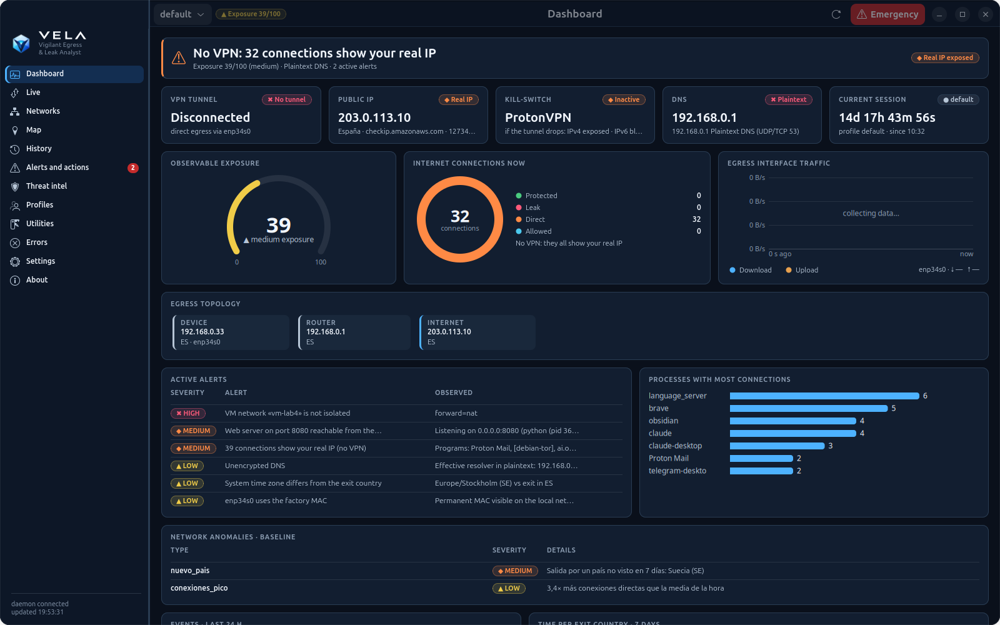
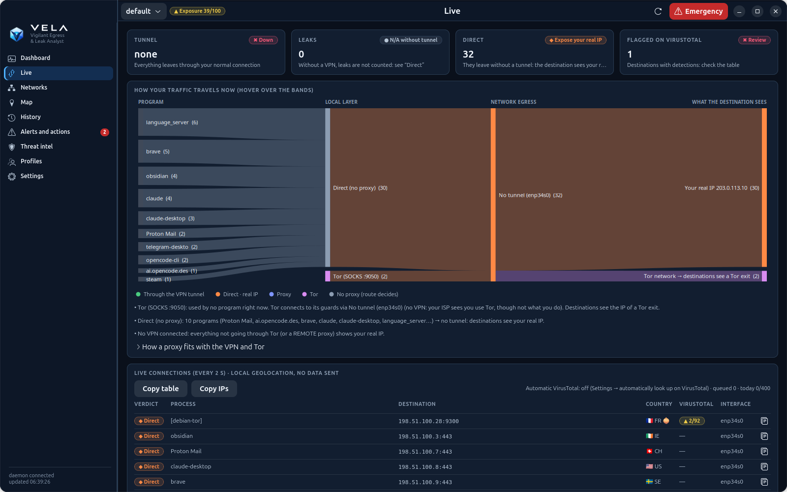
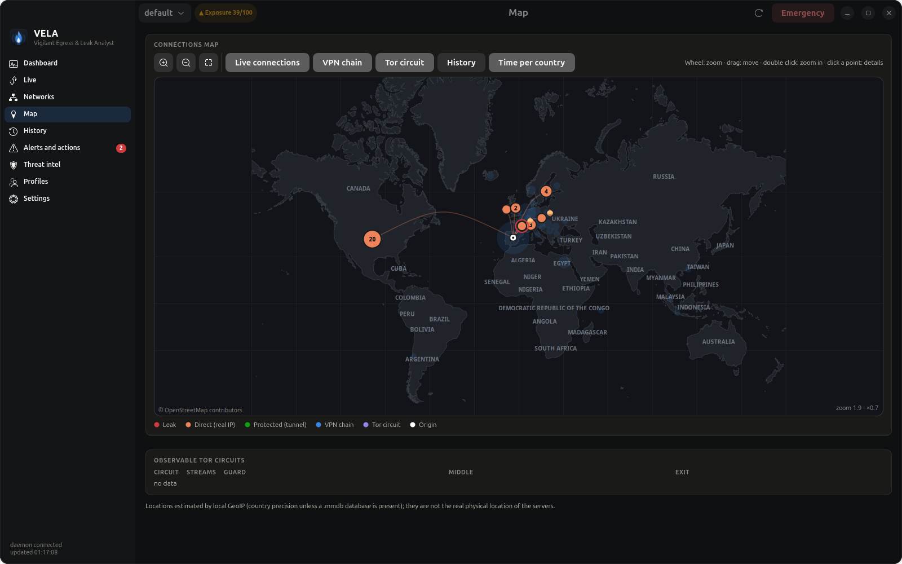
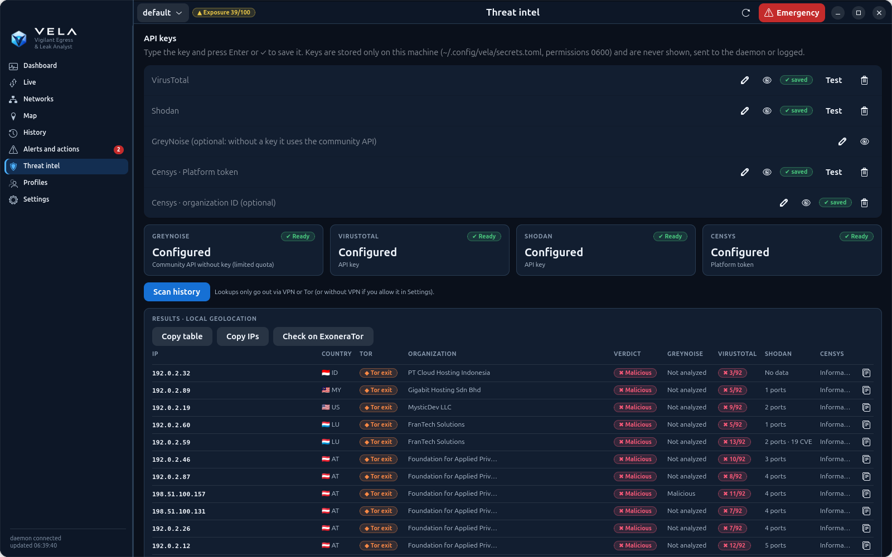
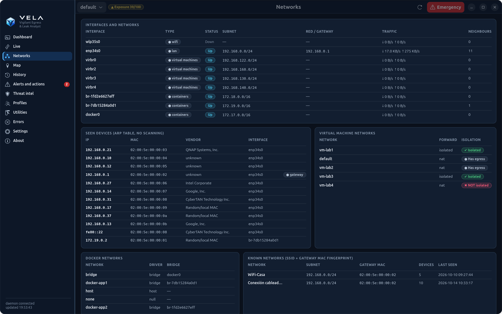
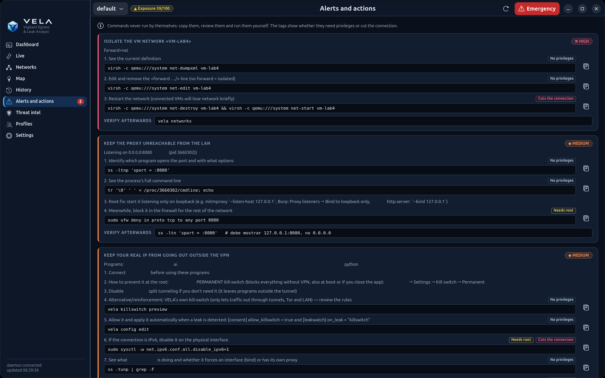
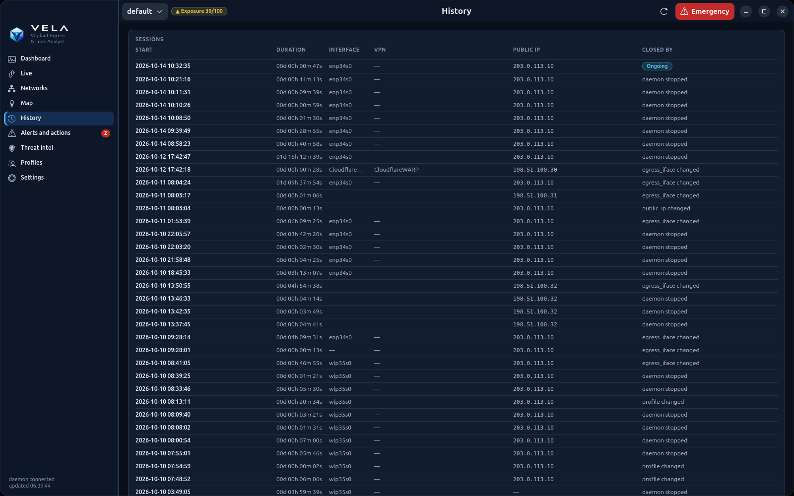
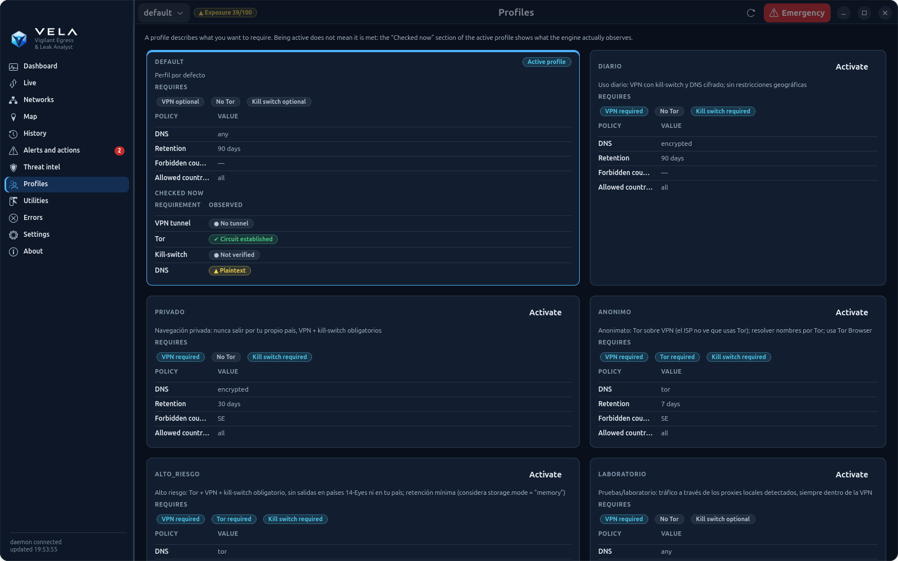
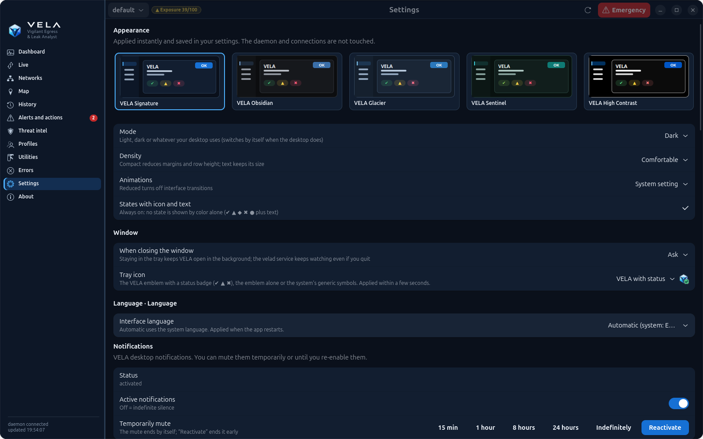
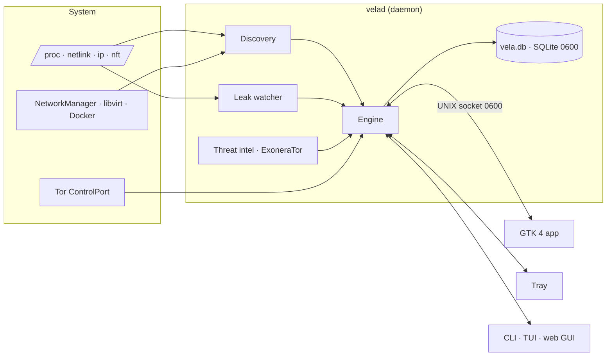

<p align="center">
  <picture>
    <source media="(prefers-color-scheme: light)" srcset="docs/brand/banner-light.png">
    
  </picture>
</p>

> [!WARNING]
> **`windows-lite` branch — work in progress.** It will be a light Windows version (public IP, connections and leaks, DNS, web GUI, autostart, `install.ps1`). So far only the Windows data layer exists (`vela/winsys.py`), tested with simulated Windows output (`tests/test_windows.py`); it **does not run on Windows yet** and has not been tried on a real Windows machine. Everything else is identical to `master` (Linux).

<h1 align="center">VELA</h1>

<p align="center">
  <b>English</b> · <a href="README.es.md">Español</a> · <a href="README.ca.md">Català</a> · <a href="README.pt.md">Português</a> · <a href="README.fr.md">Français</a> · <a href="README.de.md">Deutsch</a>
</p>

<p align="center">
  <b>V</b>igilant <b>E</b>gress &amp; <b>L</b>eak <b>A</b>nalyst<br>
  <i>Your network identity, always on watch.</i>
</p>

<p align="center">
  
  
  
  
  
  
  
</p>

<p align="center">
  
</p>

VELA watches **where your traffic leaves from** (router, VPN, proxies, Tor and DNS), **how long** you use each
exit, **the leaks** that expose you and **the reputation** of the IPs you talk to. All local, on Linux, with no
external dependencies: it discovers what is on your machine and only enables what actually exists.

> **Linux only.** VELA reads the network straight from the Linux kernel (/proc, netlink, nftables, systemd). Windows versions are being developed in separate branches: [`windows-lite`](../../tree/windows-lite) (light: public IP, connections and leaks, DNS, web GUI) and [`windows`](../../tree/windows) (full port).

| Letter | What it does |
|---|---|
| **V**igilant | Always-on daemon, leak watcher every 2 s, kernel events (netlink) and tray notifications |
| **E**gress | Tracks every exit: local IP, router WAN, public IP, VPN, proxies, Tor circuits and DNS, with sessions, `00d 00h 00m 00s` counters and no-repeat rotation |
| **L**eak | Detects what exposes you: connections outside the tunnel, plaintext DNS, IPv6, WebRTC, kill-switch, non-isolated VM networks |
| **A**nalyst | Enriches and explains: local geolocation, VirusTotal, Shodan, GreyNoise, Censys, ExoneraTor and the path of every connection |

*Vela* is Spanish for the candle that stays lit while everyone sleeps: **estar en vela** means to keep watch.

> The screenshots use real **anonymised** data: IPs in documentation ranges (RFC 5737/3849), made-up MACs,
> Wi-Fi names, networks and Tor relays, and shifted times.

---

## Contents

- [Features](#features)
- [Privacy by design](#privacy-by-design)
- [Themes](#themes)
- [Languages](#languages)
- [Installation](#installation)
- [Usage](#usage)
- [Architecture](#architecture)
- [Status and limitations](#status-and-limitations)
- [Development and repository security](#development-and-repository-security)

## Features

### Dashboard
At a glance: VPN tunnel, public IP, kill-switch, DNS, current session with its counter, the **observable
exposure** (0–100), connections by state, egress interface traffic, the full **topology** (device → router →
Internet → Tor guard → middle → exit), active alerts, processes with most connections, events of the last 24 h
and time per exit country.

### Live: how your traffic travels
Every connection is classified every 2 s as **protected**, **leak** or **direct**, with the responsible
program, country, VirusTotal score and quick copy. The flow diagram shows **program → local layer (direct /
proxy / Tor) → egress (VPN tunnel or not) → what the destination sees**, and explains in plain words what it
means: for example, that a *local* proxy does not change the IP the destination sees.

<p align="center"></p>

### The app's own OpenStreetMap map
Web Mercator map built from OSM data and **bundled with the app** (coastlines, countries, capitals and cities,
4 levels of detail, place names in your language). It works offline: viewing the map **requests no tiles from
any server**, so it doesn't reveal which areas you look at. Layers for live connections, VPN chain, Tor
circuit, history and time per country; zoom, drag and click for details.

<p align="center"></p>

### Threat intel with ExoneraTor
GreyNoise, VirusTotal, Shodan and Censys on your history or a list of IPs, with flag, organisation and **Tor
node detection** (your own Tor's consensus, the official exit list and ExoneraTor). Lookups only go out via the
VPN or Tor; keys are stored in `~/.config/vela/secrets.toml` (0600).

<p align="center"></p>

### More screens

| Networks | Alerts and actions |
|---|---|
|  |  |
| Wi-Fi, LAN, VPN, Docker and VMs; seen devices (ARP, no scanning), VM network isolation and known-network fingerprints | Every problem with **specific commands** to fix it. VELA never runs them: you copy, review and run them |
| **History** | **Profiles** |
|  |  |
| Egress sessions with duration, interface, VPN, public IP and why they ended | Profiles generated from what's on your system (daily, private, anonymous, high risk, lab) |

<details>
<summary><b>Settings and consents</b></summary>
<p align="center"></p>
</details>

It also includes a **tray icon** (status, profile, Tor, emergency and notifications), a terminal **TUI**, a
local **web GUI** (127.0.0.1 only, with a token) and a complete **CLI** with `--json` output.

## Privacy by design

- **Observe-only by default.** Anything that generates traffic to third parties or changes the system sits
  behind an explicit consent (`[consent]` or the Settings page).
- **Nothing leaves from your real IP without permission:** the public IP is checked through the tunnel; threat
  intel, the map and ExoneraTor go via the VPN or Tor.
- **Local:** geolocation with Tor's and the system's databases, bundled map, no CDNs, no telemetry.
- **Secrets:** keys in a 0600 file that is never shown nor sent to the daemon; IPC over a 0600 UNIX socket with
  peer-user checks (`SO_PEERCRED`).
- **Honesty:** the database is **not** encrypted unless you install SQLCipher (0600 permissions only), and
  geolocation is approximate (country level).

<details>
<summary><b>Available consents</b></summary>

By default the tool only observes. These actions are enabled under `[consent]`; see
[config.example.toml](config.example.toml):

| Key | Why it is off |
|---|---|
| `direct_ip_checks` | The echo service would see your real IP |
| `active_dns_leak_test` | An external service sees your IP and your resolvers |
| `allow_rotation_changes` | Changes real connections |
| `allow_killswitch` | Applies nftables rules (with `sudo -n` or pkexec) |
</details>

## Themes

The desktop app has **five themes, each in light and dark**, plus *Follow system*: **VELA Signature** (official, from the
brand's navy, blue and cyan), **Obsidian** (graphite for SOC work), **Glacier** (cool and analytical), **Sentinel**
(petrol green) and **High Contrast** (text ≥ 7:1). Choose one in **Settings → Appearance**, along with density (comfortable or
compact) and animations. It applies instantly, without restarting anything.

Colors are *design tokens* shared by the GTK app, its charts and map, and the web GUI. Their meaning never changes between
themes: protected is green, direct (real IP) is orange, proxy is indigo, Tor is violet and a leak is red, always with an icon and text.
All 790 contrast checks (WCAG 2.2 AA; AAA for High Contrast text) are computed and enforced by the tests. See
[docs/THEMES.md](docs/THEMES.md).

<p align="center"></p>

## Languages

The whole interface (desktop app, tray, CLI, TUI, web GUI, alerts and explanations) is available in
**English, Spanish, Catalan, Portuguese, French and German**, including country and city names on the map.

- **Automatic:** follows the system language (`LANG`); if it isn't one of the six, English.
- **Choose it:** Settings → Language (the app restarts and the daemon switches instantly), `vela --lang de status`
  or the `VELA_LANG=fr` variable.
- **Translate:** catalogues live in [`vela/locale/`](vela/locale) (`{"Spanish source text": "translation"}`);
  `python3 -m vela.i18n check` reports what's missing and any translation that loses a `{…}` variable.

## Installation

Requirements: **Linux** and **Python ≥ 3.10**. The desktop app uses GTK 4 + libadwaita (PyGObject) and the
tray uses AyatanaAppIndicator3, already present on GNOME/Ubuntu.

```bash
git clone https://github.com/j0rd1s3rr4n0/VELA.git && cd VELA
./install.sh          # installs the app, the velad service, the tray icon and the launcher (no pip, no root)
```

Update: **Settings → Updates** in the app or `vela update` (checks your clone's remote over Tor or the VPN, never on its own, shows the new commits and only fast-forwards; `vela update --check` changes nothing) · Uninstall: `./install.sh --uninstall` (`--purge` also deletes your data). It detects missing system packages (apt, dnf, pacman, zypper) and asks before installing them; see `./install.sh --help`.

It also works without installing, with `python3 -m vela <command>`.

Optional:

- `pip install geoip2`, with the GeoLite2-City/ASN `.mmdb` databases in `~/.local/share/GeoIP/`, for city and ASN;
- `pip install sqlcipher3` for real database encryption.

To observe Tor you need to be able to read its control cookie:

```bash
sudo usermod -aG debian-tor $USER
```

## Usage

```bash
vela app               # desktop application
vela status            # chain, IPs, Tor, DNS, session, counters, rotation, alerts
vela leakwatch         # public IP and IP leaks in real time
vela routes            # how your traffic travels: program → direct/proxy/Tor → VPN → destination
vela tui               # interactive terminal
```

<details>
<summary><b>All commands</b></summary>

| Command | What it does |
|---|---|
| `vela tray [--install \| --remove]` | **Tray icon** (AppIndicator): VPN status, IP, exposure and leaks; open the app, check IP/leaks, profile, Tor, emergency, quick settings and notifications |
| `vela daemon enable\|disable` | Start the daemon with the session (systemd user service) so no history is lost |
| `vela app [--install]` | **Native desktop application** (GTK 4 + libadwaita); `--install` adds the launcher to the menu |
| `vela leakwatch [--once] [--all]` | **Public IP and IP leaks in real time**: every connection classified as protected / leak / direct, with the responsible program |
| `vela networks [-n]` | All your networks (Wi-Fi, LAN, VPN, Docker, VMs): traffic, gateway, SSID, seen devices, VM isolation |
| `vela fix` | Specific commands to fix each detected problem (runs nothing) |
| `vela intel scan [IP…] [--file f] [--history]` | GreyNoise / VirusTotal / Shodan / Censys on your history or a list (`intel keys`, `intel set-key`, `intel show`, `intel targets`) |
| `vela map [status\|build]` | **The app's own OpenStreetMap map, bundled** (`vela/data/`, works offline in the native app, TUI and web GUI). `build` updates it with recent data: download via Tor or the VPN (`--via direct` only if you ask, `--file` for an already downloaded zip); viewing the map requests no tiles from anyone |
| `vela update [--check\|--status] [--via auto\|tor\|vpn\|direct]` | Updates from your git clone: only when you ask, over Tor or the VPN, fast-forward only, with the new commits shown first |
| `vela network` | Interfaces, classified addresses (private, CGNAT, ULA…), routes and policy routing |
| `vela vpn list` / `vela proxy list` | Detected VPNs and proxies, with their status |
| `vela tor status` | Circuits with guard, middle and exit; guards; external check |
| `vela dns check [--active]` | Per-link resolvers, split DNS, DoT and leaks |
| `vela ip [--route tor]` | Public IP per route (with consent) and WAN IP via UPnP |
| `vela sessions` / `vela counters` / `vela history` | Sessions, `00d 00h 00m 00s` counters and timeline |
| `vela watch` | Real-time events (requires the daemon) |
| `vela rotate [tor\|proxy\|vpn] [--dry-run]` | Safe rotation or rotation status |
| `vela leaks check [--active]` | Diagnostics with evidence, method, limitations and confidence |
| `vela profiles [activate X \| correlation \| generate [--write]]` | Profiles, correlation risk and profile generation tailored to the system |
| `vela audit [--html f.html]` | Privacy Audit |
| `vela stats --period day\|week\|month` | Statistics and anomalies |
| `vela export --format json\|csv\|html --out …` | Export the history |
| `vela killswitch preview\|apply --yes\|release` | nftables kill-switch (own table) |
| `vela panic` / `vela resume` | Emergency mode (deletes no data) |
| `vela purge --days N --yes` | Delete old history |
| `vela config show\|init\|edit` / `vela doctor` | Configuration and installation diagnostics |

Every command accepts `--json` and `--lang`. Without the daemon, the CLI, TUI and GUI run the engine in their
own process but don't record sessions.
</details>

## Architecture



Details in [ARCHITECTURE.md](ARCHITECTURE.md) (Spanish).

## Status and limitations

<details>
<summary><b>Capability matrix</b> (validated 2026-10-09 on Ubuntu 26.04, Python 3.14)</summary>

Legend:

- ✅ implemented and tested (automated tests and/or real run on this machine);
- 🟡 implemented, real-world validation pending;
- ⛔ not available due to an environment limitation;
- ⏳ pending.

| Feature | Status | Evidence |
|---|---|---|
| Capability discovery (5 states) | ✅ | tests + real `vela discover` |
| Interfaces, routes, effective route, IPv4/IPv6/CGNAT/ULA classification | ✅ | tests + real `vela network` |
| Netlink events | ✅ | real daemon: "netlink: active events" |
| Tor: SAFECOOKIE, circuits, guard/middle/exit, streams, guards | ✅ | fake server + 22 real circuits |
| Tor: exit IP via check.torproject.org (IsTor) | ✅ | real: 185.220.101.140 confirmed |
| Tor: NEWNYM with rate limit and no exit repetition | ✅ / 🟡 | tested with mocks and real dry-run; real NEWNYM not run (no consent) |
| Per-link DNS (systemd-resolved), split DNS, DoT | ✅ | tests + real `vela dns check` |
| Effective and encrypted DNS: WARP DoH, cloudflared, dnscrypt/stubby, DoT, Firefox/Chromium DoH; DoH route | ✅ | tests + real: WARP DoH via `proton0` |
| VPN client kill-switches (ProtonVPN, Mullvad, NordVPN) + route check «what if the tunnel drops?» | ✅ / 🟡 | real ProtonVPN verified (IPv4/IPv6); Mullvad/NordVPN not validated (not installed) |
| Snap/flatpak VPN clients (ProtonVPN) and VPN server from the connection name | ✅ | real: `ProtonVPN CH-DE#2` |
| Profile generation (daily, private, anonymous, high risk, lab) and `require_killswitch`/`dns_policy` policies | ✅ | tests + real profiles evaluated live |
| Passive leaks: IPv6, tunnel, DNS, exposed proxy, time zone, MAC, kill-switch | ✅ | tests + real findings |
| Monitoring of all networks: traffic, ARP neighbours (no scanning), network fingerprint, gateway MAC change (ARP spoofing), new devices, open Wi-Fi, libvirt network isolation | ✅ | tests + real: detected `pentest-isolated` with NAT |
| Public IP only through the tunnel (`public_ip.require_tunnel`) | ✅ | tests + real: skipped when the VPN dropped |
| Real-time public IP (every 60 s with tunnel + immediately on route change) and «the Internet sees your real IP» detection | ✅ / 🟡 | tests; real validation pending a VPN reconnection |
| Real-time leak watcher (kernel sockets every 2 s, responsible program, DNS leaks, automatic kill-switch reaction) | ✅ | tests + real: 29 direct connections detected with the VPN down |
| Remediation with commands (`vela fix`, GUI with copy button) | ✅ | tests + real run |
| Threat intel: GreyNoise | ✅ | tests + real query via Tor |
| Threat intel: VirusTotal / Shodan | ✅ | validated with the user's real keys (VT score, Shodan ports) |
| Threat intel: Censys | 🟡 | implemented and tested with simulated responses; no key to validate |
| Geolocation with flag, organisation and VT score in Live and Threat intel | ✅ | tests + real data |
| Tray icon with status and controls + desktop notifications | ✅ | real: registered in the GNOME tray, menu verified over D-Bus |
| Persistence: daemon with the session (systemd), settings and API keys from the app | ✅ | tests + active service |
| Native GTK 4 + libadwaita GUI (dashboard, networks, cairo map, history, alerts, intel, profiles, notifications) | ✅ | real GTK-rendered screenshots |
| Active DNS leak test (bash.ws) | 🟡 | implemented; not run (requires consent) |
| WebRTC test in the GUI | 🟡 | implemented; not run in a browser |
| Direct / proxy public IP | 🟡 | implemented; disabled without consent |
| WAN IP via UPnP-IGD + CGNAT/double NAT | 🟡 | implemented; your router doesn't answer UPnP |
| Sessions, intervals, counters, persistence, recovery | ✅ | tests + real daemon |
| Rotation engine (selector, cooldown, exclusions, limits, rollback, fail-closed) | ✅ | 12 tests with a simulated backend |
| NetworkManager / wg-quick / Mullvad VPN adapters | 🟡 | implemented; not validated. ProtonVPN (GUI app v4) has no CLI to switch servers: observe only |
| Forwarder to rotate proxies | ✅ | test with local upstreams |
| nftables kill-switch | ✅ / 🟡 | rules tested and real preview; not applied (consent and sudo) |
| Profiles, Correlation Risk Engine, anomalies, statistics, Exposure Score | ✅ | tests |
| JSON/CSV/HTML export, Privacy Audit, doctor | ✅ | real run |
| IPC (0600, SO_PEERCRED, whitelist, events) | ✅ | tests + real permissions |
| CLI | ✅ | every command run against the real system |
| TUI (curses) | ✅ / 🟡 | real start-up and rendering; interactive navigation not verified by me |
| Web GUI (token, Host/Origin, CSP, dashboard, map, timeline) | ✅ | tests + real browser with no console errors |
| Traffic routes (program → proxy/Tor/direct → VPN → destination), `vela routes` + diagram in Live | ✅ / 🟡 | tests + real data (Tor and direct without VPN); real local proxy and chained proxy only with simulated tests (no proxy on the machine) |
| HTTP proxy vs web server (CONNECT probe) | ✅ | tests + real :8080 identified as a web server |
| Bundled OpenStreetMap base map (Mercator, 4 levels of detail, coastlines, countries, capitals and cities; offline; also TUI and web GUI) | ✅ | tests + real OSM data downloaded via Tor and native app screenshots; web GUI checked with tests and `node --check` only |
| Interface in 6 languages (en, es, ca, pt, fr, de) with live switching in the daemon and translated map names | ✅ | tests (complete catalogues, variables intact) + real screenshots in all 6 languages |
| Country borders on the map | ⏳ | not included (OSM border data weighs hundreds of MB) |
| City / ASN | ⛔ | no `.mmdb` database on the system (optional) |
| Database encryption | ⛔ | SQLCipher not installed: the database is **not** encrypted, only protected by 0600 permissions |
| Windows and macOS | ⛔ | this branch is Linux-only; Windows: `windows-lite` and `windows` branches |
| PAC/WPAD proxies: script evaluation | ⏳ | detected, but the PAC script is not evaluated |
</details>

- Geolocation is local and approximate (country). **It is not the real physical location** of the servers.
- `NEWNYM` does not guarantee a different exit. The tool never touches guards nor sets `ExitNodes`.
- Tor Browser, if detected on port 9151, is only observed: its rotation is "New Identity".
- Separating network profiles doesn't prevent correlation through cookies, accounts or browser fingerprint.

## Development and repository security

```bash
python3 -m unittest discover -s tests -t .
```

171 tests with mocks and simulated backends (fake Tor control server with real SAFECOOKIE, rotation with
failures and rollback, simulated leaks, IPC, GUI security, fake SOCKS5 proxy, OSM map, migration, git guard and
translations). None touches real connectivity.

The repository ships a guard (`vela/gitguard.py`) that runs automatically through the hooks in `.githooks/`
(`git config core.hooksPath .githooks` after cloning):

- **pre-commit**: blocks personal files (`.devlogs/`, databases, `secrets.toml`, `config.toml`, app settings, Tor
  cookies, VPN configurations, keys…), secret patterns (private keys, WireGuard PrivateKey, GitHub/AWS/Google/Slack
  tokens, `api_key = "…"`) and the **exact values of your machine**: your API keys and real IPs, without storing
  them anywhere.
- **pre-push**: checks every commit about to be published (including things deleted later, because they remain in
  history) and blocks if the author email isn't anonymous (`…@users.noreply.github.com`).
- `python3 -m vela.gitguard all`: checks everything already in the repository.

It never shows the secret it found, only file, line and type. `user.useConfigOnly=true` stops git from inventing
your identity from your username and hostname.

### Migrating from OPSecTools

VELA used to be called *OPSecTools* (`opsec`/`opsecd` commands). The first `vela` command moves your data
(`~/.config`, `~/.local/share`, `~/.local/state` and `~/.cache` from `opsectools` to `vela`, with `opsec.db` →
`vela.db`), replaces the `opsecd` service with `velad` if it was enabled and renews the tray autostart and the
launcher. It never overwrites newer data and does nothing while the old daemon is still running.

## Licence and credits

- Map data: © OpenStreetMap contributors, [ODbL 1.0](https://www.openstreetmap.org/copyright)
  (see [vela/data/OSM-ATTRIBUTION.txt](vela/data/OSM-ATTRIBUTION.txt)).
- Code licence: to be decided.
