<!-- <p align="center">
  
</p>-->

<p align="center">
  <picture>
    <source media="(prefers-color-scheme: light)" srcset="vela/data/brand/vela-wordmark-on-light.png">
    
  </picture>
</p>

<p align="center">
  <a href="README.md">English</a> · <a href="README.es.md">Español</a> · <a href="README.ca.md">Català</a> · <b>Português</b> · <a href="README.fr.md">Français</a> · <a href="README.de.md">Deutsch</a>
</p>

<p align="center">
  <b>V</b>igilant <b>E</b>gress &amp; <b>L</b>eak <b>A</b>nalyst<br>
  <i>A sua identidade de rede, sempre em vigília.</i>
</p>

<p align="center">
  
  
  
  
  
  
  
  
</p>

<p align="center">
  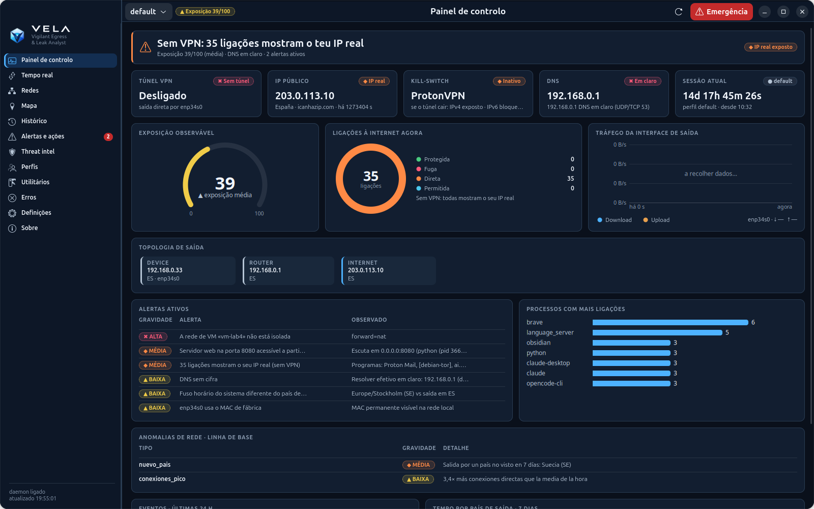
</p>

O VELA vigia **por onde sai o seu tráfego** (router, VPN, proxies, Tor e DNS), **quanto tempo** usa cada saída,
**as fugas** que o expõem e **a reputação** dos IPs com que comunica. Tudo local, em Linux, sem dependências
externas: descobre o que existe no seu equipamento e só ativa o que realmente está lá.

> **Só Linux.** O VELA lê a rede diretamente do kernel do Linux (/proc, netlink, nftables, systemd). As versões para Windows são desenvolvidas em ramos à parte: [`windows-lite`](../../tree/windows-lite) (ligeira: IP público, ligações e fugas, DNS, GUI web) e [`windows`](../../tree/windows) (versão completa).

| Letra | O que faz |
|---|---|
| **V**igilant | Daemon permanente, vigilante de fugas a cada 2 s, eventos do kernel (netlink) e avisos na bandeja |
| **E**gress | Segue cada saída: IP local, WAN do router, IP público, VPN, proxies, circuitos Tor e DNS, com sessões, contadores `00d 00h 00m 00s` e rotação sem repetições |
| **L**eak | Deteta o que o expõe: ligações fora do túnel, DNS em claro, IPv6, WebRTC, kill-switch, redes de VMs sem isolamento |
| **A**nalyst | Enriquece e explica: geolocalização local, VirusTotal, Shodan, GreyNoise, Censys, ExoneraTor e o percurso de cada ligação |

*Vela* é a chama que continua acesa quando tudo dorme: **estar en vela** (em espanhol) é ficar de vigia.

> As capturas usam dados **anonimizados**: endereços privados e de documentação, MACs, SSIDs, redes,
> nomes de processos e relays do Tor inventados, e horas deslocadas.

---

## Conteúdo

- [Funcionalidades](#funcionalidades)
- [Privacidade desde a conceção](#privacidade-desde-a-conceção)
- [Temas](#temas)
- [Idiomas](#idiomas)
- [Instalação](#instalação)
- [Utilização](#utilização)
- [Arquitetura](#arquitetura)
- [Estado e limitações](#estado-e-limitações)
- [Desenvolvimento e segurança do repositório](#desenvolvimento-e-segurança-do-repositório)

## Funcionalidades

### Painel de controlo
Num relance: túnel VPN, IP público, kill-switch, DNS, sessão atual com o seu contador, a **exposição observável**
(0–100), ligações por estado, tráfego da interface de saída, a **topologia** completa (equipamento → router →
Internet → guard → middle → exit do Tor), alertas ativos, processos com mais ligações, eventos das últimas 24 h e
tempo por país de saída.

### Tempo real: como viaja o seu tráfego
Cada ligação é classificada a cada 2 s como **protegida**, **fuga** ou **direta**, com o programa responsável, o
país, a pontuação do VirusTotal e cópia rápida. O diagrama de fluxo mostra **programa → camada local (direto /
proxy / Tor) → saída (túnel VPN ou não) → o que o destino vê**, e explica em frases o que significa: por exemplo,
que um proxy *local* não muda o IP que o destino vê.

<p align="center">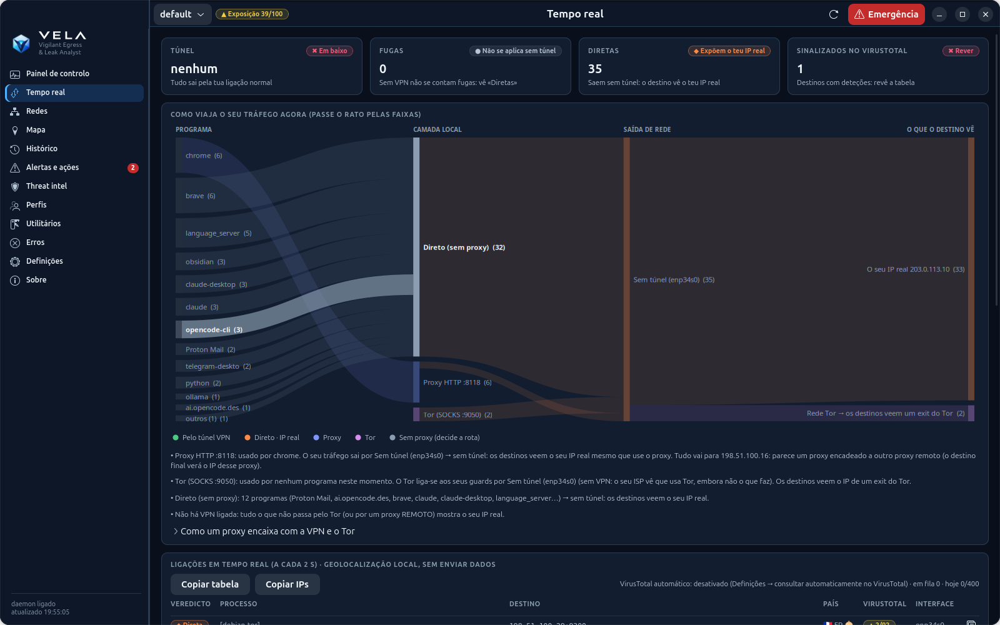</p>

### Mapa próprio do OpenStreetMap
Mapa Web Mercator feito com dados do OSM e **incorporado na app** (costas, países, capitais e cidades, 4 níveis de
detalhe, nomes no seu idioma). Funciona sem ligação: ver o mapa **não pede mosaicos a nenhum servidor**, por isso
não revela que zonas consulta. Camadas de ligações em direto, cadeia VPN, circuito Tor, histórico e tempo por
país; zoom, arrastar e detalhe ao clicar.

<p align="center">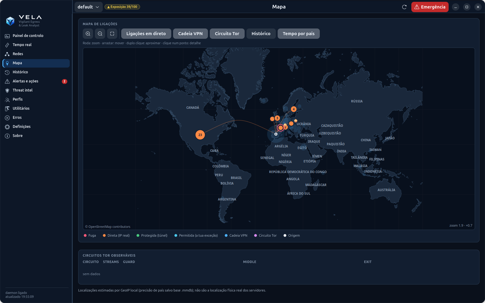</p>

### Threat intel com ExoneraTor
GreyNoise, VirusTotal, Shodan e Censys sobre o seu histórico ou uma lista de IPs, com bandeira, organização e
**deteção de nós Tor** (consenso do seu próprio Tor, lista oficial de exits e ExoneraTor). As consultas só saem pela
VPN ou pelo Tor; as chaves são guardadas em `~/.config/vela/secrets.toml` (0600).

<p align="center">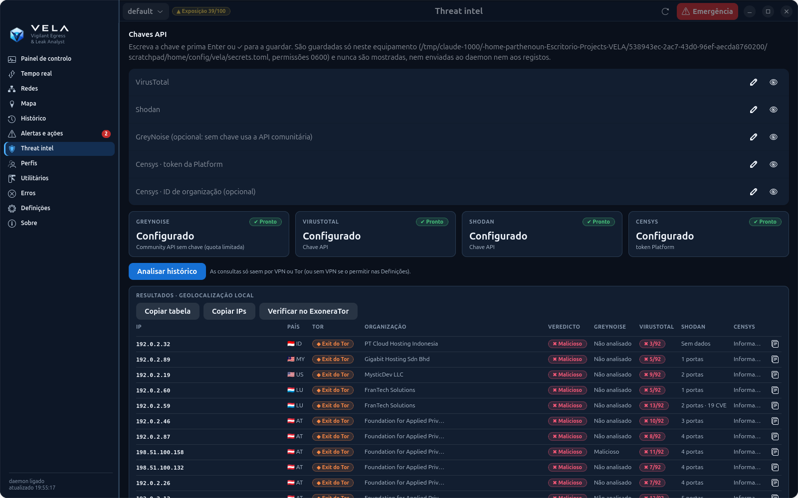</p>

### Mais ecrãs

| Redes | Alertas e ações |
|---|---|
| 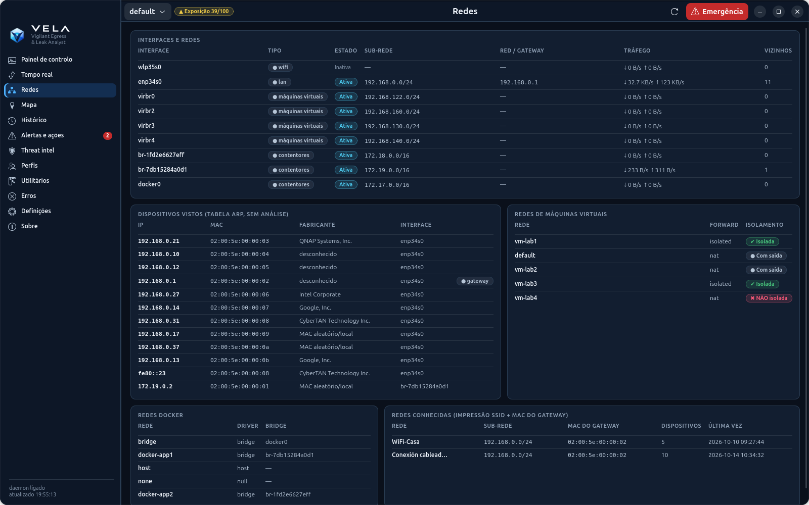 | 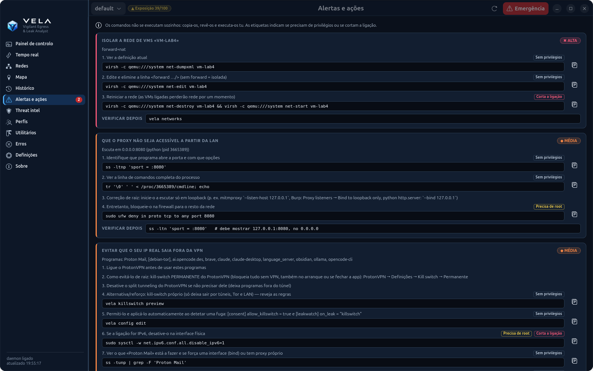 |
| Wi-Fi, LAN, VPN, Docker e VMs; dispositivos vistos (ARP, sem análise), isolamento de redes de VMs e impressão de redes conhecidas | Cada problema com **comandos concretos** para o corrigir. O VELA nunca os executa: é você que os copia, revê e executa |
| **Histórico** | **Perfis** |
| 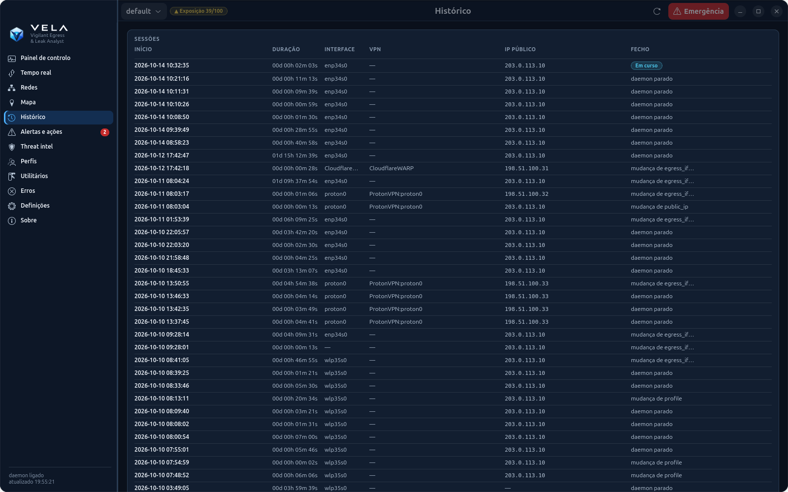 | 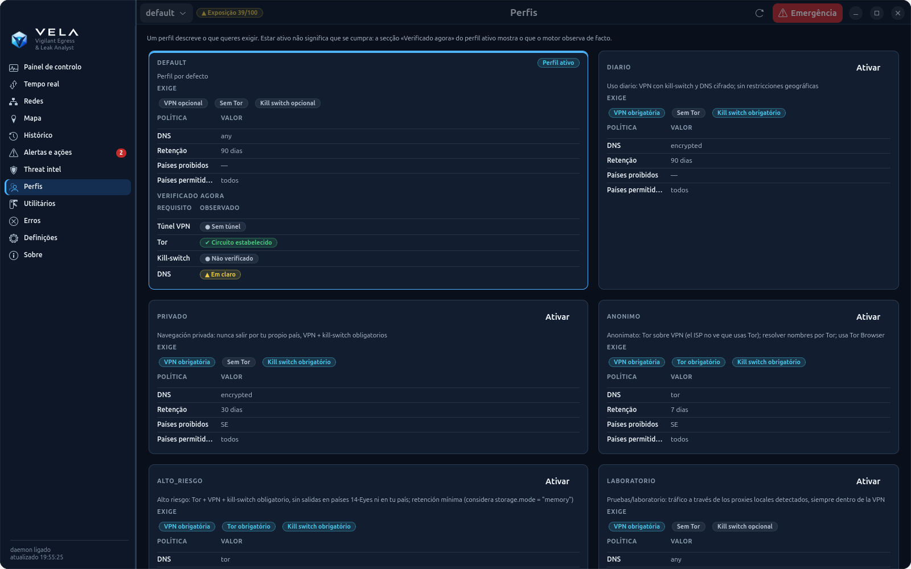 |
| Sessões de saída com duração, interface, VPN, IP público e motivo do fecho | Perfis gerados conforme o que existe no seu sistema (diário, privado, anónimo, alto risco, laboratório) |
| **Utilitários** | **Erros e auditoria** |
| 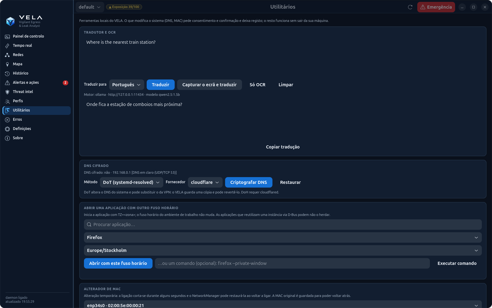 | 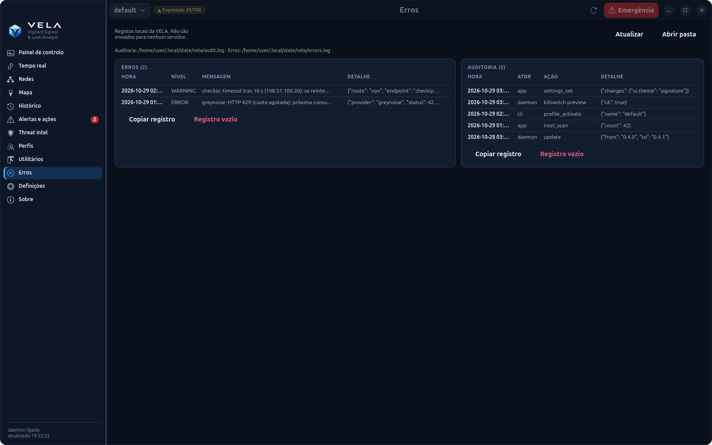 |
| Ferramentas locais: tradutor + OCR (LLM local), DNS cifrado (DoT/DoH), abrir uma app noutro fuso horário, alterador de MAC, dependências opcionais e exportar/importar dados | Registo local de erros do VELA e auditoria de cada ação (quem fez o quê e quando); não é enviado para lado nenhum |

<details>
<summary><b>Definições, aparência, janela e bandeja, sobre</b></summary>
<p align="center">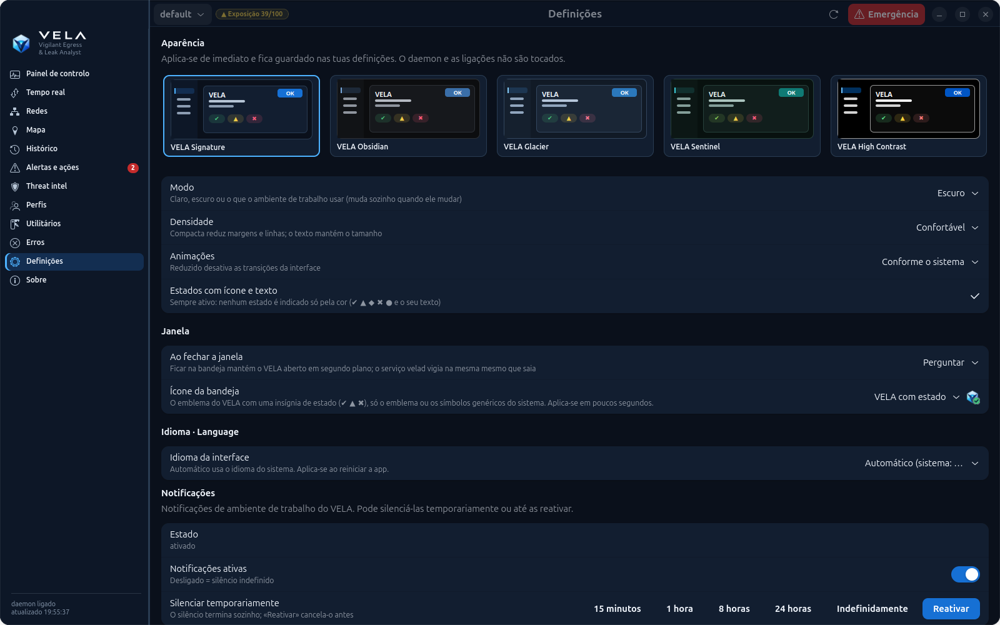</p>
<p align="center">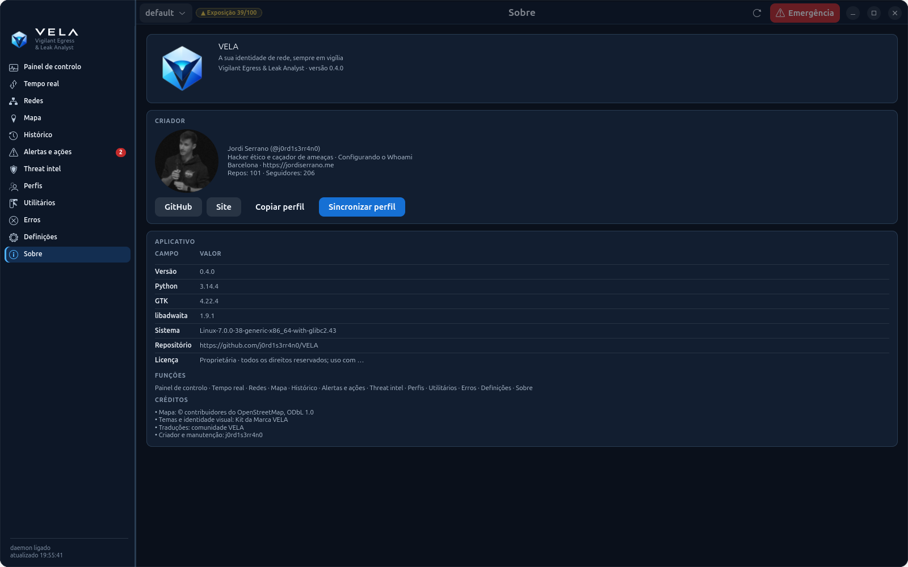</p>
</details>

Inclui também **ícone na bandeja** (estado, perfil, Tor, emergência e notificações; mostra o emblema do VELA com uma insígnia de estado ✔ ▲ ✖, só o emblema ou os símbolos do sistema, a escolher em Definições → Janela, onde também decide se ao fechar a janela o VELA fica na bandeja), **TUI** no terminal, **GUI
web** local (só 127.0.0.1, com token) e uma **CLI** completa com saída `--json`.

### Ferramentas

- **Tradutor + OCR** — um LLM local pequeno (Ollama ou llama.cpp) traduz qualquer texto; selecione uma região do ecrã e o tesseract lê-a. Nada sai da máquina a menos que ative uma API remota.
- **Dados** — exporte/importe cópias completas (histórico, ajustes, configuração e opcionalmente segredos) e apague apenas o histórico ou todos os dados da VELA, com confirmação.
- **Anomalias de rede** — linha de base local de volume, fan-out de ligações, processos/países/portas novos, mudanças de rota e de DNS.
- **DNS cifrado** — um clique para ativar DoT (systemd-resolved) ou DoH (cloudflared) com cópia, verificação e reversão; avisa antes de substituir o DNS da VPN.
- **Apps com outro fuso horário** — abra qualquer app `.desktop` ou comando com `TZ=Asia/Tokyo` sem alterar o relógio do ambiente de trabalho.
- **Alterador de MAC** — MAC aleatória ou manual, com a original guardada e restauração num clique.
- **Dependências opcionais** — deteta e instala pacotes de OCR, captura, MAC, DNS e LLM com confirmação e o comando exato à vista.
- **Registos** — separador **Erros** com dois ficheiros persistentes: `audit.log` (ações suas ou do daemon) e
  `errors.log` (exceções não controladas e falhas da UI/CLI), com rotação, cópia e eliminação.
- **Controlo de notificações** — ative ou silencie os avisos de ambiente de trabalho 15 min, 1 h, 8 h, 24 h ou
  indefinidamente nas Definições, na bandeja ou com `vela notify`. Os silêncios temporários expiram sozinhos.
- **About** — versão, créditos e perfil do criador, offline por predefinição com sincronização opcional do GitHub.
- **Perfis adaptáveis** — ao arrancar, a VELA cria os perfis `diario`, `privado`, `anonimo`, `alto_riesgo` e
  `laboratorio` conforme o que o equipamento tiver (VPN, kill-switch, Tor, proxies e DNS cifrado). São recalculados
  quando o sistema muda e podes escrevê-los em `config.toml` com `vela profiles generate --write`.

## Privacidade desde a conceção

- **Por omissão só observa.** Tudo o que gera tráfego para terceiros ou altera o sistema exige um consentimento
  explícito (`[consent]` ou a página de Definições).
- **Nada sai pelo seu IP real sem permissão:** o IP público é verificado pelo túnel; threat intel, mapa e
  ExoneraTor vão pela VPN ou pelo Tor.
- **Local:** geolocalização com as bases do Tor e do sistema, mapa incorporado, sem CDN nem telemetria.
- **Segredos:** chaves num ficheiro 0600 que nunca é mostrado nem enviado ao daemon; IPC por socket UNIX 0600 com
  verificação do utilizador (`SO_PEERCRED`).
- **Honestidade:** a base de dados **não** está cifrada se não instalar o SQLCipher (só permissões 0600), e a
  geolocalização é aproximada (país).

<details>
<summary><b>Consentimentos disponíveis</b></summary>

Por omissão a ferramenta só observa. Estas ações ativam-se em `[consent]`; veja
[config.example.toml](config.example.toml):

| Chave | Porque está desativada |
|---|---|
| `direct_ip_checks` | O serviço de eco veria o seu IP real |
| `active_dns_leak_test` | Um serviço externo vê o seu IP e os seus resolvers |
| `allow_rotation_changes` | Altera ligações reais |
| `allow_killswitch` | Aplica regras nftables (com `sudo -n` ou pkexec) |
| `allow_dns_changes` | Modifica `/etc/systemd/resolved.conf.d` para cifrar o DNS |
| `allow_mac_changes` | Altera a MAC de uma interface (corta a ligação alguns segundos) |
| `llm_remote` | Envia texto para uma API de tradução remota |
| `about_profile_lookup` | Consulta api.github.com e descarrega o avatar público |
</details>

## Temas

A app de ambiente de trabalho tem **cinco temas, cada um em claro e escuro**, e o modo *Seguir o sistema*: **VELA Signature**
(oficial, com o azul-marinho, o azul e o ciano da marca), **Obsidian** (grafite para trabalho SOC), **Glacier** (frio e
analítico), **Sentinel** (verde-petróleo) e **High Contrast** (texto ≥ 7:1). Escolhe-se em **Definições → Aparência**, junto com
a densidade (confortável ou compacta) e as animações. Aplica-se de imediato, sem reiniciar nada.

As cores são *design tokens* partilhados pela app GTK, pelos seus gráficos e mapa, e pela GUI web. O significado não muda entre
temas: protegida a verde, direta (IP real) a laranja, proxy a índigo, Tor a violeta e fuga a vermelho, sempre com ícone e texto.
As 790 verificações de contraste (WCAG 2.2 AA; AAA para o texto do High Contrast) são calculadas e exigidas pelos testes. Mais em
[docs/THEMES.md](docs/THEMES.md).

<p align="center"></p>

## Idiomas

Toda a interface (app de ambiente de trabalho, bandeja, CLI, TUI, GUI web, avisos e explicações) está em
**português, espanhol, inglês, catalão, francês e alemão**, incluindo os nomes de países e cidades do mapa.

- **Automático:** usa o idioma do sistema (`LANG`); se não for nenhum dos seis, inglês.
- **Escolher:** Definições → Idioma (a app reinicia e o daemon muda de imediato), `vela --lang pt status` ou a
  variável `VELA_LANG=pt`.
- **Traduzir:** os catálogos estão em [`vela/locale/`](vela/locale) (`{"texto em espanhol": "tradução"}`);
  `python3 -m vela.i18n check` indica o que falta e se alguma tradução perde uma variável `{…}`.

## Instalação

Requisitos: **Linux** e **Python ≥ 3.10**. A app de ambiente de trabalho usa GTK 4 + libadwaita (PyGObject) e a
bandeja AyatanaAppIndicator3, já presentes no GNOME/Ubuntu.

**Autoinstalação numa linha** (descarrega o script, instala git/curl se faltarem, clona ou atualiza a VELA e
executa `install.sh`):

```bash
curl -fsSL https://raw.githubusercontent.com/j0rd1s3rr4n0/VELA/master/autoinstall.sh | bash
```

Usa o URL **raw**, não a página `/blob/` do GitHub. As opções vão depois de `bash -s --`:

```bash
# acrescenta OCR, captura, MAC e Ollama + qwen2.5:1.5b
curl -fsSL https://raw.githubusercontent.com/j0rd1s3rr4n0/VELA/master/autoinstall.sh | bash -s -- --with-all

# instala noutra pasta e não arranca serviço nem bandeja
curl -fsSL https://raw.githubusercontent.com/j0rd1s3rr4n0/VELA/master/autoinstall.sh | bash -s -- --dir ~/src/VELA --no-service --no-tray
```

A partir de um clone:

```bash
git clone https://github.com/j0rd1s3rr4n0/VELA.git && cd VELA
./install.sh          # instala a app, o serviço velad, o ícone da bandeja e o lançador (sem pip; também com sudo, instala para o teu utilizador)
./install.sh --with-all   # acrescenta OCR, captura, MAC e Ollama + qwen2.5:1.5b (≈1 GB)
```

`install.sh` instala PyGObject, pycairo, GTK 4, libadwaita, AyatanaAppIndicator3, PolicyKit (`pkexec`), systemd-resolved, iproute2 e um portal XDG; deteta o gestor de pacotes (apt, dnf, pacman, zypper), mostra o comando exato e pergunta antes de alterar o sistema. Opções: `--with-ocr`, `--with-mac`, `--with-llm`, `--with-all`, `--no-optional`, `--no-deps`, `--no-service`, `--no-tray`, `--prefix DIR`. `cloudflared` não costuma estar nos repositórios: instala-o a partir de cloudflare.com apenas se preferires DoH; DoT funciona sem ele.

Podes executar `./install.sh` ou `sudo ./install.sh`: em ambos os casos instala para o utilizador que o invocou (com sudo é redirecionado para `$SUDO_USER`). Os comandos também funcionam com ou sem sudo: `sudo vela …` volta a executar-se como o teu utilizador para que os dados fiquem na tua home e a app possa usar a tua sessão gráfica; as ações privilegiadas continuam a usar `pkexec`/`sudo`. Usa `VELA_KEEP_ROOT=1 sudo vela …` se quiseres mesmo manter root.

Atualizar: **Definições → Atualizações** na app ou `vela update` (consulta o remoto do seu clone por Tor ou pela VPN, nunca por iniciativa própria, mostra os commits novos e só avança; `vela update --check` não altera nada). Executar `./install.sh` sobre um VELA instalado também é uma atualização: primeiro descarrega-se tudo com o VELA a vigiar e depois pergunta como mudar de versão: com o **kill switch até a nova versão arrancar** (só VPN, Tor e LAN) ou **fechando e voltando a abrir sem proteção** (possível fuga de IP durante alguns segundos) · Desinstalar: **Definições → Desinstalar**, clique direito em VELA no menu de aplicações → *Desinstalar o VELA*, ou `vela uninstall` (`--dry-run` mostra o que removeria; `--purge` apaga também os seus dados; o seu repositório git não é tocado). Deteta os pacotes do sistema em falta (apt, dnf, pacman, zypper) e pergunta antes de os instalar; veja `./install.sh --help`.

Também funciona sem instalar, com `python3 -m vela <comando>`.

Opcionais:

- `pip install geoip2`, com as bases GeoLite2-City/ASN `.mmdb` em `~/.local/share/GeoIP/`, para cidade e ASN;
- `pip install sqlcipher3` para cifra real da base de dados.
- `tesseract-ocr` (com os idiomas `spa`/`eng`) e uma ferramenta de captura ou portal XDG para OCR;
- [Ollama](https://ollama.com) com um modelo pequeno (`qwen2.5:1.5b`) para traduzir localmente;
- `cloudflared` apenas se preferires DoH em vez de DoT;
- `macchanger` é opcional: a VELA usa `ip link` quando não está presente.

Para observar o Tor é preciso conseguir ler o seu cookie de controlo:

```bash
sudo usermod -aG debian-tor $USER
```

## Utilização

```bash
vela app               # aplicação de ambiente de trabalho
vela status            # cadeia, IPs, Tor, DNS, sessão, contadores, rotação, alertas
vela leakwatch         # IP público e fugas de IP em tempo real
vela routes            # como viaja o seu tráfego: programa → direto/proxy/Tor → VPN → destino
vela tui               # terminal interativo
```

<details>
<summary><b>Todos os comandos</b></summary>

| Comando | O que faz |
|---|---|
| `vela tray [--install \| --remove]` | **Ícone na bandeja** (AppIndicator): estado da VPN, IP, exposição e fugas; abrir a app, verificar IP/fugas, perfil, Tor, emergência, definições rápidas e notificações |
| `vela daemon enable\|disable` | Iniciar o daemon com a sessão (serviço de utilizador do systemd) para não perder histórico |
| `vela app [--install]` | **Aplicação nativa de ambiente de trabalho** (GTK 4 + libadwaita); `--install` adiciona o lançador ao menu |
| `vela leakwatch [--once] [--all]` | **IP público e fugas de IP em tempo real**: cada ligação classificada como protegida / fuga / direta, com o programa responsável |
| `vela networks [-n]` | Todas as suas redes (Wi-Fi, LAN, VPN, Docker, VMs): tráfego, gateway, SSID, dispositivos vistos, isolamento de VMs |
| `vela fix` | Comandos concretos para corrigir cada problema detetado (não executa nada) |
| `vela intel scan [IP…] [--file f] [--history]` | GreyNoise / VirusTotal / Shodan / Censys sobre o seu histórico ou uma lista (`intel keys`, `intel set-key`, `intel show`, `intel targets`) |
| `vela map [status\|build]` | **Mapa próprio do OpenStreetMap, incorporado na app** (`vela/data/`, funciona sem ligação na app nativa, na TUI e na GUI web). `build` atualiza-o com dados recentes: descarga via Tor ou VPN (`--via direct` só se o pedir, `--file` para um zip já descarregado); ver o mapa não pede mosaicos a ninguém |
| `vela update [--check\|--status] [--via auto\|tor\|vpn\|direct] [--protect killswitch\|restart]` | Atualizar a partir do seu clone git: só quando pede, por Tor ou VPN, só avançando e mostrando antes os commits novos; `--protect killswitch` mantém o kill switch enquanto o VELA está parado para mudar de versão |
| `vela network` | Interfaces, endereços classificados (privado, CGNAT, ULA…), rotas e policy routing |
| `vela vpn list` / `vela proxy list` | VPNs e proxies detetados, com o seu estado |
| `vela tor status` | Circuitos com guard, middle e exit; guards; verificação externa |
| `vela dns check [--active]` | Resolvers por ligação, DNS dividido, DoT e fugas |
| `vela ip [--route tor]` | IP público por via (com consentimento) e IP WAN por UPnP |
| `vela sessions` / `vela counters` / `vela history` | Sessões, contadores `00d 00h 00m 00s` e cronologia |
| `vela watch` | Eventos em tempo real (requer o daemon) |
| `vela rotate [tor\|proxy\|vpn] [--dry-run]` | Rotação segura ou estado da rotação |
| `vela leaks check [--active]` | Diagnósticos com evidência, método, limitações e confiança |
| `vela profiles [activate X \| correlation \| generate [--write]]` | Perfis, risco de correlação e geração de perfis adaptados ao sistema |
| `vela audit [--html f.html]` | Auditoria de privacidade |
| `vela stats --period day\|week\|month` | Estatísticas e anomalias |
| `vela anomalies` | Anomalias de rede da linha de base local |
| `vela logs [show\|clear] [--kind audit\|errors]` | Registo de auditoria e registo de erros |
| `vela notify [status\|on\|off\|mute --for 1h]` | Ativar, silenciar temporária/indefinidamente ou consultar notificações |
| `vela refresh [dns\|network\|leaks\|all…]` | Invalidar caches e recalcular alertas/recomendações agora |
| `vela translate [TEXTO] --to es` | Traduzir com o LLM local (Ollama/llama.cpp) |
| `vela ocr [--image f] --to es` | OCR de uma região ou imagem e tradução |
| `vela data info\|export\|import\|reset` | Cópias, importação e reset (histórico ou todos os dados) |
| `vela deps check\|install [--feature …]` | Detetar e instalar dependências opcionais |
| `vela dns encrypt\|restore [--transport dot\|doh]` | Cifrar o DNS do sistema ou reverter |
| `vela tz list\|launch --app … --tz …` | Abrir uma app ou comando com outro fuso horário |
| `vela mac list\|random\|set\|restore` | Alterar ou restaurar a MAC de uma interface |
| `vela about [--sync]` | Versão, créditos e perfil do criador |
| `vela export --format json\|csv\|html --out …` | Exportar o histórico |
| `vela killswitch preview\|apply --yes\|release` | Kill-switch nftables (tabela própria) |
| `vela panic` / `vela resume` | Modo de emergência (não apaga dados) |
| `vela purge --days N --yes` | Apagar o histórico antigo |
| `vela config show\|init\|edit` / `vela doctor` | Configuração e diagnóstico da instalação |

Qualquer comando aceita `--json` e `--lang`. Sem o daemon, a CLI, a TUI e a GUI usam o motor no seu próprio
processo, mas não registam sessões.
</details>

## Arquitetura

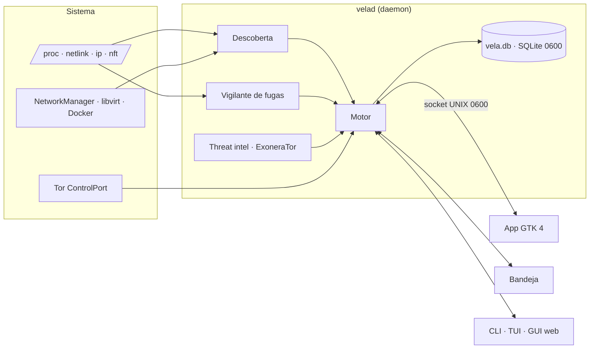

Detalhes em [ARCHITECTURE.md](ARCHITECTURE.md) (em espanhol).

## Estado e limitações

<details>
<summary><b>Matriz de capacidades</b> (validado a 2026-10-09 em Ubuntu 26.04, Python 3.14)</summary>

Legenda:

- ✅ implementado e testado (testes automáticos e/ou execução real neste equipamento);
- 🟡 implementado mas com validação real pendente;
- ⛔ não disponível por uma limitação do ambiente;
- ⏳ pendente.

| Funcionalidade | Estado | Evidência |
|---|---|---|
| Descoberta de capacidades (5 estados) | ✅ | testes + `vela discover` real |
| Interfaces, rotas, rota efetiva, classificação IPv4/IPv6/CGNAT/ULA | ✅ | testes + `vela network` real |
| Eventos netlink | ✅ | daemon real: "netlink: eventos ativos" |
| Tor: SAFECOOKIE, circuitos, guard/middle/exit, streams, guards | ✅ | servidor falso + 22 circuitos reais |
| Tor: IP de saída via check.torproject.org (IsTor) | ✅ | real: 192.0.2.140 confirmado |
| Tor: NEWNYM com limite de frequência e sem repetir exit | ✅ / 🟡 | testado com mocks e dry-run real; NEWNYM real não executado (sem consentimento) |
| DNS por ligação (systemd-resolved), DNS dividido, DoT | ✅ | testes + `vela dns check` real |
| DNS efetivo e cifrado: WARP DoH, cloudflared, dnscrypt/stubby, DoT, DoH do Firefox/Chromium; rota do DoH | ✅ | testes + real: WARP DoH via `proton0` |
| Kill-switch de clientes (ProtonVPN, Mullvad, NordVPN) + verificação por rotas «e se o túnel cair?» | ✅ / 🟡 | ProtonVPN real verificado (IPv4/IPv6); Mullvad/NordVPN não validados (não instalados) |
| Clientes VPN em snap/flatpak (ProtonVPN) e servidor VPN a partir do nome da ligação | ✅ | real: `ProtonVPN XX-YY#2` |
| Geração de perfis (diário, privado, anónimo, alto risco, laboratório) e políticas `require_killswitch`/`dns_policy` | ✅ | testes + perfis reais avaliados em direto |
| Fugas passivas: IPv6, túnel, DNS, proxy exposto, fuso horário, MAC, kill-switch | ✅ | testes + resultados reais |
| Monitorização de todas as redes: tráfego, vizinhos ARP (sem análise), impressão de rede, mudança de MAC do gateway (ARP spoofing), dispositivos novos, Wi-Fi aberta, isolamento de redes libvirt | ✅ | testes + real: detetou `lab-isolated` com NAT |
| IP público só pelo túnel (`public_ip.require_tunnel`) | ✅ | testes + real: omitido ao cair a VPN |
| IP público em tempo real (a cada 60 s com túnel + imediato ao mudar a rota) e deteção de «a Internet vê o seu IP real» | ✅ / 🟡 | testes; validação real pendente de religar a VPN |
| Vigilante de fugas em tempo real (sockets do kernel a cada 2 s, programa responsável, fugas DNS, reação automática com kill-switch) | ✅ | testes + real: 29 ligações diretas detetadas com a VPN em baixo |
| Remediação com comandos (`vela fix`, GUI com botão de copiar) | ✅ | testes + execução real |
| Threat intel: GreyNoise | ✅ | testes + consulta real via Tor |
| Threat intel: VirusTotal / Shodan | ✅ | validados com as chaves reais do utilizador (pontuação VT, portas Shodan) |
| Threat intel: Censys | 🟡 | implementado e testado com respostas simuladas; sem chave para validar |
| Geolocalização com bandeira, organização e pontuação VT em Tempo real e Threat intel | ✅ | testes + dados reais |
| Ícone na bandeja com estado e controlos + notificações de ambiente de trabalho | ✅ | real: registado na bandeja do GNOME e menu verificado por D-Bus |
| Persistência: daemon com a sessão (systemd), definições e chaves API a partir da app | ✅ | testes + serviço ativo |
| GUI nativa GTK 4 + libadwaita (painel, redes, mapa cairo, histórico, alertas, intel, perfis, notificações) | ✅ | capturas reais renderizadas pelo GTK |
| Teste ativo de fugas DNS (bash.ws) | 🟡 | implementado; não executado (requer consentimento) |
| Teste WebRTC na GUI | 🟡 | implementado; não executado num navegador |
| IP público direto / por proxy | 🟡 | implementado; desativado sem consentimento |
| IP WAN por UPnP-IGD + CGNAT/NAT duplo | 🟡 | implementado; o seu router não responde a UPnP |
| Sessões, intervalos, contadores, persistência, recuperação | ✅ | testes + daemon real |
| Motor de rotação (seletor, espera, exclusões, limites, rollback, fail-closed) | ✅ | 12 testes com backend simulado |
| Adaptadores VPN NetworkManager / wg-quick / Mullvad | 🟡 | implementados; não validados. O ProtonVPN (app gráfica v4) não tem CLI para mudar de servidor: só é observado |
| Reencaminhador para rodar proxies | ✅ | teste com upstreams locais |
| Kill-switch nftables | ✅ / 🟡 | regras testadas e pré-visualização real; não aplicado (consentimento e sudo) |
| Perfis, Correlation Risk Engine, anomalias, estatísticas, Exposure Score | ✅ | testes |
| Exportação JSON/CSV/HTML, auditoria de privacidade, doctor | ✅ | execução real |
| IPC (0600, SO_PEERCRED, lista branca, eventos) | ✅ | testes + permissões reais |
| CLI | ✅ | todos os comandos executados contra o sistema real |
| TUI (curses) | ✅ / 🟡 | arranque e renderização reais; navegação interativa não verificada por mim |
| GUI web (token, Host/Origin, CSP, painel, mapa, cronologia) | ✅ | testes + navegador real sem erros de consola |
| Rotas do tráfego (programa → proxy/Tor/direto → VPN → destino), `vela routes` + diagrama em Tempo real | ✅ / 🟡 | testes + dados reais (Tor e direto sem VPN); proxy local real e proxy encadeado só com testes simulados (não há proxy no equipamento) |
| Proxy HTTP vs servidor web (sonda CONNECT) | ✅ | testes + :8080 real identificado como servidor web |
| Mapa base do OpenStreetMap incorporado (Mercator, 4 níveis de detalhe, costas, países, capitais e cidades; sem ligação; também TUI e GUI web) | ✅ | testes + dados OSM reais descarregados via Tor e capturas da app nativa; GUI web verificada só com testes e `node --check` |
| Interface em 6 idiomas (pt, es, en, ca, fr, de) com mudança a quente no daemon e nomes do mapa traduzidos | ✅ | testes (catálogos completos, variáveis intactas) + capturas reais nos 6 idiomas |
| Fronteiras entre países no mapa | ⏳ | não incluídas (os dados de fronteiras do OSM pesam centenas de MB) |
| Cidade / ASN | ⛔ | sem base `.mmdb` no sistema (opcional) |
| Cifra da base de dados | ⛔ | SQLCipher não instalado: a base **não** está cifrada, só protegida por permissões 0600 |
| Windows e macOS | ⛔ | este ramo é só para Linux; Windows: ramos `windows-lite` e `windows` |
| Proxies PAC/WPAD: avaliação do script | ⏳ | deteta-se que existem, mas o script PAC não é avaliado |
</details>

- A geolocalização é local e aproximada (país). **Não é a localização física real** dos servidores.
- `NEWNYM` não garante um exit diferente. A ferramenta nunca toca nos guards nem define `ExitNodes`.
- O Tor Browser, se detetado na porta 9151, só é observado: a sua rotação é "Nova identidade".
- Separar perfis de rede não evita a correlação por cookies, contas ou impressão digital do navegador.

## Desenvolvimento e segurança do repositório

```bash
python3 -m unittest discover -s tests -t .
```

283 testes com mocks e backends simulados (servidor de controlo do Tor falso com SAFECOOKIE real, rotação com
falhas e rollback, fugas simuladas, IPC, segurança da GUI, proxy SOCKS5 falso, mapa OSM, migração, guarda do git e
traduções). Nenhum toca na conectividade real.

O repositório inclui uma guarda (`vela/gitguard.py`) que corre sozinha através dos hooks de `.githooks/`
(`git config core.hooksPath .githooks` depois de clonar):

- **pre-commit**: bloqueia ficheiros pessoais (`.devlogs/`, bases de dados, `secrets.toml`, `config.toml`,
  definições da app, cookies do Tor, configurações de VPN, chaves…), padrões de segredos (chaves privadas,
  PrivateKey do WireGuard, tokens do GitHub/AWS/Google/Slack, `api_key = "…"`) e os **valores exatos do seu
  equipamento**: as suas chaves de API e os seus IPs reais, sem os guardar em lado nenhum.
- **pre-push**: revê cada commit que vai ser publicado (incluindo o que foi apagado depois, porque continua no
  histórico) e bloqueia se o e-mail do autor não for anónimo (`…@users.noreply.github.com`).
- `python3 -m vela.gitguard all`: revê tudo o que já está no repositório.

Nunca mostra o segredo encontrado, só ficheiro, linha e tipo. `user.useConfigOnly=true` impede que o git invente a
sua identidade a partir do utilizador e do nome do equipamento.

### Migração a partir do OPSecTools

O VELA chamava-se *OPSecTools* (comandos `opsec`/`opsecd`). O primeiro comando `vela` move os seus dados
(`~/.config`, `~/.local/share`, `~/.local/state` e `~/.cache` de `opsectools` para `vela`, com `opsec.db` →
`vela.db`), substitui o serviço `opsecd` por `velad` se estava ativado e renova o arranque automático da bandeja e
o lançador. Nunca substitui dados novos e não atua enquanto o daemon antigo continuar em execução.

## Licença e créditos

- **Código, documentação, design e marca: proprietários, todos os direitos reservados.** A VELA
  **não é open source**. Não é permitido usar, copiar, modificar, distribuir, alojar, oferecer como
  serviço nem explorar comercialmente sem autorização prévia por escrito. Ver [LICENSE](LICENSE),
  [LICENSING.md](LICENSING.md) e [TRADEMARK.md](TRADEMARK.md).
- Dados do mapa: © OpenStreetMap contributors, [ODbL 1.0](https://www.openstreetmap.org/copyright)
  (ver [vela/data/OSM-ATTRIBUTION.txt](vela/data/OSM-ATTRIBUTION.txt)). Os dados ODbL não estão
  cobertos pela licença proprietária.
